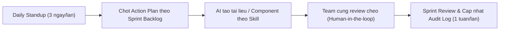

> **Liên kết ngữ cảnh:** [Skill Discovery (SSOT)](./skill.md) | [Skill UI/UX (React & Web)](./ui-ux-skill.md) | [PO Kit](./po-kit.md) | [Market & Needs](../01-discovery/01-market-and-needs.md) | [Product Backlog](../03-requirements/product-backlog.md)

# 🐎 Nhật ký Điều phối & Kiểm soát AI (AI Harness Log)

Tài liệu này ghi lại cách **Nhóm F5 (VKU)** sử dụng các bộ Kit/Skill, câu lệnh đầu vào (Prompt) và quá trình con người kiểm duyệt, chỉnh sửa (**Human-in-the-loop**) qua từng giai đoạn phát triển dự án TrekMate.

---

## 1. Giai đoạn 1: Research & Discovery

| Tài liệu đầu ra | Công cụ / Kit sử dụng | Prompt / Input đầu vào của nhóm | Điểm AI làm chưa tốt (Hallucination / Lệch ngữ cảnh) | Cách nhóm đã ghìm cương & sửa lại (Human Review) |
| :--- | :--- | :--- | :--- | :--- |
| [Market & Needs](../01-discovery/01-market-and-needs.md) | PO Kit + [skill.md](./skill.md) | Yêu cầu phân tích bối cảnh du lịch tự túc Việt Nam, đối thủ (Wanderlog, Mindtrip, ChatGPT, Google Maps) và mô hình tạo doanh thu cho web app. | AI ban đầu tự ý đưa các đối thủ nước ngoài không phù hợp và đề xuất mô hình đặt vé máy bay / khách sạn quốc tế phức tạp, vượt quá phạm vi đề tài sinh viên. | Nhóm đối chiếu với `skill.md`, khóa lại phạm vi điểm đến trong nước (Việt Nam), xác lập 3 Market Gaps trọng tâm (Lên lịch AI neo POI, Realtime Task Checklist, Bóc tách chi phí & VietQR), đồng thời chuẩn hóa mô hình Freemium + TrekMate Pro `49.000đ/tháng`. |
| [Problem Statement](../02-problem-statement.md) | PO Kit + [skill.md](./skill.md) | Tổng hợp Tuyên bố vấn đề từ bối cảnh phân mảnh 4–6 ứng dụng khi đi du lịch tự túc và tình huống thực tế chuyến đi 4N3Đ Đà Nẵng – Hà Nội. | AI ban đầu lồng ghép ngay giải pháp kỹ thuật ("cần xây dựng web app tích hợp Gemini AI và React") vào câu tuyên bố, đồng thời viết chung chung không nêu rõ sự bất hòa khi chia tiền nhóm. | Nhóm áp dụng **Luật 4** trong `skill.md`, tách bạch hoàn toàn bài toán khỏi giải pháp: nhấn mạnh nỗi đau mất 4–6 giờ ghép nối thông tin, AI hay bịa địa điểm đi ngược đường, và tình trạng cãi vã khi tính tiền nhóm bằng Excel/Zalo. |
| [Persona 01 (Sinh viên)](../01-discovery/personas/persona-01-student.md) & [Persona 02 (Đi làm)](../01-discovery/personas/persona-02-working-pro.md) | PO Kit + Case Study Thực tế | Xây dựng 2 Persona: Bạn An (Sinh viên VKU, đại diện trưởng nhóm du lịch tiết kiệm) và Anh Tuấn (Nhân viên văn phòng đi nghỉ ngắn ngày cuối tuần). | Bản nháp đầu AI mô tả nhân vật đi du lịch sang chảnh ở resort 5 sao, ngân sách 15–20 triệu, không sát với tệp sinh viên VKU (ngân sách 3,5 triệu/người cho 4N3Đ). | Nhóm chỉnh lại Persona 01 chuẩn xác theo case study: **Bạn An, 20 tuổi, SV VKU, dẫn nhóm 4 người đi Đà Nẵng – Hà Nội với 3.500.000 VNĐ/người**, cần chia tiền sòng phẳng qua VietQR và tối ưu tuyến di chuyển. Persona 02: **Anh Tuấn, 28 tuổi, nhân viên IT văn phòng**, cần lịch trình thư giãn 2N1Đ không chạy show. |
| [Product Vision](../01-discovery/03-product-vision.md), [Product Canvas](../01-discovery/04-product-canvas.md) & [MVP MoSCoW](../01-discovery/05-mvp-moscow.md) | PO Kit + [skill.md](./skill.md) | Viết Tầm nhìn khung Geoffrey Moore, 3 Product Goals, Lean Canvas 9 ô và phân bổ phạm vi MVP bám sát 4 tuần Vibe Code theo chuẩn Agile/Scrum. | AI có xu hướng đưa tính năng Đặt phòng khách sạn trực tiếp và Thanh toán quốc tế qua Visa/Mastercard vào nhóm Must-Have của MVP. | Nhóm áp dụng **Luật số 2 (Anti-Scope Creep)**, khóa cứng 3 Scope cốt lõi vào Must-Have: Scope 1 (Tài khoản OTP), Scope 2 (Lịch trình Gemini + Maps + Task Checklist), Scope 3 (Ngân sách 30-30-25-15 + Bóc tách chi phí + VietQR). Đẩy việc liên kết OTA đặt phòng/vé sang Hướng phát triển tương lai. |

---

## 2. Giai đoạn 2 & 3: Requirements, Design System & Kiến trúc Kỹ thuật

| Tài liệu đầu ra | Công cụ / Kit sử dụng | Prompt / Input đầu vào của nhóm | Điểm AI dễ mắc lỗi (Cần ghìm cương) | Cách nhóm đã ghìm cương & sửa lại (Human Review) |
| :--- | :--- | :--- | :--- | :--- |
| [UI/UX Skill](./ui-ux-skill.md) | PO Feedback + Tech Architecture | Định nghĩa quy trình sinh giao diện Single Page Application (React + Tailwind CSS) chuẩn Responsive cho cả Desktop (1280–1440px) và Mobile Web. | AI dễ nhầm lẫn TrekMate là mobile app native, sinh mã React Native hoặc hardcode các kích thước cố định gây vỡ giao diện trên điện thoại. | Ban hành `ui-ux-skill.md` quy chuẩn rõ: Web SPA Desktop-first kết hợp Mobile Web responsive mượt mà, chuẩn hóa bộ 5 Domain Components (Timeline Card, Interactive Map, Task Kanban, Budget Pie Chart, VietQR Modal). |
| [Product Backlog](../03-requirements/product-backlog.md) & User Stories | [skill.md](./skill.md) + PowerPoint Scope | Phân rã 3 Scope cốt lõi thành các User Story chi tiết kèm tiêu chí nghiệm thu (Acceptance Criteria theo Gherkin). | AI dễ viết User Story sơ sài, thiếu kịch bản xử lý khi Gemini API bị nghẽn (Quota Limit) hoặc khi người dùng nhập sai định dạng số tiền. | Nhóm bổ sung kịch bản kiểm thử: Cơ chế fallback Caching lịch trình mẫu trên Firestore khi Gemini API gặp sự cố, và kiểm tra tính hợp lệ dữ liệu ngân sách theo 4 danh mục chuẩn. |
| [Architecture & CSDL](../04-architecture/) | PowerPoint Tech Stack | Thiết lập kiến trúc Client - Server & AI Gateway, NoSQL Firestore và Security Rules. | AI tự động vẽ thêm các microservices phức tạp không cần thiết, làm tăng chi phí và rủi ro triển khai trong 4 tuần MVP. | Nhóm giữ đúng kiến trúc đã bảo vệ: React.js + Node.js/Express.js trung gian + Firestore Realtime + Gemini API + Google Maps API, triển khai tối ưu trên Vercel. |

---

## 3. Quy trình Rà soát Định kỳ của Nhóm (Scrum Cadence)

Dự án áp dụng quy trình **Agile/Scrum với Sprint 1 tuần/lần**, kết hợp chặt chẽ việc con người kiểm soát AI (Human-in-the-loop) để bàn giao sản phẩm tăng trưởng (Increments) qua từng Sprint:

