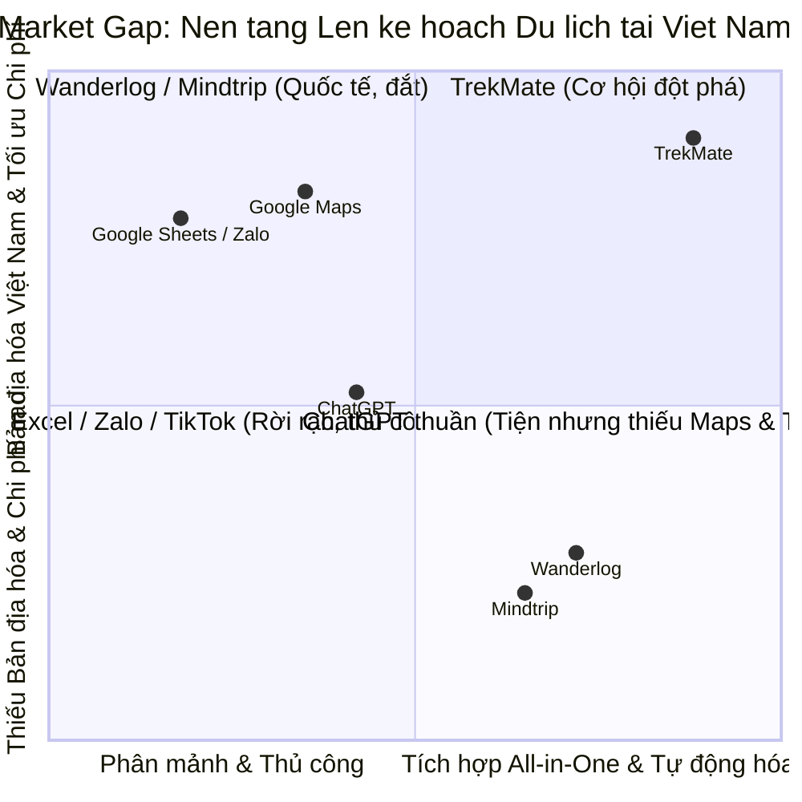

> **Liên kết ngữ cảnh:** [Skill Harness (SSOT)](../00-ai-harness/skill.md) | [PO Kit](../00-ai-harness/po-kit.md) | [Problem Statement](./02-problem-statement.md) | [Persona Student](./personas/persona-01-student.md) | [Persona Working Pro](./personas/persona-02-working-pro.md) | [Product Vision](./03-product-vision.md) | [Product Canvas](./04-product-canvas.md) | [MVP MoSCoW](./05-mvp-moscow.md)

# 01. Phân tích Thị trường & Nhu cầu Người dùng (Market & Needs)

## 1. Nhu cầu người dùng (User Needs)

### 1.1 Bối cảnh Du lịch Tự túc tại Việt Nam & Vấn đề Phân mảnh Thông tin
Trong những năm gần đây, xu hướng du lịch tự túc (Free & Independent Travel - FIT) bùng nổ mạnh mẽ trong giới trẻ, sinh viên và nhân viên văn phòng tại Việt Nam. Thay vì chọn các tour du lịch đóng gói sẵn gò bó, người dùng khao khát được tự do thiết kế hành trình theo sở thích cá nhân, gu ẩm thực riêng và khả năng tài chính của nhóm.

Tuy nhiên, quy trình chuẩn bị cho một chuyến đi tự túc hiện tại đang bị **phân mảnh nghiêm trọng (Information Fragmentation)**. Để tổ chức một chuyến đi 3–4 ngày, một nhóm du lịch thường phải phối hợp từ 4 đến 6 công cụ rời rạc:
1. **Lướt TikTok / Facebook / Threads / Google:** Tìm kiếm hàng giờ các bài đánh giá (review) quán ăn, điểm check-in (thông tin thường bị thổi phồng hoặc lỗi thời).
2. **Google Maps:** Tra cứu khoảng cách thủ công, nhưng không thể tối ưu thứ tự lộ trình nhiều điểm trong ngày, dẫn đến việc đi ngược đường hoặc quá tải thời gian.
3. **Chatbot AI (ChatGPT / Gemini thông thường):** Hỏi gợi ý lịch trình, nhưng AI hay "bịa" địa điểm (Hallucination), gợi ý các quán đã đóng cửa hoặc phân bổ thời gian vô lý (gợi ý đi bảo tàng lúc nửa đêm).
4. **Google Sheets / Excel:** Lập bảng dự toán chi phí phức tạp, không đồng bộ thời gian thực với các thành viên.
5. **Nhóm Zalo / Messenger:** Bàn bạc phân công nhiệm vụ (ai thuê xe, ai đặt phòng, ai mua vé), tin nhắn trôi liên tục khiến việc chuẩn bị lộn xộn.
6. **Ứng dụng Ngân hàng:** Cuối chuyến đi, nhóm trưởng phải ngồi bấm máy tính tính tiền chênh lệch từng người, gửi số tài khoản và nhắc nợ rất nhạy cảm, dễ gây bất hòa.

### 1.2 Dữ liệu Thực nghiệm & Quan sát Thực tế (Case Study VKU)
Từ nghiên cứu bối cảnh của **Nhóm F5** (Trường Đại học CNTT & Truyền thông Việt - Hàn — VKU), điển hình qua **Case Study chuyến đi Đà Nẵng – Hà Nội (4N3Đ)** của nhóm 4 sinh viên với mức ngân sách **3.500.000 VNĐ/người**, các phát hiện thực tế cho thấy:
* **Thời gian chuẩn bị:** Nhóm trưởng mất trung bình **6 đến 10 giờ** chỉ để gom nhặt thông tin và ghép lịch trình.
* **Rủi ro di chuyển:** Nếu không có bản đồ tối ưu tuyến, các nhóm thường lãng phí **$25–35\%$ thời gian di chuyển** vì chạy lòng vòng qua lại giữa các quận/huyện.
* **Sai lệch ngân sách:** Hơn **$80\%$ chuyến đi tự túc** bị phát sinh chi phí ngoài dự kiến do không thiết lập hạn mức rõ ràng ngay từ đầu.
* **Mong muốn công nghệ:** Người dùng mong muốn một nền tảng duy nhất tạo lịch trình hoàn chỉnh dưới **30 đến 45 giây**, có kiểm chứng địa điểm thực tế, quản lý việc nhóm và tự động tính tiền qua **VietQR**.

### 1.3 Nhu cầu Cốt lõi theo 3 Trụ Cột của Hệ thống (3 Scopes)

#### a) Quản lý Tài khoản & Cá nhân hóa (Scope 1)
* Đăng ký/đăng nhập nhanh chóng, an toàn qua xác thực **OTP Email** (giảm thiểu rủi ro spam và quên mật khẩu).
* Lưu trữ hồ sơ cá nhân với các trường tùy chỉnh "gu du lịch" (nghỉ dưỡng, khám phá, ẩm thực đường phố, trải nghiệm văn hóa) để hệ thống AI hiểu sâu sở thích mà không cần nhập lại nhiều lần.
* Đảm bảo tính minh bạch, có cơ chế quản trị viên (Admin) giám sát, kiểm duyệt nội dung và khóa tài khoản vi phạm tiêu chuẩn cộng đồng.

#### b) Lập Lịch trình Thông minh & Quản lý Công việc Nhóm (Scope 2)
* Khả năng sinh lịch trình tự động trong **$< 30\text{s}$** bằng mô hình Gemini 1.5 Flash API theo đúng số ngày, kinh phí và gu du lịch.
* Lịch trình được trực quan hóa trên bản đồ tương tác Google Maps: Cho phép kéo thả thay đổi điểm tham quan, trích xuất tọa độ POI chuẩn xác và tự động tính khoảng cách tuyến đường ngắn nhất.
* Bảng phân công công việc nhóm thời gian thực (Realtime Task Checklist): Mời bạn đồng hành qua liên kết (Link) hoặc mã QR; gán người phụ trách (Assignee), thời hạn (Deadline) cho các đầu việc chuẩn bị; đồng bộ trạng thái *ToDo $\rightarrow$ InProgress $\rightarrow$ Done*.

#### c) Quản lý Ngân sách & Quyết toán Tự động (Scope 3)
* Thiết lập tổng hạn mức ngân sách và tự động chia tỷ lệ chuẩn khoa học: **Di chuyển 30%, Lưu trú/Phòng 30%, Ăn uống 25%, Dự phòng 15%**.
* Ghi nhận khoản chi thực tế, tự động trừ vào hạn mức danh mục, trực quan hóa qua biểu đồ tròn (Pie Chart) và kích hoạt **cảnh báo đỏ khi chi tiêu vượt quá 90%** hạn mức danh mục.
* Thuật toán tối ưu hóa bù trừ nợ tự động cuối chuyến và sinh mã **VietQR** chuẩn NAPAS 247 để các thành viên thanh toán ngay trong 1 chạm.

---

## 2. Khoảng trống thị trường (Market Gap)

### 2.1 Phân tích Đối thủ Cạnh tranh & Giải pháp Thay thế

| Đối thủ / Công cụ | Điểm mạnh (Strengths) | Điểm yếu đối với người du lịch Việt (Weaknesses) | Cơ hội cho TrekMate |
| :--- | :--- | :--- | :--- |
| **Google Maps** | Bản đồ số chính xác nhất, dữ liệu POI khổng lồ, dẫn đường theo thời gian thực xuất sắc. | Không có chức năng AI tự động sắp xếp lịch trình nhiều ngày; không quản lý ngân sách; không có công cụ phân công công việc nhóm. | Tích hợp Google Maps Platform API làm nền tảng định vị và dẫn đường, kết hợp AI Gemini để xếp lịch trình thông minh. |
| **ChatGPT / Gemini App** | Khả năng ngôn ngữ linh hoạt, trả lời phong phú, gợi ý ý tưởng nhanh chóng. | **Hay bịa địa điểm (Hallucination)**, không hiển thị trên bản đồ số, không tính được quãng đường thực tế; không lưu trữ trạng thái chuyến đi và không quản lý tài chính nhóm. | Ứng dụng kỹ thuật **AI Grounding** neo prompt vào kho dữ liệu POI đã được xác minh trên Firestore; xuất kết quả dạng JSON để render trực tiếp lên Timeline & Maps. |
| **Wanderlog / Mindtrip** | Nền tảng lập kế hoạch du lịch chuyên nghiệp, giao diện đẹp, có tích hợp bản đồ và cộng tác nhóm. | Thiết kế chủ yếu cho thị trường Âu - Mỹ; giao diện tiếng Anh; dữ liệu POI tại Việt Nam thưa thớt; **chi phí gói Pro đắt đỏ ($40–60/năm)**; **hoàn toàn không hỗ trợ thanh toán qua VietQR**. | Bản địa hóa 100% cho thị trường Việt Nam; tối ưu hóa chi phí học sinh/sinh viên; tích hợp sâu thanh toán chuyển khoản VietQR. |
| **Google Sheets & Zalo** | Linh hoạt, miễn phí, quen thuộc với mọi người dùng Việt Nam. | Hoàn toàn thủ công; mất hàng giờ nhập liệu; dễ sai sót công thức tính toán; tin nhắn Zalo bị trôi làm thất lạc nhiệm vụ. | Tự động hóa phân bổ ngân sách 30-30-25-15, bảng Checklist việc nhóm realtime và thuật toán chia tiền tự động thay thế bảng tính. |

### 2.2 Ba Khoảng trống Thị trường Cốt lõi (3 Market Gaps)

1. **Khoảng trống 1 — Nền tảng All-in-One bản địa hóa cho thị trường Việt Nam:**
   Chưa có một ứng dụng web nào kết hợp trọn vẹn giữa **Lên lịch trình bằng AI + Bản đồ dẫn đường tương tác + Quản lý task nhóm + Quyết toán VietQR** dành riêng cho người Việt đi du lịch trong nước.
2. **Khoảng trống 2 — AI Grounding chống bịa địa điểm & Tối ưu lộ trình di chuyển:**
   Khắc phục điểm yếu lớn nhất của các ứng dụng AI hiện nay bằng cách ràng buộc mô hình Gemini chỉ chọn POI từ cơ sở dữ liệu đã xác thực, kết hợp thuật toán tính quãng đường ngắn nhất của Google Maps nhằm chấm dứt tình trạng chạy ngược đường.
3. **Khoảng trống 3 — Minh bạch tài chính nhóm & Quyết toán VietQR một chạm:**
   Giải quyết triệt để nỗi sợ lớn nhất khi đi du lịch nhóm: tính toán chia tiền phức tạp và ngại nhắc nợ. Cơ chế phân bổ ngân sách tự động kèm mã thanh toán VietQR giúp chuyến đi minh bạch và giữ gìn tình bạn.

### 2.3 Sơ đồ Khoảng trống Thị trường (Mermaid Quadrant Chart)

---

## 3. Mô hình kinh doanh & Kiếm tiền (Monetization Model)

Mô hình doanh thu của TrekMate được xây dựng theo định hướng tinh gọn, phù hợp với túi tiền của học sinh, sinh viên và người trẻ, đồng thời đảm bảo khả năng bù đắp chi phí vận hành API Cloud:

1. **Freemium (Gói Miễn phí Trải nghiệm):**
   * Cho phép tạo tối đa **02 chuyến đi đang hoạt động**, trải nghiệm đầy đủ tính năng tạo lịch trình bằng Gemini AI (có hạn chế số lần yêu cầu tạo lại/ngày để bảo vệ Quota API).
   * Sử dụng đầy đủ tính năng Checklist nhóm và phân bổ ngân sách cơ bản.
2. **Gói Thuê bao *TrekMate Pro* (`49.000đ/tháng` hoặc `29.000đ/chuyến đi`):**
   * Không giới hạn số lượng chuyến đi lưu trữ.
   * Không giới hạn số lần AI tái tạo hoặc tinh chỉnh chi tiết lịch trình.
   * Tùy biến tỷ lệ phân bổ ngân sách nâng cao, xuất báo cáo tài chính chuyến đi ra file PDF/Excel đẹp mắt.
   * Ưu tiên tốc độ xử lý khi hệ thống chịu tải cao.
3. **Affiliate Marketing & Liên kết Dịch vụ (Định hướng Mở rộng):**
   * Tích hợp đường dẫn đối tác liên kết (Affiliate Links) giới thiệu homestay, khách sạn, vé xe khách hoặc tour trải nghiệm địa phương uy tín.
   * Nhận hoa hồng $5–10\%$ trên mỗi giao dịch đặt chỗ thành công thông qua nền tảng.

---

## 4. Bước tiếp theo trong Chuỗi ngữ cảnh (Context Chain)
* Tiếp theo: [02. Problem Statement](./02-problem-statement.md) — Chuẩn hóa Tuyên bố vấn đề từ dữ liệu thực tế và phân tích hệ quả.
