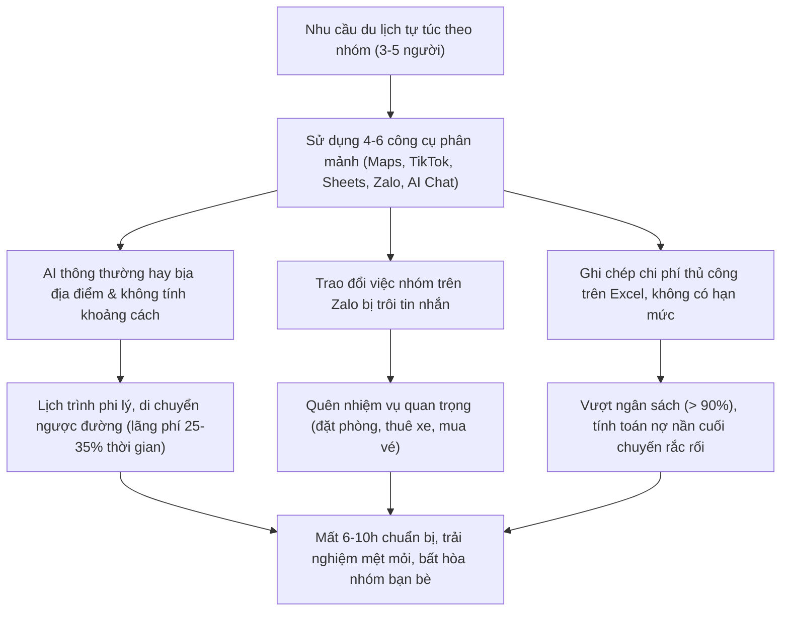

> **Liên kết ngữ cảnh:** [Skill Harness (SSOT)](../00-ai-harness/skill.md) | [PO Kit](../00-ai-harness/po-kit.md) | [Market & Needs](./01-market-and-needs.md) | [Persona Student](./personas/persona-01-student.md) | [Persona Working Pro](./personas/persona-02-working-pro.md) | [Product Vision](./03-product-vision.md) | [Product Canvas](./04-product-canvas.md) | [MVP MoSCoW](./05-mvp-moscow.md)

# 02. Tuyên bố Vấn đề (Problem Statement)

## 1. Tuyên bố Vấn đề Cốt lõi (Core Problem Statement)

Theo quy tắc bắt buộc trong [po-kit.md](../00-ai-harness/po-kit.md) và [skill.md](../00-ai-harness/skill.md), tuyên bố vấn đề phải tập trung hoàn toàn vào **người dùng, nỗi đau có bằng chứng thực tế và hệ quả tiêu cực** — tuyệt đối **không lồng ghép giải pháp kỹ thuật** vào mệnh đề vấn đề.

> **Tuyên bố Vấn đề Chuẩn hóa (Problem Statement đã khóa):**
> *"Khách du lịch tự túc và các nhóm bạn trẻ cần một nền tảng tập trung (All-in-One) giúp lập kế hoạch di chuyển hợp lý, cộng tác phân công công việc và quản lý chi phí minh bạch, vì hiện tại họ phải sử dụng phân mảnh 4–6 công cụ riêng lẻ (Google Maps, TikTok review, Excel, Zalo, chatbot AI), trong khi các công cụ AI thông thường hay gợi ý sai lệch địa điểm và không tối ưu khoảng cách di chuyển, còn việc theo dõi chi tiêu nhóm trên bảng tính thường dẫn đến vượt ngân sách và phát sinh tranh cãi khi chia tiền cuối chuyến. Tình trạng này khiến người đi tốn hàng chục giờ chuẩn bị, lãng phí thời gian di chuyển ngược đường và làm giảm đáng kể trải nghiệm du lịch."*

---

### Phân rã 4 thành phần theo công thức chuẩn

* **1. Nhóm người dùng (`[Nhóm người dùng]`):** Khách du lịch tự túc tại Việt Nam, đặc biệt là học sinh, sinh viên các trường đại học (như sinh viên VKU) và các nhóm bạn bè/đồng nghiệp trẻ tuổi (độ tuổi 18–29).
* **2. Nhu cầu cốt lõi (`[Nhu cầu cốt lõi]`):** Lập được một lịch trình di chuyển khả thi, tối ưu quãng đường theo khung giờ; phân công rõ ràng việc chuẩn bị chuyến đi cho từng thành viên và kiểm soát chi tiêu minh bạch theo hạn mức.
* **3. Insight thực tế & Nỗi đau kiểm chứng (`[Insight]`):**
  * **Phân mảnh công cụ:** Phải chuyển đổi liên tục giữa 4–6 ứng dụng (Google Maps, review mạng xã hội, Google Sheets, Zalo, chatbot AI) làm loãng thông tin và mất trung bình **6 đến 10 giờ** chuẩn bị cho một chuyến đi 3–4 ngày.
  * **AI Hallucination & Lộ trình phi lý:** Khi nhờ chatbot AI thông thường lên lịch, AI hay đề xuất địa điểm không tồn tại hoặc đã đóng cửa; thiếu sự kết nối về vị trí địa lý khiến các điểm đến trong cùng một buổi bị cách xa nhau hàng chục cây số, gây lãng phí **$25–35\%$ thời gian di chuyển** vì chạy ngược đường.
  * **Công việc nhóm lộn xộn:** Bàn bạc trong nhóm chat Zalo/Messenger thường xuyên bị trôi tin nhắn; thiếu một danh sách kiểm tra (checklist) tập trung dẫn đến tình trạng quên đặt phòng, quên thuê xe hoặc bỏ sót đồ đạc quan trọng.
  * **Nguy cơ vỡ ngân sách & Tranh cãi tiền bạc:** Việc ghi chép chi tiêu bằng sổ tay hoặc Excel rất chậm trễ; cuối chuyến đi việc tính toán bù trừ chênh lệch giữa người chi hộ và người chưa đóng tiền rất phức tạp, dễ gây hiểu lầm và làm sứt mẻ tình cảm bạn bè.
* **4. Hệ quả tiêu cực (`[Hậu quả]`):** Tốn quá nhiều công sức trước chuyến đi; trải nghiệm du lịch bị ức chế vì di chuyển mệt mỏi, phát sinh chi phí ngoài tầm kiểm soát và tâm lý ngượng ngùng, khó chịu khi phải đòi tiền nhau sau chuyến đi.

---

## 2. Hệ quả (Impact)

### 2.1 Hệ quả đối với Người đi Du lịch (Travelers)
* **Lãng phí thời gian & Quá tải nhận thức:** Mất hàng buổi tối tìm kiếm và ghép lịch trình thủ công; dễ nản lòng hoặc hủy kế hoạch vì quá nhiều công việc chuẩn bị không tên.
* **Hành trình kiệt sức vì đi ngược đường:** Không tối ưu hóa tọa độ các điểm tham quan dẫn đến việc di chuyển chéo lộ trình, kẹt xe, tốn tiền xăng/taxi và không kịp trải nghiệm trọn vẹn điểm đến.
* **Thủng ngân sách chuyến đi:** Không có hạn mức danh mục cụ thể (ăn uống, đi lại, lưu trú) khiến nhóm chi tiêu bộc phát, khi phát hiện ra thì đã vượt ngân sách dự kiến hàng triệu đồng.
* **Rạn nứt tình cảm nhóm bạn:** Các khoản chi tiêu chung - riêng mập mờ, người trả trước cảm thấy thiệt thòi khi người khác chậm thanh toán lại.

### 2.2 Hệ quả đối với Nền tảng & Vận hành Kỹ thuật
* **Tỷ lệ rời bỏ (Churn) tức thì:** Nếu thời gian AI phản hồi lịch trình quá lâu ($> 30\text{s}$) hoặc trả về địa điểm ảo, người dùng sẽ lập tức quay về cách tra cứu Google Maps truyền thống.
* **Chi phí vận hành API tăng vọt:** Nếu không có cơ chế Caching lịch trình mẫu hoặc giới hạn quota, các yêu cầu gọi Gemini API lặp đi lặp lại sẽ nhanh chóng làm cạn kiệt ngân sách dự án.

---

## 3. Sơ đồ Nguyên nhân – Hệ quả (Cause & Effect Flowchart)

---

## 4. Bước tiếp theo trong Chuỗi ngữ cảnh (Context Chain)
* Nguồn dữ liệu: [01. Market & Needs](./01-market-and-needs.md)
* Tiếp theo: [Persona 01: Bạn An — Sinh viên VKU](./personas/persona-01-student.md) và [Persona 02: Anh Tuấn — Nhân viên văn phòng](./personas/persona-02-working-pro.md)
