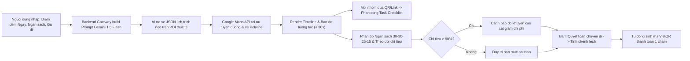

> **Liên kết ngữ cảnh:** [Skill Harness (SSOT)](../00-ai-harness/skill.md) | [PO Kit](../00-ai-harness/po-kit.md) | [Market & Needs](./01-market-and-needs.md) | [Problem Statement](./02-problem-statement.md) | [Persona Student](./personas/persona-01-student.md) | [Persona Working Pro](./personas/persona-02-working-pro.md) | [Product Canvas](./04-product-canvas.md) | [MVP MoSCoW](./05-mvp-moscow.md)

# 03. Tầm nhìn Sản phẩm & Mục tiêu OKRs (Product Vision & OKRs)

## 1. Tuyên ngôn Tầm nhìn Sản phẩm (Geoffrey Moore Framework)

Tuân thủ đúng khuôn mẫu 6 mệnh đề kinh điển của **Geoffrey Moore** cho dự án **TrekMate** (**Nhóm F5 — VKU**):

* **For** *(Đối tượng mục tiêu)*: Khách du lịch tự túc tại Việt Nam, đặc biệt là học sinh, sinh viên các trường đại học và các nhóm bạn trẻ/đồng nghiệp bận rộn.
* **Who** *(Nỗi đau cốt lõi)*: Mệt mỏi vì phải chuyển đổi qua lại giữa 4–6 công cụ phân mảnh (Google Maps, TikTok, Excel, Zalo, chatbot AI), mất hàng chục giờ chuẩn bị, lo sợ AI bịa địa điểm đi ngược đường và đau đầu vì chia tiền nhóm.
* **The** *(Tên sản phẩm)*: **TrekMate**
* **Is a** *(Danh mục sản phẩm)*: Nền tảng Web lên kế hoạch du lịch thông minh All-in-One (Smart Travel Planner Single Page Application).
* **That** *(Giá trị mang lại)*: Giúp người dùng tạo lịch trình theo ngày hoàn chỉnh chỉ trong **$< 30\text{s}$** bằng AI Gemini 1.5 Flash, trực quan hóa tuyến đường ngắn nhất trên Google Maps tương tác, phân công Checklist công việc nhóm thời gian thực và tự động phân bổ ngân sách, quyết toán chia tiền qua mã **VietQR**.
* **Unlike** *(Khác với các lựa chọn thay thế)*: Các nền tảng quốc tế (Wanderlog, TripIt) giao diện tiếng Anh đắt đỏ, không bản địa hóa thanh toán; chatbot AI thông thường (ChatGPT) thiếu bản đồ và hay bịa địa điểm; hoặc phương pháp lập bảng tính Excel/Zalo thủ công rối rắm.
* **Our product** *(Điểm khác biệt cốt lõi)*: Cung cấp giải pháp trọn gói 3 Scope tích hợp chặt chẽ, bản địa hóa 100% cho thị trường Việt Nam với mô hình **AI Grounding** neo vào dữ liệu POI kiểm chứng, tỷ lệ phân bổ ngân sách vàng **30-30-25-15** và cơ chế thanh toán chuyển khoản VietQR chuẩn NAPAS 247 một chạm.

---

## 2. Ba Mục tiêu Sản phẩm Cốt lõi (3 Product Goals)

### Goal 1: Đơn giản hóa quy trình lập lịch trình bằng AI có kiểm chứng
* Tự động hóa việc xây dựng lịch trình thông minh dựa trên mô hình Gemini 1.5 Flash, đảm bảo thời gian phản hồi **$< 30\text{s}$** (và dưới **45s** cho chuyến đi phức tạp 4N3Đ).
* 100% địa điểm đề xuất được neo vào kho POI thực tế, tối ưu thứ tự ghé thăm trên Google Maps để tránh lãng phí thời gian di chuyển ngược đường.

### Goal 2: Tối ưu hóa cộng tác nhóm & điều phối công việc thời gian thực
* Xóa bỏ hoàn toàn tình trạng trôi tin nhắn trên Zalo bằng bảng Checklist công việc nhóm tập trung, mời thành viên nhanh chóng qua link hoặc mã QR.
* Cho phép gán người phụ trách (Assignee), thời hạn hoàn thành và đồng bộ trạng thái *ToDo $\rightarrow$ InProgress $\rightarrow$ Done* theo thời gian thực (Realtime sync).

### Goal 3: Minh bạch hóa tài chính chuyến đi & quyết toán VietQR một chạm
* Thiết lập hạn mức chi tiêu tự động theo tỷ lệ chuẩn (Di chuyển 30%, Lưu trú 30%, Ăn uống 25%, Dự phòng 15%).
* Tự động cảnh báo đỏ khi chạm ngưỡng $> 90\%$ hạn mức danh mục và áp dụng thuật toán tính chênh lệch để sinh mã VietQR tự động, giúp quyết toán tiền nhóm trong vài giây mà không cần tính tay.

---

## 3. Hệ thống Mục tiêu & Kết quả Then chốt (SMART OKRs)

Được thiết kế bám sát mô hình **Agile/Scrum (chu kỳ Sprint 1 tuần, 4 tuần Vibe Code MVP)** và các chỉ số KPI đã cam kết trong báo cáo đề tài:

| Mã OKR | Mức ưu tiên | Mục tiêu (Objective) | Kết quả then chốt đo lường được (Key Results - SMART) | Mốc thời gian |
| :--- | :--- | :--- | :--- | :--- |
| **O1** | **Must** | Hoàn thành và triển khai bản chạy thử MVP Web SPA ổn định trên Vercel | Hoàn thành đủ 3 Scope chức năng cốt lõi; đạt thời gian AI sinh lịch trình **$< 30\text{s}$**; độ sẵn sàng hệ thống (Uptime) **$\ge 99,5\%$**. | **Sprint 4 (Tuần 4)** |
| **O2** | **Must** | Đảm bảo tính khả thi và chính xác của lịch trình du lịch AI | $100\%$ POI đề xuất có tọa độ thực; thuật toán Google Maps tối ưu tuyến ngắn nhất; độ chính xác dự toán chi phí đạt **$\ge 90\%$** so với thực tế (như case study 92%). | **Sprint 3–4** |
| **O3** | **Must** | Đạt mức độ hài lòng cao từ người dùng thử nghiệm và Hội đồng | Đạt chỉ số hài lòng người dùng **$\text{CSAT} \ge 85\%$** trong đợt nghiệm thu thử nghiệm; hoàn thiện báo cáo và bảo vệ đồ án thành công. | **Sprint 4 (Tuần 4)** |
| **O4** | **Should** | Kiểm soát chi phí hạ tầng và vận hành API nghiêm ngặt | Vận hành toàn bộ hệ thống trong ngân sách dự toán **1.800.000 VNĐ**; áp dụng Caching dữ liệu lịch trình mẫu trên Firestore để giảm thiểu số lượng request Gemini API. | **Tháng 2** |
| **O5** | **Should** | Thúc đẩy sự lan tỏa trong cộng đồng sinh viên du lịch tự túc | Đạt tối thiểu **500 lượt tạo lịch trình thử nghiệm** trong tháng đầu tiên sau triển khai; tỷ lệ người dùng bấm nút chia sẻ hoặc mời nhóm đạt **$\ge 50\%$**. | **Tháng 3** |

---

## 4. Sơ đồ Luồng Giá trị Sản phẩm (Product Value Flow — Mermaid)

