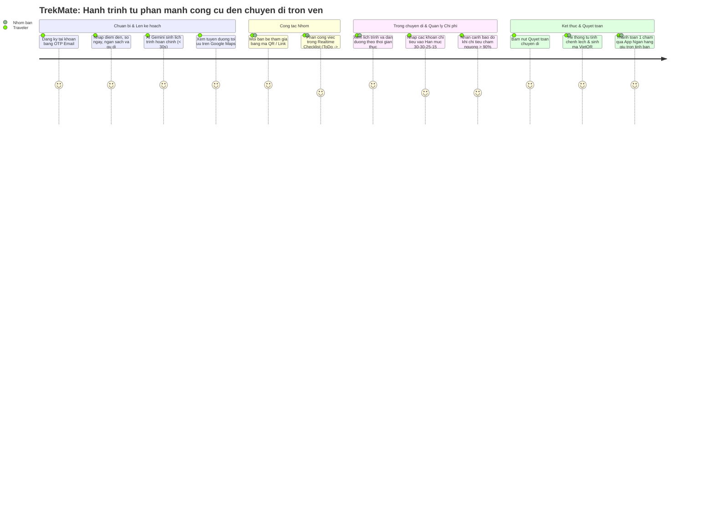

> **Liên kết ngữ cảnh:** [Skill Harness (SSOT)](../00-ai-harness/skill.md) | [PO Kit](../00-ai-harness/po-kit.md) | [Market & Needs](./01-market-and-needs.md) | [Problem Statement](./02-problem-statement.md) | [Persona Student](./personas/persona-01-student.md) | [Persona Working Pro](./personas/persona-02-working-pro.md) | [Product Vision](./03-product-vision.md) | [MVP MoSCoW](./05-mvp-moscow.md)

# 04. Product Canvas & Lean Canvas 9 Ô (`TrekMate`)

## 1. Bảng Tóm tắt Product Canvas (Theo chuẩn `po-kit.md`)

| Trường thông tin | Nội dung chuẩn hóa theo `skill.md` |
| :--- | :--- |
| **Tên sản phẩm** | **TrekMate — Ứng dụng Web Lên Kế Hoạch Du Lịch Thông Minh** *(Nhóm F5 — VKU)* |
| **Goals / KPIs** | **Chỉ số kỹ thuật & vận hành:** Hoàn thành 3 Scope trong 4 tuần Vibe Code (Sprint 1–4); triển khai thành công trên Vercel; thời gian AI sinh lịch trình **$< 30\text{s}$**; Uptime hệ thống **$\ge 99,5\%$**; chỉ số hài lòng người dùng **$\text{CSAT} \ge 85\%$**. **Ngân sách dự án:** Vận hành tối ưu trong mức **1.800.000 VNĐ**. **Chỉ số sản phẩm:** Tỷ lệ lưu & chia sẻ chuyến đi **$\ge 60\%$**; độ chính xác dự toán ngân sách so với thực tế **$\ge 90\%$** (chứng minh qua case study đạt **$92\%$**). |
| **Target Personas** | 1. **Bạn An — Sinh viên VKU (20 tuổi):** Đại diện nhóm sinh viên đi du lịch tự túc theo nhóm (3–5 người), ngân sách tiết kiệm, dùng smartphone liên tục, nhạy cảm về tài chính. 2. **Anh Tuấn — Nhân viên văn phòng (28 tuổi):** Đại diện người đi làm bận rộn, du lịch ngắn ngày cuối tuần (2N1Đ hoặc 3N2Đ), cần lịch trình thư giãn không chạy show. |
| **Key Pain Points** | • Phân mảnh 4–6 công cụ (mất 6–10h chuẩn bị cho một chuyến đi). • Chatbot AI hay bịa địa điểm ảo, di chuyển ngược đường lãng phí $25–35\%$ thời gian. • Phân công việc nhóm trên Zalo bị trôi tin nhắn, dễ quên đặt phòng/xe. • Chi tiêu vượt ngân sách và tính toán chia tiền cuối chuyến rối rắm, dễ mất hòa khí. |
| **Core Solutions** | • **Scope 1:** Đăng ký/đăng nhập OTP Email, cập nhật Profile gu du lịch, cơ chế Admin khóa tài khoản. • **Scope 2:** Gemini 1.5 Flash sinh lịch trình $< 30\text{s}$ + Google Maps tối ưu lộ trình ngắn nhất + Realtime Checklist nhóm. • **Scope 3:** Phân bổ ngân sách 30-30-25-15 + Bóc tách chi phí & Pie Chart cảnh báo $> 90\%$ + Quyết toán VietQR tự động. |

---

## 2. Mô hình Kinh doanh Lean Canvas 9 Ô (Theo thứ tự liền mạch Bước 5 `skill.md`)

| Ô Lean Canvas | Nội dung chi tiết (Single Source of Truth) |
| :--- | :--- |
| **1. Problem (Vấn đề)** | • **Phân mảnh thông tin:** Người đi du lịch phải ghép 4–6 app (Maps, TikTok, Excel, Zalo, ChatGPT) tốn 6–10 tiếng chuẩn bị. • **Lộ trình bất hợp lý:** AI thông thường gợi ý điểm đến không có thật hoặc không tối ưu vị trí địa lý, khiến nhóm đi ngược đường và kẹt xe. • **Việc nhóm & Chi phí lộn xộn:** Bàn bạc việc nhóm trôi tin nhắn; chi tiêu vượt hạn mức và chia tiền cuối chuyến gây tranh cãi. |
| **2. Customer Segments (Phân khúc khách hàng)** | • **Khách du lịch tự túc (Travelers):** Học sinh, sinh viên các trường đại học/cao đẳng (độ tuổi 18–22) và nhân viên văn phòng trẻ (23–29 tuổi). • **Nhóm du lịch đồng hành:** Các nhóm bạn thân, câu lạc bộ sinh viên hoặc gia đình trẻ đi phượt/nghỉ lễ. • **Early Adopters:** Sinh viên VKU và bạn bè lập kế hoạch du lịch hè/nghỉ lễ theo nhóm (điển hình như Case Study chuyến đi Đà Nẵng – Hà Nội). |
| **3. Unique Value Proposition (UVP)** | *"Nền tảng All-in-One kết hợp AI Lập lịch trình chuẩn xác trong 30 giây + Bản đồ tối ưu tuyến đường ngắn nhất + Quản lý task nhóm thời gian thực và Quyết toán chi phí tự động qua VietQR."* |
| **4. Channels (Kênh tiếp cận)** | • Video ngắn trên **TikTok / Facebook Reels / Threads** chia sẻ mẹo du lịch tự túc và công cụ tạo lịch trình trong 30s. • Các hội nhóm du lịch tự túc, phượt thủ và cộng đồng sinh viên VKU / Đà Nẵng. • Kênh giới thiệu tự nhiên qua tính năng **chia sẻ link chuyến đi** và mời bạn bè tham gia Checklist nhóm. |
| **5. Solution (Giải pháp 3 Scope)** | • **Scope 1:** Xác thực OTP Email an toàn, cá nhân hóa gu du lịch, quản trị tài khoản bảo mật. • **Scope 2:** AI Gemini 1.5 Flash lập lịch trình có kiểm chứng (Grounding POI), kéo thả trên Google Maps tương tác, phân công task Kanban thời gian thực. • **Scope 3:** Tự động chia hạn mức 30-30-25-15, Pie Chart cảnh báo đỏ $> 90\%$, tự tính toán chênh lệch và sinh mã VietQR thanh toán 1 chạm. |
| **6. Key Metrics (Chỉ số đo lường)** | • **Thời gian AI sinh lịch trình:** mục tiêu $< 30\text{s}$ (case study thực tế $45\text{s}$). • **Độ sẵn sàng hệ thống (Uptime):** $\ge 99,5\%$ trên Vercel. • **Chỉ số hài lòng khách hàng:** $\text{CSAT} \ge 85\%$. • **Độ chính xác chi phí:** $\ge 90\%$ so với thực tế. • **Tỷ lệ tương tác nhóm:** Số lượng chuyến đi được tạo, lưu trữ và mời bạn bè tham gia thành công. |
| **7. Unfair Advantage (Lợi thế cạnh tranh độc quyền)** | • **Cơ chế AI Grounding bản địa hóa:** Ràng buộc mô hình LLM vào kho POI Việt Nam đã được xác minh trên Firestore, chấm dứt triệt để lỗi "bịa" địa điểm. • **Tích hợp thanh toán VietQR chuẩn NAPAS 247:** Giải pháp chia tiền tự động gắn liền với hạ tầng thanh toán ngân hàng phổ biến nhất tại Việt Nam. |
| **8. Cost Structure (Cơ cấu chi phí dự án — 1.800.000 VNĐ)** | • **Khảo sát & Marketing thử nghiệm:** 600.000 VNĐ ($33\%$). • **Dự phòng API Gemini & Dịch vụ Cloud:** 450.000 VNĐ ($25\%$). • **Quỹ vận hành phát sinh:** 400.000 VNĐ ($22\%$). • **Tên miền & Duy trì Hosting Vercel:** 350.000 VNĐ ($19\%$). |
| **9. Revenue Streams (Dòng doanh thu)** | • **Freemium:** Miễn phí tạo 02 chuyến đi hoạt động và các tính năng cơ bản. • **Gói thuê bao TrekMate Pro:** `49.000đ/tháng` hoặc `29.000đ/chuyến đi` (tạo chuyến không giới hạn, tinh chỉnh nâng cao, xuất PDF/Excel). • **Affiliate Marketing:** Hoa hồng $5–10\%$ từ các đối tác lưu trú (homestay/khách sạn), xe khách, vé tham quan khi người dùng click đặt chỗ. |

---

## 3. Hành trình Trải nghiệm Tổng thể (Mermaid User Journey)

