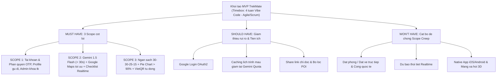

> **Liên kết ngữ cảnh:** [Skill Harness (SSOT)](../00-ai-harness/skill.md) | [PO Kit](../00-ai-harness/po-kit.md) | [Market & Needs](./01-market-and-needs.md) | [Problem Statement](./02-problem-statement.md) | [Persona Student](./personas/persona-01-student.md) | [Persona Working Pro](./personas/persona-02-working-pro.md) | [Product Vision](./03-product-vision.md) | [Product Canvas](./04-product-canvas.md)

# 05. Phạm vi MVP theo Ma trận MoSCoW (MVP MoSCoW Prioritization)

## 1. Nguyên tắc Khóa Phạm vi (Anti-Scope Creep Guardrail)

Theo **Luật số 2 (`Anti-Scope Creep Rule`)** trong [skill.md](../00-ai-harness/skill.md), khung thời gian phát triển vòng lặp MVP của **Nhóm F5 (VKU)** được ấn định trong **4 tuần Vibe Code (Sprint 1 đến Sprint 4, chu kỳ 1 tuần/sprint)** theo mô hình **Agile/Scrum**:
* **Sprint 1 (Tuần 1):** Discovery, Setup Architecture & Auth: Khóa tài liệu Discovery, thiết kế Database Firestore, cấu hình Firebase Auth xác thực OTP Email.
* **Sprint 2 (Tuần 2):** Hoàn thiện Scope 1 (Auth & Profile gu du lịch) & Tích hợp Gemini 1.5 Flash API (Prompt Engineering sinh JSON lịch trình $< 30\text{s}$).
* **Sprint 3 (Tuần 3):** Hoàn thiện Scope 2: Bản đồ tương tác Google Maps (tính lộ trình ngắn nhất, Polyline) & Bảng phân công Checklist công việc nhóm Realtime.
* **Sprint 4 (Tuần 4):** Hoàn thiện Scope 3: Phân bổ ngân sách 30-30-25-15, bóc tách chi phí & Pie Chart $> 90\%$, Quyết toán tự động qua VietQR, Deploy Vercel & bàn giao bản MVP.

Nhằm đảm bảo mục tiêu **O1** (Uptime $\ge 99,5\%$, thời gian AI $< 30\text{s}$) và kiểm soát chặt chẽ phạm vi Sprint, toàn bộ tính năng phải được phân loại nghiêm ngặt vào ma trận **MoSCoW**, chỉ tập trung hoàn thiện tuyệt đối các tính năng thuộc nhóm **Must Have**.

---

## 2. Phân loại Tính năng theo Ma trận MoSCoW

| Nhóm ưu tiên | Danh sách Tính năng / Phân hệ Chức năng | Cơ sở dữ liệu & Lý do quyết định |
| :--- | :--- | :--- |
| **M — Must Have** *(Bắt buộc hoàn thành trong 4 tuần Vibe Code cho 3 Scope)* | **SCOPE 1 — Tài khoản & Phân quyền:** 1. Đăng ký & đăng nhập qua xác thực OTP Email (Firebase Auth). 2. Cập nhật hồ sơ cá nhân: Avatar, số điện thoại, gu du lịch (sở thích). 3. Cơ chế Admin khóa/mở khóa tài khoản vi phạm (Revoke Token) kèm email thông báo.  **SCOPE 2 — Lịch trình & Công việc:** 4. Lập lịch trình tự động bằng Gemini 1.5 Flash API (< 30s) theo điểm đến, số ngày, ngân sách, gu đi. 5. Bản đồ tương tác Google Maps: Kéo thả điểm tham quan, trích xuất tọa độ POI, tính lộ trình ngắn nhất tránh đi ngược đường. 6. Phân công Checklist công việc nhóm Realtime qua Link/QR (Kanban *ToDo $\rightarrow$ InProgress $\rightarrow$ Done*).  **SCOPE 3 — Ngân sách & Chi phí:** 7. Phân bổ hạn mức tự động theo tỷ lệ vàng: Di chuyển 30%, Phòng 30%, Ăn uống 25%, Dự phòng 15%. 8. Bóc tách chi phí thực tế, trừ tự động, trực quan hóa Pie Chart & cảnh báo đỏ khi chi tiêu $> 90\%$. 9. Thuật toán tính chênh lệch bù trừ và tự động sinh mã VietQR thanh toán nhóm một chạm. | Đây là 3 trụ cột phạm vi (System Scope) bắt buộc của đề tài; giải quyết triệt để vấn đề phân mảnh thông tin, sai lệch lộ trình và bất hòa tài chính nhóm bạn bè (chứng minh qua Case Study chuyến đi Đà Nẵng – Hà Nội đạt 92% độ chính xác ngân sách). |
| **S — Should Have** *(Ưu tiên thực hiện ngay sau khi hoàn thành vòng lặp lõi)* | 1. Đăng nhập nhanh bằng tài khoản Google (OAuth2). 2. Cơ chế **Caching dữ liệu lịch trình mẫu trên Firestore** để giảm tải số lượng request Gemini API (ứng phó rủi ro Quota Limit). 3. Tạo liên kết chia sẻ chuyến đi ở chế độ chỉ đọc (Read-only Share Link) để xem không cần đăng nhập. 4. Bộ lọc tìm kiếm POI theo danh mục (Ăn uống, Tham quan, Lưu trú) và mức chi phí. | Nâng cao trải nghiệm tiện lợi cho người dùng và giảm thiểu rủi ro nghẽn API Gemini mà không làm biến động cấu trúc hệ thống. |
| **C — Could Have** *(Bổ sung nếu vượt tiến độ hoặc ở các Sprint mở rộng sau MVP)* | 1. Tính năng bình luận (Comments) đóng góp ý kiến dưới chuyến đi. 2. Xuất lịch trình ra file PDF hoặc ảnh Infographic đẹp mắt để gửi qua Zalo. 3. Gợi ý thêm homestay, khách sạn phù hợp với mức ngân sách của từng ngày. | Tối ưu hóa tính thẩm mỹ và khả năng chia sẻ ngoại mạng, không ảnh hưởng đến logic vận hành cốt lõi của chuyến đi. |
| **W — Won't Have** *(Loại bỏ hoàn toàn khỏi phạm vi 4 tuần MVP)* | 1. **Đặt phòng khách sạn và vé máy bay trực tiếp:** Đòi hỏi kết nối API đối tác OTA phức tạp và cổng thanh toán quốc tế Visa/Mastercard. 2. **Tích hợp dữ liệu thời tiết thời gian thực:** Cần thêm gói API trả phí của bên thứ ba, đưa vào định hướng tương lai. 3. **Ứng dụng Native Mobile (iOS / Android):** MVP tập trung hoàn toàn vào Web Responsive (Desktop & Mobile Web) trên nền React.js. 4. **Mạng xã hội du lịch quy mô lớn, tính năng Livestream:** Quá nặng về vận hành và kiểm duyệt nội dung. | Vi phạm **Luật 2 (Anti-Scope Creep)**: vượt quá nguồn lực sinh viên và khung thời gian 4 tuần Vibe Code của Sprint MVP. |

---

## 3. Sơ đồ Luồng Phạm vi MVP 4 Tuần (Mermaid Flowchart)

---

## 4. Kết nối sang Giai đoạn Tiếp theo
* Hoàn thành Bước 6/6 của Giai đoạn 1 (`Research & Discovery`) theo chuẩn [skill.md](../00-ai-harness/skill.md).
* Tài liệu này là căn cứ tối thượng để nhóm tiếp tục triển khai các giai đoạn tiếp theo: `02-design-system/` (Hệ thống thiết kế giao diện Web Responsive), `03-requirements/` (Đặc tả Product Backlog & User Stories theo 3 Scope) và `04-architecture/` (Kiến trúc Client - Server, AI Gateway và Firestore Schema).
