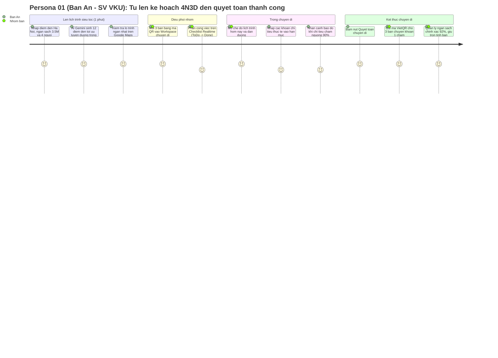

> **Liên kết ngữ cảnh:** [Skill Harness (SSOT)](../../00-ai-harness/skill.md) | [PO Kit](../../00-ai-harness/po-kit.md) | [Market & Needs](../01-market-and-needs.md) | [Problem Statement](../02-problem-statement.md) | [Persona Working Pro](./persona-02-working-pro.md) | [Product Vision](../03-product-vision.md) | [Product Canvas](../04-product-canvas.md)

# Persona 01: Bạn An — Sinh viên VKU (Trưởng nhóm Du lịch Tự túc Tiết kiệm)

> **Cơ sở dữ liệu thực nghiệm:** Trực tiếp từ **Case Study Kịch bản thực tế (Slide 10)** của đề tài TrekMate: Lập kế hoạch chuyến đi Đà Nẵng – Hà Nội (4N3Đ) cho nhóm 4 người với ngân sách **3.500.000 VNĐ/người**.

---

## 1. Thông tin nhân khẩu học (Demographics)
* **Họ và tên:** Lê Hoàng An (đại diện sinh viên VKU).
* **Tuổi:** 20 tuổi (Sinh viên năm 2 chuyên ngành Công nghệ Thông tin, Đại học CNTT & Truyền thông Việt - Hàn).
* **Nơi sinh sống:** Làng Đại học Đà Nẵng (ở trọ cùng bạn bè).
* **Vai trò trong nhóm du lịch:** Nhóm trưởng (Trưởng ban tổ chức kiêm "kế toán" kiêm "hoa tiêu").
* **Ngân sách:** Tiết kiệm — Trung bình (**3.500.000 VNĐ/người** cho hành trình 4 ngày 3 đêm), rất nhạy cảm với các khoản phát sinh ngoài ý muốn.
* **Thiết bị sử dụng:**
  * **Smartphone:** Sử dụng $90\%$ thời gian (đặc biệt khi đang trên tàu xe, đi bộ tìm quán, tra cứu đường đi và thanh toán).
  * **Laptop:** Dùng vào buổi tối tại phòng trọ khi ngồi gom thông tin lập kế hoạch ban đầu.

---

## 2. Mục tiêu & Động lực (Goals & Motivations)
* **Lên lịch trình siêu tốc:** Muốn có một kế hoạch chuyến đi 4N3Đ hoàn chỉnh chỉ trong **$< 45\text{s}$** thay vì phải ngồi ghép thông tin 6–10 tiếng từ TikTok và Google Maps.
* **Tối ưu hóa cung đường:** Tìm được tuyến đường di chuyển ngắn nhất giữa các điểm tham quan (Hồ Gươm, Lăng Bác, Phố Cổ, Văn Miếu, các quán ăn ngon), không bị đi ngược đường lãng phí tiền xăng/xe công nghệ.
* **Không bị "ôm đồm" việc:** Có công cụ phân công rõ ràng cho 3 bạn đồng hành (ai đặt vé máy bay/tàu, ai tìm homestay, ai thuê xe máy) qua danh sách kiểm tra (Checklist) trực quan.
* **Minh bạch tài chính:** Bóc tách chính xác các khoản chi tiêu thực tế, đảm bảo không vượt mức ngân sách 3,5 triệu đồng và tự động chia tiền sòng phẳng qua **VietQR** mà không cần ngồi bấm máy tính tính tay.

---

## 3. Thói quen & Hành vi (Habits & Behaviors)
* **Thói quen tìm kiếm:** Thường xem các video review ngắn trên TikTok / Reels để chọn quán ăn ngon, giá sinh viên; nhưng hay gặp cảnh quán đóng cửa hoặc thực tế không như quảng cáo.
* **Thói quen di chuyển:** Ưu tiên thuê xe máy hoặc đi xe buýt/đi bộ để tiết kiệm chi phí; cần ứng dụng chỉ đường nhanh và hiển thị rõ khoảng cách giữa các điểm đến kế tiếp.
* **Thói quen thanh toán:** Gần như $100\%$ không dùng tiền mặt, quét mã QR qua ứng dụng ngân hàng di động (VietQR / Napas 247) cho mọi giao dịch từ quán nước mía đến tiền phòng.
* **Hành vi làm việc nhóm:** Nhắn tin bàn bạc trên Zalo/Messenger, nhưng tin nhắn trôi quá nhanh khiến việc ai làm việc nấy hay bị quên hoặc làm trùng lặp.

---

## 4. Nỗi đau (Pain Points — Trích dẫn Case Study Thực tế)
* **Mất quá nhiều thời gian tìm quán và ghép lịch:** Tốn hàng buổi tối đọc hàng chục bài viết trên mạng, ghi chép vào sổ tay hoặc Google Docs rời rạc.
* **Sợ lãng phí thời gian di chuyển ngược đường:** Không rành đường phố Hà Nội, nếu sắp xếp thứ tự tham quan theo cảm tính sẽ phải chạy lòng vòng qua lại, gây kẹt xe và mệt mỏi cho cả nhóm.
* **Rủi ro vượt ngân sách nhóm:** Không có bảng theo dõi hạn mức tự động theo từng danh mục (Ăn uống, Phòng ở, Đi lại); rất dễ "vung tay quá trán" trong 2 ngày đầu khiến những ngày cuối bị cạn tiền.
* **Áp lực chia tiền và đòi nợ tế nhị:** Là người đứng ra trả tiền trước cho nhiều khoản lớn (tiền cọc homestay, tiền ăn lẩu), cuối chuyến An rất ngại khi phải chụp bảng tính Excel gửi vào nhóm để đòi tiền từng bạn.

---

## 5. Ánh xạ sang Giao diện & Trải nghiệm (UI/UX Implications cho Web Responsive)

Từ đặc điểm **20 tuổi, dùng smartphone khi di chuyển, ngân sách 3,5M và đi nhóm 4 người**, giao diện hệ thống Web SPA cần đáp ứng:

* **Tối ưu hóa Mobile Web cho thao tác 1 tay:**
  * Bố cục thẻ dọc (Vertical Cards) cho dòng thời gian lịch trình (Timeline). Các nút bấm chính như *"Dẫn đường"*, *"Thêm chi phí"*, *"Đánh dấu xong việc"* có diện tích chạm lớn ($\ge 44\text{dp}$).
  * Thanh điều hướng dưới đáy (Bottom Navigation Tab): Cho phép chuyển đổi nhanh 1 chạm giữa: `Lịch trình` | `Bản đồ` | `Checklist` | `Ngân sách`.
* **Trực quan hóa Bản đồ Google Maps:**
  * Tự động nối các điểm POI bằng đường Polyline màu xanh đậm, đánh số thứ tự `1, 2, 3...` theo tuyến đường ngắn nhất. Cho phép chạm vào điểm đến để mở ngay ứng dụng Google Maps chỉ đường thực tế.
* **Bảng phân bổ ngân sách & Cảnh báo đỏ:**
  * Biểu đồ tròn Donut chia 4 màu trực quan: Di chuyển (30%), Phòng ở (30%), Ăn uống (25%), Dự phòng (15%).
  * Khi danh mục Ăn uống chạm mức $> 90\%$ của hạn mức cho phép, hệ thống hiển thị ngay **thanh cảnh báo màu đỏ (Red Alert Badge)** để An nhắc nhở nhóm kịp thời.
* **Popup Quyết toán VietQR một chạm:**
  * Nút to nổi bật *"Quyết toán chuyến đi"*. Khi bấm, hệ thống hiển thị danh sách: *Bạn B chuyển cho An: 850.000đ*, kèm nút bấm *"Xem mã VietQR"* tự động điền sẵn số tài khoản, số tiền và nội dung chuyển khoản chuẩn cú pháp.

---

## 6. Hành trình người dùng (User Journey — Mermaid)

