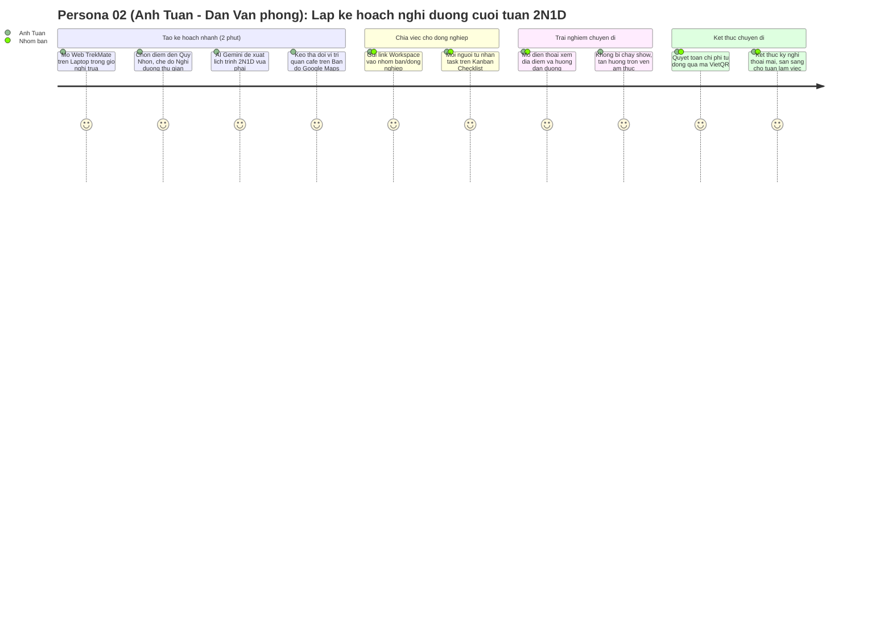

> **Liên kết ngữ cảnh:** [Skill Harness (SSOT)](../../00-ai-harness/skill.md) | [PO Kit](../../00-ai-harness/po-kit.md) | [Market & Needs](../01-market-and-needs.md) | [Problem Statement](../02-problem-statement.md) | [Persona Student](./persona-01-student.md) | [Product Vision](../03-product-vision.md) | [Product Canvas](../04-product-canvas.md)

# Persona 02: Anh Tuấn — Nhân viên Văn phòng Bận rộn (Du lịch Cuối tuần Ngắn ngày)

> **Vai trò trong Vault:** Đại diện cho phân khúc người đi làm trẻ tuổi (25–29 tuổi), thường xuyên bận rộn với công việc nhưng có nhu cầu du lịch "xả stress" ngắn ngày (2N1Đ hoặc 3N2Đ) cùng bạn bè hoặc đồng nghiệp vào dịp cuối tuần.

---

## 1. Thông tin nhân khẩu học (Demographics)
* **Họ và tên:** Trần Quốc Tuấn.
* **Tuổi:** 28 tuổi.
* **Nghề nghiệp:** Kỹ sư phần mềm / Trưởng nhóm dự án tại một công ty công nghệ ở Đà Nẵng.
* **Tình trạng hôn nhân:** Độc thân / Sống cùng nhóm bạn thân.
* **Thu nhập & Ngân sách:** 18.000.000 – 25.000.000 VNĐ/tháng. Ngân sách du lịch ở mức **Khá — Thoải mái** (khoảng 2.000.000 – 3.000.000 VNĐ/người cho chuyến đi 2N1Đ như Quy Nhơn, Huế, Hội An, Măng Đen).
* **Thiết bị sử dụng:**
  * **Laptop (Desktop Web):** Sử dụng chính khi lên kế hoạch trong giờ nghỉ trưa hoặc buổi tối tại văn phòng (màn hình lớn, thao tác đa nhiệm).
  * **Smartphone:** Xem lịch trình và điều hướng khi đang lái xe hoặc ngồi trên ô tô.

---

## 2. Mục tiêu & Động lực (Goals & Motivations)
* **Tiết kiệm thời gian chuẩn bị tối đa:** Muốn có ngay một kế hoạch du lịch hoàn chỉnh trong **$< 2\text{ phút}$** mà không phải tự lùng sục hàng chục bài viết review trên mạng xã hội.
* **Nhịp độ chuyến đi thư giãn (Relaxed Pace):** Tuyệt đối không thích lịch trình "chạy show" dày đặc; chỉ cần 2–3 điểm tham quan chất lượng, một quán cà phê view đẹp và một nhà hàng ẩm thực bản địa đặc sắc mỗi ngày.
* **Thông tin chính xác, không sai sót:** Giờ mở cửa, thời gian di chuyển giữa các điểm phải chuẩn xác để không làm hỏng kỳ nghỉ ngắn ngủi.
* **Cộng tác công việc văn minh:** Muốn các thành viên trong nhóm tự giác chọn việc (ai đặt bàn ăn, ai lái xe) trên một bảng Checklist trực tuyến thay vì phải liên tục nhắn tin nhắc nhở.

---

## 3. Thói quen & Hành vi (Habits & Behaviors)
* **Quyết định đi nhanh chóng:** Thường nảy ra ý định đi chơi vào thứ Tư hoặc thứ Năm và khởi hành vào chiều thứ Sáu sau giờ làm việc.
* **Thói quen sử dụng công cụ:** Rất quen thuộc với các giao diện dạng bảng điều khiển (Dashboard), quản lý công việc dạng Kanban (Trello, Jira) và ưa thích thao tác kéo thả trên màn hình máy tính.
* **Sẵn sàng chi trả cho trải nghiệm tốt:** Không quá căn ke từng nghìn đồng như sinh viên, sẵn sàng trả tiền thuê bao Pro nếu ứng dụng giúp tiết kiệm được 3–4 tiếng công sức lập kế hoạch.
* **Kỳ vọng cao về tính ổn định:** Rất khó chịu nếu ứng dụng bị treo, giật lag hoặc AI phản hồi chậm trễ khi đang thao tác.

---

## 4. Nỗi đau (Pain Points)
* **Quá ít thời gian rảnh để lên kế hoạch:** Áp lực công việc (deadline, họp hành) khiến Tuấn không thể dành ra 5–6 tiếng để tra cứu từng địa điểm trên Google Maps.
* **Dị ứng với lịch trình AI "dập khuôn & quá tải":** Các chatbot AI thông thường thường nhồi nhét 7–8 điểm đến trong một ngày, bắt người dùng di chuyển liên tục từ sáng sớm tới đêm muộn, trái ngược hoàn toàn với mục đích đi nghỉ dưỡng xả stress.
* **Thiếu công cụ phân công công việc chuyên nghiệp:** Nhắn tin trong nhóm chat Zalo hay bị chìm tin nhắn, dẫn đến cảnh gần đến ngày đi mới phát hiện ra chưa ai đặt xe hoặc chưa ai xác nhận chỗ nghỉ.
* **Ngại cảnh cộng trừ tiền bạc thủ công:** Dù có điều kiện kinh tế, Tuấn vẫn muốn mọi khoản chi tiêu chung của cả nhóm được ghi nhận minh bạch và chia đều tự động để tránh cảm giác người chi nhiều, người chi ít.

---

## 5. Ánh xạ sang Giao diện & Trải nghiệm (UI/UX Implications cho Web Responsive)

Từ đặc điểm **28 tuổi, nhân viên văn phòng, lập kế hoạch trên laptop và ưu thích nhịp độ thư giãn**, giao diện hệ thống Web SPA cần thiết kế:

* **Bố cục Desktop tối ưu cho màn hình lớn (Split-Screen View 1280–1440px):**
  * Giao diện 3 cột chuyên nghiệp:
    * **Cột trái ($35\%$):** Timeline lịch trình theo khung giờ (Sáng, Trưa, Chiều, Tối) với nhãn phân loại rõ ràng (Ăn uống, Check-in, Nghỉ ngơi).
    * **Cột giữa ($45\%$):** Khung bản đồ Google Maps tương tác kích thước lớn, cho phép **kéo thả (Drag & Drop)** trực tiếp các thẻ địa điểm để đổi thứ tự lộ trình.
    * **Cột phải ($20\%$):** Bảng tiến độ công việc nhóm (Kanban Checklist) và biểu đồ phân bổ ngân sách Pie Chart.
* **Bộ lọc Nhịp độ chuyến đi (Trip Pace Selector):**
  * Tùy chọn rõ ràng ngay từ bước nhập yêu cầu ban đầu: *Thư giãn / Nghỉ dưỡng (Relaxed)* vs *Khám phá / Năng động (Active)* để AI Gemini tự động căn chỉnh số lượng điểm đến hợp lý ($\le 3$ điểm/ngày cho chế độ thư giãn).
* **Quản lý Task nhóm dạng thẻ Kanban:**
  * Bảng công việc phân loại rõ ràng: *Cần làm (ToDo) $\rightarrow$ Đang làm (InProgress) $\rightarrow$ Hoàn thành (Done)*, có hiển thị avatar người nhận việc và đếm ngược hạn chót (Deadline).
* **Tính năng Xuất Báo cáo & Chia sẻ Chuyên nghiệp:**
  * Hỗ trợ nút *"Sao chép liên kết chia sẻ"* để gửi nhanh cho nhóm đồng nghiệp xem trước trên máy tính mà không bắt buộc họ phải đăng ký tài khoản rườm rà.

---

## 6. Hành trình người dùng (User Journey — Mermaid)

