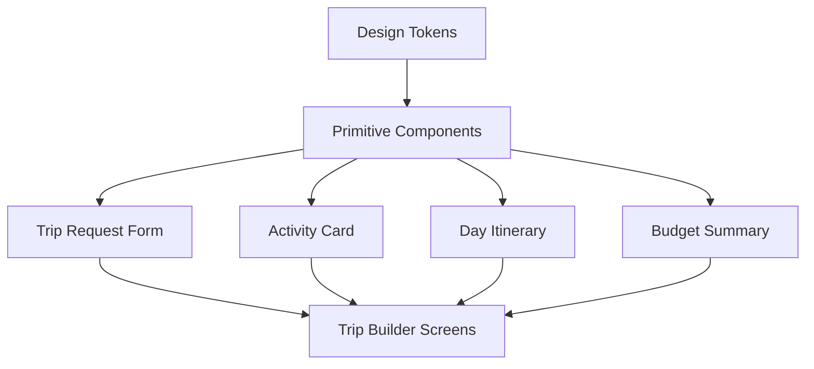

> **Liên kết ngữ cảnh:** [UI/UX Skill](../00-ai-harness/ui-ux-skill.md) | [Design Tokens](./design-tokens.md) | [Screens](./prototype-screens.md) | [Product Backlog](../03-requirements/product-backlog.md) | [Personas](../01-discovery/personas/persona-01-trip-planner.md)

# Component Library — SmartTrip Web

Đặc tả component tái sử dụng cho web responsive. Tên component là đề xuất; implementation cụ thể cần theo framework đã được nhóm chốt. Mọi giao diện dùng token trong `design-tokens.md`.

## 1. Cấu trúc

## 2. Primitives

### `Button`

- Variants: `primary`, `secondary`, `tertiary`, `danger`.
- States: default, hover, focus-visible, disabled, loading.
- Dùng `<button>` thật; không cho phép gửi lặp khi đang xử lý.
- Có nhãn nêu hành động; không dùng icon đơn độc nếu không có accessible name.

### `TextField` / `DateField` / `NumberField`

- Nhãn hiển thị cố định, giá trị ví dụ không thay thế label.
- Lỗi gắn với trường bằng `aria-describedby`, thông báo rõ cách khắc phục.
- Ngày đi/ngày về phải kiểm tra thứ tự hợp lệ; số người và ngân sách có min/max được đặc tả.
- Không xóa giá trị hợp lệ khi validate trường khác thất bại.

### `Select` / `Chip`

- Dùng chọn sở thích, phương tiện hoặc nhịp độ chuyến đi.
- Hỗ trợ bàn phím, focus rõ, selected state đọc được bởi screen reader.
- Chip có thể bỏ chọn và không truyền tải trạng thái chỉ bằng màu sắc.

### `Alert` / `Toast` / `Dialog`

- `Alert` cho lỗi cần hành động; `Toast` chỉ cho thông báo ngắn không quan trọng.
- `Dialog` dùng để xác nhận bỏ thay đổi hoặc xóa kế hoạch; focus được quản lý và trả về vị trí trước đó khi đóng.

## 3. Domain components

### `TripRequestForm`

Thu thập điểm đến, ngày/thời lượng, số người, ngân sách, sở thích và nhịp độ. Cho phép bỏ trống trường tùy chọn, tóm tắt đầu vào và thông báo dữ liệu cần thiết trước khi gửi.

### `ItineraryDay`

Hiển thị ngày, hoạt động theo thứ tự, khoảng thời gian, khu vực và khoảng di chuyển nếu có. Có thông báo khi thời gian bị chồng lấn; không tự thay đổi thứ tự người dùng.

### `ActivityCard`

Hiển thị tên, mô tả ngắn, thời lượng, địa chỉ/khu vực và chi phí nếu có. Gắn nhãn nguồn/độ tin cậy cho dữ liệu ngoài; menu hành động có sửa, thay, xóa và di chuyển.

### `BudgetSummary`

Phân biệt tổng do người dùng nhập, tổng khoản có giá, khoản ước tính và khoản chưa có dữ liệu. Không hiển thị tổng như con số chính xác nếu còn khoản chưa xác định.

### `ItineraryStatus`

Phân biệt bản nháp, đang tạo, đã lưu và lỗi. Khi AI/API lỗi, thông báo phần nào chưa hoàn thành và giữ dữ liệu người dùng.

### `SourceFreshness`

Hiển thị nguồn và thời điểm cập nhật bên cạnh dữ liệu giá/giờ/đường đi. Nếu thiếu nguồn hoặc quá cũ, hiện rõ “Chưa xác minh” thay vì tự tạo giá trị.

## 4. Responsive và accessibility

- Desktop: có thể đặt form và bản xem trước hai cột; giữ nội dung trong chiều rộng đọc hợp lý.
- Tablet/mobile: xếp một cột; actions không phụ thuộc hover; menu không bị cắt khỏi viewport.
- Dùng semantic headings, landmarks, labels và danh sách có thứ tự cho hoạt động theo ngày.
- Mọi thao tác có thể dùng bàn phím; focus không bị che và thứ tự tab theo luồng đọc.
- Kiểm tra ở độ phóng đại 200%, tương phản và chế độ giảm chuyển động.

