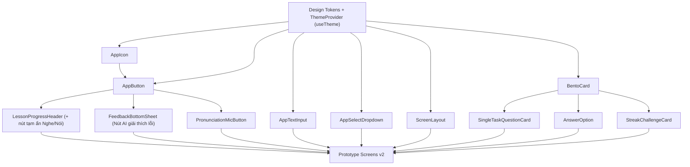

> **Liên kết ngữ cảnh:** [Skill UI/UX (React Native)](../00-ai-harness/ui-ux-skill.md) | [Design Tokens v2](./design-tokens-v2.md) | [Prototype Screens v2](./prototype-screens-v2.md) | [Product Backlog](../03-requirements/product-backlog.md) | [Persona Student](../01-discovery/personas/persona-01-student.md) | [Persona Working Pro](../01-discovery/personas/persona-02-working-pro.md) | Bản gốc: [component-library.md](./component-library.md)

# 🧩 Thư viện Component React Native v2 (`LingoCraft AI Design System`)

Bản v2 dựng lại bộ component theo **Soft Bento** và các luật của skill kit khác (UI UX Pro Max, Stitch `DESIGN.md`, taste-skill — xem [design-tokens-v2.md](./design-tokens-v2.md)). Khi sinh giao diện mới từ `03-requirements/`, AI Agent **chỉ được lắp ghép** từ các component dưới đây và lấy giá trị từ `useTheme()`.

**Phụ thuộc cần cài:** `react-native-safe-area-context`, `react-native-svg`, `lucide-react-native`, `@expo-google-fonts/be-vietnam-pro`.

---

## 1. Kiến trúc Phân tầng



---

## 2. Hook & Primitives

### 2.0 `useReducedMotion`
```tsx
// src/hooks/useReducedMotion.ts
import { useEffect, useState } from 'react';
import { AccessibilityInfo } from 'react-native';

export const useReducedMotion = (): boolean => {
  const [reduced, setReduced] = useState(false);
  useEffect(() => {
    AccessibilityInfo.isReduceMotionEnabled().then(setReduced);
    const sub = AccessibilityInfo.addEventListener('reduceMotionChanged', setReduced);
    return () => sub.remove();
  }, []);
  return reduced;
};
```

### 2.1 `AppIcon` (thay toàn bộ emoji)
```tsx
// src/components/primitives/AppIcon.tsx
import React from 'react';
import {
  ChevronDown, ChevronUp, CircleCheck, Flame, Heart, Lock, Mic, Play,
  Sparkles, Square, Target, Trophy, Volume2, VolumeX, X, Zap,
} from 'lucide-react-native';
import { useTheme } from '../../theme/ThemeProvider';

const ICONS = {
  check: CircleCheck, close: X, flame: Flame, heart: Heart, lock: Lock, mic: Mic,
  play: Play, sparkles: Sparkles, stop: Square, target: Target, trophy: Trophy,
  volumeOn: Volume2, volumeOff: VolumeX, xp: Zap, chevronDown: ChevronDown, chevronUp: ChevronUp,
} as const;

export type IconName = keyof typeof ICONS;

export interface AppIconProps {
  name: IconName;
  size?: number;
  color?: string;
}

// Icon chỉ mang tính trang trí: nhãn đọc cho screen reader nằm ở component cha.
export const AppIcon: React.FC<AppIconProps> = ({ name, size = 20, color }) => {
  const { colors } = useTheme();
  const Cmp = ICONS[name];
  return <Cmp size={size} color={color ?? colors.textPrimary} strokeWidth={2} />;
};
```

### 2.2 `AppButton` (≥ 48dp, có icon, có trạng thái đầy đủ)
* **Variants:** `primary`, `secondary`, `ai`, `danger`, `ghost`. **States:** `default`, `selected`, `disabled`, `loading`.

```tsx
// src/components/primitives/AppButton.tsx
import React from 'react';
import { ActivityIndicator, Pressable, Text, ViewStyle } from 'react-native';
import { useTheme } from '../../theme/ThemeProvider';
import { ColorTokens } from '../../theme/tokens';
import { AppIcon, IconName } from './AppIcon';

export type AppButtonVariant = 'primary' | 'secondary' | 'ai' | 'danger' | 'ghost';

export interface AppButtonProps {
  label: string;
  onPress: () => void;
  variant?: AppButtonVariant;
  icon?: IconName;
  selected?: boolean;
  disabled?: boolean;
  loading?: boolean;
  style?: ViewStyle;
}

const getVariant = (variant: AppButtonVariant, selected: boolean, c: ColorTokens) => {
  switch (variant) {
    case 'secondary':
      return {
        bg: selected ? c.primarySurface : c.surface,
        pressed: c.primarySurface,
        border: selected ? c.primary : c.border,
        text: selected ? c.primary : c.textPrimary,
      };
    case 'ai':
      return { bg: c.aiPrimary, pressed: c.aiPrimary, border: 'transparent', text: c.textOnAi };
    case 'danger':
      return { bg: c.error, pressed: c.error, border: 'transparent', text: c.textOnError };
    case 'ghost':
      return { bg: 'transparent', pressed: c.primarySurface, border: 'transparent', text: c.primary };
    default:
      return { bg: c.primary, pressed: c.primaryPressed, border: 'transparent', text: c.textOnPrimary };
  }
};

export const AppButton: React.FC<AppButtonProps> = ({
  label,
  onPress,
  variant = 'primary',
  icon,
  selected = false,
  disabled = false,
  loading = false,
  style,
}) => {
  const { colors, radius, spacing, typography, layout, motion } = useTheme();
  const v = getVariant(variant, selected, colors);
  const textColor = disabled ? colors.textSecondary : v.text;

  return (
    <Pressable
      onPress={onPress}
      disabled={disabled || loading}
      accessibilityRole="button"
      accessibilityLabel={label}
      accessibilityState={{ disabled: disabled || loading, busy: loading, selected }}
      style={({ pressed }) => [
        {
          minHeight: layout.minTouchTarget,
          borderRadius: radius.md,
          paddingHorizontal: spacing.md,
          paddingVertical: spacing.sm,
          flexDirection: 'row',
          alignItems: 'center',
          justifyContent: 'center',
          gap: spacing.sm,
          borderWidth: 1.5,
          borderColor: disabled ? colors.border : v.border,
          backgroundColor: disabled ? colors.border : pressed ? v.pressed : v.bg,
          transform: [{ scale: pressed && !disabled ? motion.pressScale : 1 }],
        },
        style,
      ]}
    >
      {loading ? (
        <ActivityIndicator color={textColor} />
      ) : (
        <>
          {icon ? <AppIcon name={icon} size={18} color={textColor} /> : null}
          <Text style={[typography.buttonLabel, { color: textColor, textAlign: 'center', flexShrink: 1 }]}>
            {label}
          </Text>
        </>
      )}
    </Pressable>
  );
};
```

### 2.3 `AppTextInput`
```tsx
// src/components/primitives/AppTextInput.tsx
import React, { useState } from 'react';
import { Text, TextInput, TextInputProps, View } from 'react-native';
import { useTheme } from '../../theme/ThemeProvider';

export interface AppTextInputProps extends TextInputProps {
  label?: string;
  errorMessage?: string;
  validationState?: 'default' | 'correct' | 'error';
}

export const AppTextInput: React.FC<AppTextInputProps> = ({
  label,
  errorMessage,
  validationState = 'default',
  style,
  ...rest
}) => {
  const [focused, setFocused] = useState(false);
  const { colors, radius, spacing, typography, layout } = useTheme();

  const hasError = validationState === 'error' || !!errorMessage;
  const borderColor = hasError
    ? colors.error
    : validationState === 'correct'
      ? colors.success
      : focused
        ? colors.primary
        : colors.border;

  return (
    <View style={{ marginBottom: spacing.md }}>
      {label ? (
        <Text style={[typography.caption, { color: colors.textSecondary, marginBottom: spacing.xs }]}>
          {label}
        </Text>
      ) : null}
      <TextInput
        onFocus={() => setFocused(true)}
        onBlur={() => setFocused(false)}
        placeholderTextColor={colors.textSecondary}
        accessibilityLabel={label}
        style={[
          typography.body,
          {
            minHeight: layout.minTouchTarget,
            backgroundColor: colors.surface,
            color: colors.textPrimary,
            borderColor,
            borderWidth: 1.5,
            borderRadius: radius.md,
            paddingHorizontal: spacing.md,
          },
          style,
        ]}
        {...rest}
      />
      {errorMessage ? (
        <Text accessibilityLiveRegion="polite" style={[typography.caption, { color: colors.error, marginTop: spacing.xs }]}>
          {errorMessage}
        </Text>
      ) : null}
    </View>
  );
};
```

### 2.4 `AppSelectDropdown` (chọn Lộ trình / Chủ đề)
```tsx
// src/components/primitives/AppSelectDropdown.tsx
import React, { useState } from 'react';
import { Pressable, Text, View } from 'react-native';
import { useTheme } from '../../theme/ThemeProvider';
import { AppIcon } from './AppIcon';

export interface SelectOption {
  value: string;
  label: string;
}

export interface AppSelectDropdownProps {
  label?: string;
  options: SelectOption[];
  selectedValue: string;
  onSelect: (value: string) => void;
}

export const AppSelectDropdown: React.FC<AppSelectDropdownProps> = ({
  label,
  options,
  selectedValue,
  onSelect,
}) => {
  const [open, setOpen] = useState(false);
  const { colors, radius, spacing, typography, layout } = useTheme();
  const current = options.find((o) => o.value === selectedValue);

  return (
    <View style={{ marginBottom: spacing.md }}>
      {label ? (
        <Text style={[typography.caption, { color: colors.textSecondary, marginBottom: spacing.xs }]}>
          {label}
        </Text>
      ) : null}

      <Pressable
        onPress={() => setOpen((p) => !p)}
        accessibilityRole="button"
        accessibilityLabel={`${label ?? 'Chọn'}: ${current?.label ?? 'chưa chọn'}`}
        accessibilityState={{ expanded: open }}
        style={{
          minHeight: layout.minTouchTarget,
          flexDirection: 'row',
          alignItems: 'center',
          justifyContent: 'space-between',
          gap: spacing.sm,
          backgroundColor: colors.surface,
          borderColor: open ? colors.primary : colors.border,
          borderWidth: 1.5,
          borderRadius: radius.md,
          paddingHorizontal: spacing.md,
          paddingVertical: spacing.sm,
        }}
      >
        <Text style={[typography.body, { color: colors.textPrimary, flexShrink: 1 }]}>
          {current?.label ?? 'Chọn lộ trình'}
        </Text>
        <AppIcon name={open ? 'chevronUp' : 'chevronDown'} size={18} color={colors.textSecondary} />
      </Pressable>

      {open ? (
        <View
          style={{
            backgroundColor: colors.surface,
            borderColor: colors.border,
            borderWidth: 1,
            borderRadius: radius.md,
            marginTop: spacing.xs,
            overflow: 'hidden',
          }}
        >
          {options.map((opt) => {
            const isSelected = opt.value === selectedValue;
            return (
              <Pressable
                key={opt.value}
                accessibilityRole="radio"
                accessibilityState={{ selected: isSelected }}
                onPress={() => {
                  onSelect(opt.value);
                  setOpen(false);
                }}
                style={{
                  minHeight: layout.minTouchTarget,
                  justifyContent: 'center',
                  paddingHorizontal: spacing.md,
                  paddingVertical: spacing.sm,
                  backgroundColor: isSelected ? colors.primarySurface : 'transparent',
                }}
              >
                <Text style={[typography.body, { color: isSelected ? colors.primary : colors.textPrimary }]}>
                  {opt.label}
                </Text>
              </Pressable>
            );
          })}
        </View>
      ) : null}
    </View>
  );
};
```

### 2.5 `ScreenLayout` (Mobile-first, hỗ trợ cuộn & footer tràn viền)
```tsx
// src/components/primitives/ScreenLayout.tsx
import React from 'react';
import { ScrollView, View } from 'react-native';
import { SafeAreaView } from 'react-native-safe-area-context';
import { useTheme } from '../../theme/ThemeProvider';

export interface ScreenLayoutProps {
  header?: React.ReactNode;
  children: React.ReactNode;
  footer?: React.ReactNode;
  /** true: nội dung cuộn được (Home). false: màn hình bài học cố định. */
  scroll?: boolean;
  /** true: footer tràn hết chiều ngang (dùng cho FeedbackBottomSheet). */
  footerBleed?: boolean;
}

export const ScreenLayout: React.FC<ScreenLayoutProps> = ({
  header,
  children,
  footer,
  scroll = false,
  footerBleed = false,
}) => {
  const { colors, layout, spacing } = useTheme();
  const pad = layout.screenPadding;

  return (
    <SafeAreaView
      edges={footerBleed ? ['top'] : ['top', 'bottom']}
      style={{ flex: 1, backgroundColor: colors.background }}
    >
      {header ? <View style={{ paddingHorizontal: pad }}>{header}</View> : null}

      {scroll ? (
        <ScrollView
          showsVerticalScrollIndicator={false}
          contentContainerStyle={{ paddingHorizontal: pad, paddingVertical: spacing.md }}
        >
          {children}
        </ScrollView>
      ) : (
        <View style={{ flex: 1, paddingHorizontal: pad }}>{children}</View>
      )}

      {footer ? (
        <View style={footerBleed ? undefined : { paddingHorizontal: pad, paddingTop: spacing.sm, paddingBottom: spacing.md }}>
          {footer}
        </View>
      ) : null}
    </SafeAreaView>
  );
};
```

### 2.6 `BentoCard` (khối nền chung của phong cách Soft Bento)
```tsx
// src/components/primitives/BentoCard.tsx
import React from 'react';
import { View, ViewStyle } from 'react-native';
import { useTheme } from '../../theme/ThemeProvider';

export type BentoTone = 'default' | 'primary' | 'ai' | 'success' | 'error';

export interface BentoCardProps {
  tone?: BentoTone;
  children: React.ReactNode;
  style?: ViewStyle;
}

export const BentoCard: React.FC<BentoCardProps> = ({ tone = 'default', children, style }) => {
  const { colors, radius, spacing, elevation } = useTheme();

  const palette = {
    default: { bg: colors.surface, border: colors.border },
    primary: { bg: colors.primarySurface, border: colors.primary },
    ai: { bg: colors.aiSurface, border: colors.aiAccent },
    success: { bg: colors.successSurface, border: colors.success },
    error: { bg: colors.errorSurface, border: colors.error },
  }[tone];

  return (
    <View
      style={[
        {
          backgroundColor: palette.bg,
          borderColor: palette.border,
          borderWidth: 1,
          borderRadius: radius.lg,
          padding: spacing.md,
        },
        tone === 'default' ? elevation.card : null,
        style,
      ]}
    >
      {children}
    </View>
  );
};
```

---

## 3. Domain Composite Components

### 3.1 `LessonProgressHeader` (Tiến độ + Hearts + Streak + nút tạm ẩn Nghe/Nói)
```tsx
// src/components/composites/LessonProgressHeader.tsx
import React from 'react';
import { Pressable, Text, View } from 'react-native';
import { useTheme } from '../../theme/ThemeProvider';
import { AppIcon } from '../primitives/AppIcon';

export interface LessonProgressHeaderProps {
  currentStep: number;
  totalSteps: number;
  hearts: number;
  streak: number;
  isSpeakingMuted: boolean;
  onToggleSpeakingMute: () => void;
  onClose: () => void;
}

export const LessonProgressHeader: React.FC<LessonProgressHeaderProps> = ({
  currentStep,
  totalSteps,
  hearts,
  streak,
  isSpeakingMuted,
  onToggleSpeakingMute,
  onClose,
}) => {
  const { colors, radius, spacing, typography, layout } = useTheme();
  const percent = Math.min(100, Math.round((currentStep / Math.max(1, totalSteps)) * 100));
  const muteColor = isSpeakingMuted ? colors.warning : colors.textSecondary;

  return (
    <View style={{ paddingTop: spacing.sm, paddingBottom: spacing.md }}>
      <View style={{ flexDirection: 'row', alignItems: 'center', gap: spacing.sm }}>
        <Pressable
          onPress={onClose}
          accessibilityRole="button"
          accessibilityLabel="Thoát bài học"
          style={{ width: layout.minTouchTarget, height: layout.minTouchTarget, justifyContent: 'center', alignItems: 'flex-start' }}
        >
          <AppIcon name="close" size={24} color={colors.textSecondary} />
        </Pressable>

        <View
          accessibilityRole="progressbar"
          accessibilityLabel="Tiến độ bài học"
          accessibilityValue={{ min: 0, max: totalSteps, now: currentStep }}
          style={{ flex: 1, height: 10, backgroundColor: colors.border, borderRadius: radius.full, overflow: 'hidden' }}
        >
          <View style={{ width: `${percent}%`, height: '100%', backgroundColor: colors.primary, borderRadius: radius.full }} />
        </View>

        <View style={{ flexDirection: 'row', alignItems: 'center', gap: spacing.md }}>
          <View accessible accessibilityLabel={`Streak ${streak} ngày`} style={{ flexDirection: 'row', alignItems: 'center', gap: spacing.xs }}>
            <AppIcon name="flame" size={18} color={colors.streak} />
            <Text style={[typography.caption, { color: colors.streak }]}>{streak}</Text>
          </View>
          <View accessible accessibilityLabel={`${hearts} tim còn lại`} style={{ flexDirection: 'row', alignItems: 'center', gap: spacing.xs }}>
            <AppIcon name="heart" size={18} color={colors.heartCoral} />
            <Text style={[typography.caption, { color: colors.heartCoral }]}>{hearts}</Text>
          </View>
        </View>
      </View>

      {/* Tạm ẩn Nghe/Nói — phục vụ US-06 (Persona 02 ở nơi công cộng). Vùng chạm ≥ 48dp. */}
      <Pressable
        onPress={onToggleSpeakingMute}
        accessibilityRole="switch"
        accessibilityState={{ checked: isSpeakingMuted }}
        accessibilityLabel="Tạm ẩn bài Nghe và Nói trong 15 phút"
        style={{
          alignSelf: 'flex-start',
          minHeight: layout.minTouchTarget,
          flexDirection: 'row',
          alignItems: 'center',
          gap: spacing.sm,
          marginTop: spacing.xs,
          paddingHorizontal: spacing.md,
          borderRadius: radius.full,
          borderWidth: 1,
          borderColor: isSpeakingMuted ? colors.warning : colors.border,
          backgroundColor: isSpeakingMuted ? colors.warningSurface : colors.surface,
        }}
      >
        <AppIcon name={isSpeakingMuted ? 'volumeOff' : 'volumeOn'} size={16} color={muteColor} />
        <Text style={[typography.caption, { color: muteColor }]}>
          {isSpeakingMuted ? 'Đang tạm ẩn Nghe/Nói 15 phút · Chạm để bật lại' : 'Nghe/Nói đang bật · Chạm để tạm ẩn 15p'}
        </Text>
      </Pressable>
    </View>
  );
};
```

### 3.2 `SingleTaskQuestionCard` (1 câu / 1 màn hình)
```tsx
// src/components/composites/SingleTaskQuestionCard.tsx
import React from 'react';
import { Text } from 'react-native';
import { useTheme } from '../../theme/ThemeProvider';
import { BentoCard } from '../primitives/BentoCard';

export interface SingleTaskQuestionCardProps {
  instruction: string;
  promptText: string;
  subHint?: string;
}

export const SingleTaskQuestionCard: React.FC<SingleTaskQuestionCardProps> = ({
  instruction,
  promptText,
  subHint,
}) => {
  const { colors, spacing, typography } = useTheme();

  return (
    <BentoCard style={{ padding: spacing.lg, marginBottom: spacing.lg }}>
      <Text style={[typography.caption, { color: colors.primary, marginBottom: spacing.sm }]}>
        {instruction}
      </Text>
      <Text accessibilityRole="header" style={[typography.questionTitle, { color: colors.textPrimary }]}>
        {promptText}
      </Text>
      {subHint ? (
        <Text style={[typography.caption, { color: colors.textSecondary, marginTop: spacing.sm }]}>{subHint}</Text>
      ) : null}
    </BentoCard>
  );
};
```

### 3.3 `AnswerOption` (đáp án có trạng thái đúng/sai không chỉ bằng màu)
```tsx
// src/components/composites/AnswerOption.tsx
import React from 'react';
import { Pressable, Text, View } from 'react-native';
import { useTheme } from '../../theme/ThemeProvider';
import { AppIcon } from '../primitives/AppIcon';

export type AnswerState = 'default' | 'selected' | 'correct' | 'wrong' | 'disabled';

export interface AnswerOptionProps {
  label: string;
  index: number;
  state: AnswerState;
  onPress: () => void;
}

export const AnswerOption: React.FC<AnswerOptionProps> = ({ label, index, state, onPress }) => {
  const { colors, radius, spacing, typography, layout } = useTheme();

  const palette = {
    default: { bg: colors.surface, border: colors.border, text: colors.textPrimary },
    selected: { bg: colors.primarySurface, border: colors.primary, text: colors.primary },
    correct: { bg: colors.successSurface, border: colors.success, text: colors.success },
    wrong: { bg: colors.errorSurface, border: colors.error, text: colors.error },
    disabled: { bg: colors.surface, border: colors.border, text: colors.textSecondary },
  }[state];

  return (
    <Pressable
      onPress={onPress}
      disabled={state === 'disabled' || state === 'correct' || state === 'wrong'}
      accessibilityRole="radio"
      accessibilityState={{ selected: state === 'selected', disabled: state === 'disabled' }}
      accessibilityLabel={`${String.fromCharCode(65 + index)}. ${label}${state === 'correct' ? ', đáp án đúng' : state === 'wrong' ? ', đáp án sai' : ''}`}
      style={{
        minHeight: layout.minTouchTarget + 8,
        flexDirection: 'row',
        alignItems: 'center',
        gap: spacing.md,
        paddingHorizontal: spacing.md,
        paddingVertical: spacing.sm,
        backgroundColor: palette.bg,
        borderColor: palette.border,
        borderWidth: 1.5,
        borderRadius: radius.md,
      }}
    >
      <View
        style={{
          width: 28,
          height: 28,
          borderRadius: radius.full,
          borderWidth: 1.5,
          borderColor: palette.border,
          alignItems: 'center',
          justifyContent: 'center',
        }}
      >
        <Text style={[typography.caption, { color: palette.text }]}>{String.fromCharCode(65 + index)}</Text>
      </View>
      <Text style={[typography.body, { color: palette.text, flex: 1 }]}>{label}</Text>
      {state === 'correct' ? <AppIcon name="check" size={20} color={colors.success} /> : null}
      {state === 'wrong' ? <AppIcon name="close" size={20} color={colors.error} /> : null}
    </Pressable>
  );
};
```

### 3.4 `FeedbackBottomSheet` (Đúng/Sai + Nút *"Giải thích lỗi sai bằng AI"*)
* Đặt trong `footer` của `ScreenLayout` với `footerBleed` (không còn `position: absolute` nên không che đáp án).
* Có đủ trạng thái AI: `idle`, `loading`, `error` (nút thử lại), `done`.

```tsx
// src/components/composites/FeedbackBottomSheet.tsx
import React, { useEffect } from 'react';
import { Text, View } from 'react-native';
import { useSafeAreaInsets } from 'react-native-safe-area-context';
import { useTheme } from '../../theme/ThemeProvider';
import { AppButton } from '../primitives/AppButton';
import { AppIcon } from '../primitives/AppIcon';

export type AiStatus = 'idle' | 'loading' | 'error' | 'done';
const AI_MAX_CHARS = 240; // ≈ 4 dòng cỡ 15px trên màn hình ~360dp

export interface FeedbackBottomSheetProps {
  isCorrect: boolean;
  correctAnswer: string;
  xpGained?: number;
  aiExplanation?: string;
  aiStatus: AiStatus;
  onRequestAiExplain: () => void;
  onContinue: () => void;
}

export const FeedbackBottomSheet: React.FC<FeedbackBottomSheetProps> = ({
  isCorrect,
  correctAnswer,
  xpGained = 10,
  aiExplanation,
  aiStatus,
  onRequestAiExplain,
  onContinue,
}) => {
  const { colors, radius, spacing, typography, elevation } = useTheme();
  const insets = useSafeAreaInsets();
  const tone = isCorrect ? colors.success : colors.error;

  useEffect(() => {
    if (__DEV__ && aiExplanation && aiExplanation.length > AI_MAX_CHARS) {
      console.warn(`[FeedbackBottomSheet] Giải thích AI dài ${aiExplanation.length} ký tự (> ${AI_MAX_CHARS}). Hãy rút gọn xuống ≤ 4 dòng.`);
    }
  }, [aiExplanation]);

  return (
    <View
      accessibilityLiveRegion="polite"
      style={[
        {
          backgroundColor: isCorrect ? colors.successSurface : colors.errorSurface,
          borderTopLeftRadius: radius.lg,
          borderTopRightRadius: radius.lg,
          borderTopWidth: 1.5,
          borderColor: tone,
          padding: spacing.md,
          paddingBottom: spacing.md + insets.bottom,
          gap: spacing.sm,
        },
        elevation.sheet,
      ]}
    >
      <View style={{ flexDirection: 'row', alignItems: 'center', gap: spacing.sm }}>
        <AppIcon name={isCorrect ? 'check' : 'close'} size={22} color={tone} />
        <Text style={[typography.headingMd, { color: tone }]}>
          {isCorrect ? `Chính xác! +${xpGained} XP` : 'Chưa chính xác — không sao, thử tiếp nhé'}
        </Text>
      </View>

      {!isCorrect ? (
        <Text style={[typography.body, { color: colors.textPrimary }]}>
          Đáp án đúng: <Text style={{ fontFamily: 'BeVietnamPro_700Bold' }}>{correctAnswer}</Text>
        </Text>
      ) : null}

      {!isCorrect && aiStatus === 'done' && aiExplanation ? (
        <View
          style={{
            backgroundColor: colors.aiSurface,
            borderColor: colors.aiAccent,
            borderWidth: 1,
            borderRadius: radius.md,
            padding: spacing.md,
          }}
        >
          <View style={{ flexDirection: 'row', alignItems: 'center', gap: spacing.xs, marginBottom: spacing.xs }}>
            <AppIcon name="sparkles" size={16} color={colors.aiPrimary} />
            <Text style={[typography.caption, { color: colors.aiPrimary }]}>AI Tutor giải thích nhanh</Text>
          </View>
          <Text style={[typography.aiBody, { color: colors.textPrimary }]}>{aiExplanation}</Text>
        </View>
      ) : null}

      {!isCorrect && aiStatus === 'error' ? (
        <Text style={[typography.caption, { color: colors.error }]}>
          Chưa tải được giải thích. Kiểm tra mạng rồi thử lại nhé.
        </Text>
      ) : null}

      {!isCorrect && aiStatus !== 'done' ? (
        <AppButton
          label={aiStatus === 'error' ? 'Thử lại giải thích AI' : 'Giải thích lỗi sai bằng AI'}
          icon="sparkles"
          variant="ai"
          loading={aiStatus === 'loading'}
          onPress={onRequestAiExplain}
        />
      ) : null}

      {/* Không dùng nút đỏ đặc sau khi sai: tránh cảm giác bị phạt (Persona 01 sợ nói sai). */}
      <AppButton label="Tiếp tục" variant="primary" onPress={onContinue} />
    </View>
  );
};
```

### 3.5 `PronunciationMicButton` (Thu âm & Chấm phát âm AI)
* Vòng pulse chỉ chạy khi đang thu **và** hệ thống không bật Reduce Motion.

```tsx
// src/components/composites/PronunciationMicButton.tsx
import React, { useEffect, useRef } from 'react';
import { ActivityIndicator, Animated, Easing, Pressable, Text, View } from 'react-native';
import { useTheme } from '../../theme/ThemeProvider';
import { useReducedMotion } from '../../hooks/useReducedMotion';
import { AppIcon } from '../primitives/AppIcon';

export type MicStatus = 'idle' | 'recording' | 'analyzing' | 'scored';
export interface FlaggedWord {
  word: string;
  hint: string;
}

export interface PronunciationMicButtonProps {
  status: MicStatus;
  scorePercent?: number;
  flaggedWords?: FlaggedWord[];
  onPressToggle: () => void;
}

const STATUS_LABEL: Record<MicStatus, string> = {
  idle: 'Chạm để nói',
  recording: 'Đang nghe… chạm để dừng',
  analyzing: 'AI đang chấm điểm…',
  scored: 'Chạm để thử lại',
};

export const PronunciationMicButton: React.FC<PronunciationMicButtonProps> = ({
  status,
  scorePercent,
  flaggedWords = [],
  onPressToggle,
}) => {
  const { colors, radius, spacing, typography } = useTheme();
  const reduced = useReducedMotion();
  const pulse = useRef(new Animated.Value(0)).current;

  useEffect(() => {
    if (status !== 'recording' || reduced) {
      pulse.setValue(0);
      return;
    }
    const loop = Animated.loop(
      Animated.timing(pulse, { toValue: 1, duration: 1200, easing: Easing.out(Easing.ease), useNativeDriver: true }),
    );
    loop.start();
    return () => loop.stop();
  }, [status, reduced, pulse]);

  const recording = status === 'recording';
  const bg = recording ? colors.error : colors.aiPrimary;
  const fg = recording ? colors.textOnError : colors.textOnAi;
  const passed = typeof scorePercent === 'number' && scorePercent >= 70;

  return (
    <View style={{ alignItems: 'center', marginVertical: spacing.md }}>
      <View style={{ width: 96, height: 96, alignItems: 'center', justifyContent: 'center' }}>
        <Animated.View
          pointerEvents="none"
          style={{
            position: 'absolute',
            width: 80,
            height: 80,
            borderRadius: radius.full,
            backgroundColor: bg,
            opacity: pulse.interpolate({ inputRange: [0, 1], outputRange: [0.35, 0] }),
            transform: [{ scale: pulse.interpolate({ inputRange: [0, 1], outputRange: [1, 1.6] }) }],
          }}
        />
        <Pressable
          onPress={onPressToggle}
          disabled={status === 'analyzing'}
          accessibilityRole="button"
          accessibilityLabel={STATUS_LABEL[status]}
          accessibilityState={{ busy: status === 'analyzing' }}
          style={{ width: 80, height: 80, borderRadius: radius.full, backgroundColor: bg, alignItems: 'center', justifyContent: 'center' }}
        >
          {status === 'analyzing' ? (
            <ActivityIndicator color={fg} />
          ) : (
            <AppIcon name={recording ? 'stop' : 'mic'} size={32} color={fg} />
          )}
        </Pressable>
      </View>
      <Text style={[typography.caption, { color: colors.textSecondary, marginTop: spacing.sm }]}>
        {STATUS_LABEL[status]}
      </Text>

      {status === 'scored' && typeof scorePercent === 'number' ? (
        <View
          style={{
            marginTop: spacing.md,
            width: '100%',
            padding: spacing.md,
            borderRadius: radius.md,
            backgroundColor: passed ? colors.successSurface : colors.errorSurface,
            borderWidth: 1,
            borderColor: passed ? colors.success : colors.error,
          }}
        >
          <Text style={[typography.headingMd, { color: passed ? colors.success : colors.error, textAlign: 'center' }]}>
            Điểm phát âm: {scorePercent}%
          </Text>
          {flaggedWords.length > 0 ? (
            <View style={{ marginTop: spacing.sm, gap: spacing.xs }}>
              <Text style={[typography.caption, { color: colors.textSecondary, textAlign: 'center' }]}>
                Từ cần chú ý:
              </Text>
              {flaggedWords.map((w) => (
                <Text key={w.word} style={[typography.aiBody, { color: colors.textPrimary, textAlign: 'center' }]}>
                  <Text style={{ fontFamily: 'BeVietnamPro_700Bold' }}>{w.word}</Text> — {w.hint}
                </Text>
              ))}
            </View>
          ) : null}
        </View>
      ) : null}
    </View>
  );
};
```

### 3.6 `StreakChallengeCard` (Streak, XP & Thách đấu bạn bè)
```tsx
// src/components/composites/StreakChallengeCard.tsx
import React from 'react';
import { Text, View } from 'react-native';
import { useTheme } from '../../theme/ThemeProvider';
import { AppButton } from '../primitives/AppButton';
import { AppIcon } from '../primitives/AppIcon';
import { BentoCard } from '../primitives/BentoCard';

export interface StreakChallengeCardProps {
  streakDays: number;
  todayXp: number;
  rankPosition: number;
  friendName: string;
  onQuickResume: () => void;
  onOpenChallenge: () => void;
}

export const StreakChallengeCard: React.FC<StreakChallengeCardProps> = ({
  streakDays,
  todayXp,
  rankPosition,
  friendName,
  onQuickResume,
  onOpenChallenge,
}) => {
  const { colors, radius, spacing, typography } = useTheme();

  const Stat = ({ icon, color, value, label }: { icon: 'flame' | 'xp'; color: string; value: string; label: string }) => (
    <View
      accessible
      accessibilityLabel={`${value} ${label}`}
      style={{ flex: 1, backgroundColor: colors.background, borderRadius: radius.md, padding: spacing.md, gap: spacing.xs }}
    >
      <AppIcon name={icon} size={22} color={color} />
      <Text style={[typography.headingMd, { color: colors.textPrimary }]}>{value}</Text>
      <Text style={[typography.caption, { color: colors.textSecondary }]}>{label}</Text>
    </View>
  );

  return (
    <BentoCard style={{ marginBottom: spacing.lg, gap: spacing.md }}>
      <View style={{ flexDirection: 'row', gap: spacing.sm }}>
        <Stat icon="flame" color={colors.streak} value={`${streakDays} ngày`} label="Streak" />
        <Stat icon="xp" color={colors.xpGold} value={`${todayXp} XP`} label="Hôm nay" />
      </View>

      <View style={{ flexDirection: 'row', alignItems: 'center', gap: spacing.sm }}>
        <AppIcon name="trophy" size={18} color={colors.textSecondary} />
        <Text style={[typography.caption, { color: colors.textSecondary, flex: 1 }]}>
          Hạng #{rankPosition} trong nhóm · {friendName} vừa học xong bài hôm nay
        </Text>
      </View>

      <View style={{ flexDirection: 'row', gap: spacing.sm }}>
        <AppButton label="Tiếp tục bài 5p" icon="play" variant="primary" onPress={onQuickResume} style={{ flex: 1 }} />
        <AppButton label="Thách đấu" variant="secondary" onPress={onOpenChallenge} style={{ flex: 1 }} />
      </View>
    </BentoCard>
  );
};
```
