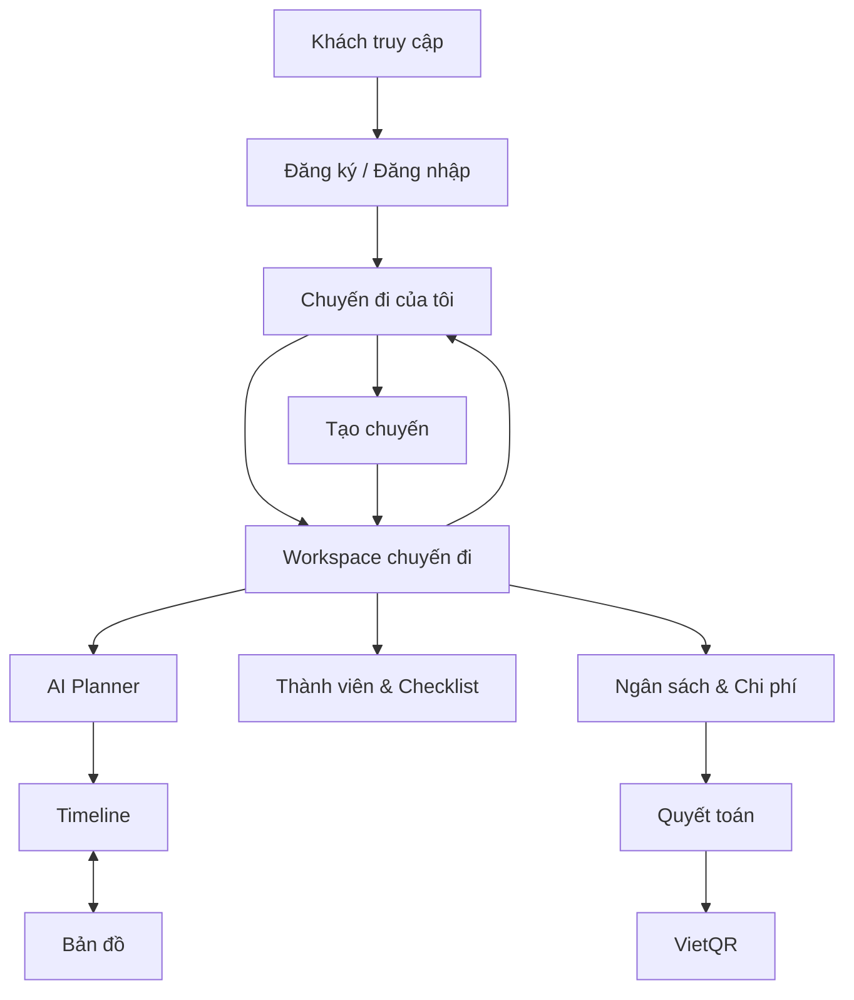
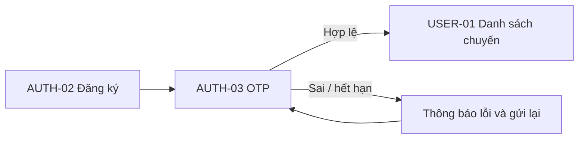
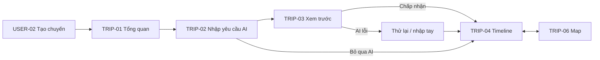

# TrekMate — Prototype Screen Specifications

> **Tài liệu:** Đặc tả màn hình, luồng tương tác và tiêu chí nghiệm thu UI/UX  
> **Sản phẩm:** TrekMate — Ứng dụng web lên kế hoạch du lịch thông minh  
> **Phiên bản:** 2.0 · **Trạng thái:** `DRAFT / READY FOR REVIEW`  
> **Cập nhật:** 21/11/2026  
> **Nền tảng đích:** Responsive Web (desktop, tablet, mobile browser)  
> **Người chịu trách nhiệm nội dung:** UI/UX owner (nhóm phân công)  
> **Người xác nhận:** Product Owner/đại diện nhóm, Frontend, QA  
> **Ngôn ngữ UI:** Tiếng Việt; tiền tệ hiển thị VND.

## 0. Mục đích, ranh giới và cách dùng

### 0.1. Tài liệu này chịu trách nhiệm về điều gì?

Tài liệu mô tả **người dùng nhìn thấy gì, làm gì, nhận phản hồi nào và di chuyển đi đâu** trên từng màn hình/bề mặt tương tác của TrekMate. Nó là đầu vào có thể kiểm tra được cho wireframe, Figma prototype, frontend implementation và UI acceptance testing.

**Bao gồm:** danh mục màn hình; cấu trúc điều hướng; các luồng người dùng; đặc tả trường nhập và hành vi; trạng thái bình thường/ngoại lệ; responsive; accessibility; tiêu chí nghiệm thu kiểm chứng được; các quyết định UI còn mở.

**Không bao gồm:** bảng mã màu/font/spacing; mã nguồn hoặc API chi tiết của component dùng chung; thiết kế cơ sở dữ liệu; endpoint/API schema; thuật toán tối ưu tuyến đường; giải pháp gửi OTP; chính sách ngân hàng; kế hoạch Sprint, nhân sự hoặc dự toán. Những phần đó có tài liệu/owner riêng. File này chỉ ghi **hợp đồng hành vi hiển thị** cần được các bên thống nhất.

Một `Screen ID` là **đơn vị mô tả và kiểm thử UX**, có thể là page, dialog, drawer, tab hoặc trạng thái giao diện; không đồng nghĩa với một route hay một trang code độc lập.

### 0.2. Nguyên tắc Agile áp dụng

- **Value first:** mỗi màn hình liên kết với một nhu cầu người dùng và một kết quả có thể chứng minh, không thiết kế vì đủ số lượng màn hình.
- **Just enough, just in time:** thông tin P0 phải đủ làm và kiểm thử; P1/P2 có thể tiếp tục refine trong backlog refinement.
- **Vertical slice:** ưu tiên hoàn chỉnh một hành trình có giá trị (ví dụ tạo chuyến → xem lịch trình), thay vì dựng toàn bộ màn hình rời rạc rồi mới nối chức năng.
- **Negotiable design:** giao diện, URL và cách sắp xếp là đề xuất tới khi được review; không giả định chưa xác nhận thành quyết định bắt buộc.
- **Testable:** mỗi màn hình có acceptance criteria (AC) quan sát được; các hành vi rủi ro có ví dụ Given/When/Then.
- **Incremental change:** thay đổi yêu cầu theo review được ghi nhận ngay tại mục Changelog và Open Decisions, không sửa ngầm.

**Lưu ý:** Agile không quy định một biểu mẫu `prototype-screens.md` bắt buộc. Tài liệu này tổ chức theo thực hành refinement, user story mapping và acceptance criteria để nhóm có thể điều chỉnh qua từng iteration.

### 0.3. Quy ước nhãn và trạng thái

| Ký hiệu | Ý nghĩa |
|---|---|
| `P0` | Cần có cho luồng MVP hoặc điều kiện an toàn để demo chức năng lõi |
| `P1` | Bổ sung giá trị, đưa vào Sprint sau khi P0 ổn định |
| `P2` | Có thể hoãn, không phải điều kiện hoàn thành MVP |
| `DRAFT` | Mới đặc tả, chưa được duyệt |
| `REVIEWED` | Đã review nội dung, còn có thể điều chỉnh |
| `APPROVED` | Đã thống nhất để triển khai/thiết kế chi tiết |
| `PROTOTYPED` | Đã có khung hình và luồng tương tác trên công cụ thiết kế |
| `IMPLEMENTED` | Đã có UI được lập trình và tích hợp cần thiết |
| `ACCEPTED` | Đã qua kiểm thử nghiệm thu theo AC |
| `OPEN-xx` | Vấn đề cần product/team ra quyết định; không tự xem là yêu cầu đã chốt |

**Trạng thái hiện tại của toàn bộ màn hình trong file:** `DRAFT`. Những hành vi có dấu `TBD` hoặc trỏ `OPEN-xx` là vấn đề chưa được chốt, **không được agent tự quyết định rồi trình bày như đã duyệt**.

### 0.4. Quy tắc sử dụng tài liệu khi làm việc

1. Chọn user story/hành trình giá trị cần làm trong Sprint.
2. Đọc các Screen IDs tham gia hành trình và AC tương ứng.
3. Chốt mọi `OPEN-xx` có thể ảnh hưởng đến UI, dữ liệu hoặc quyền truy cập.
4. Dựng wireframe, prototype click-through; review với đại diện sản phẩm.
5. Chỉ chuyển sang triển khai khi màn hình đạt Definition of Ready phù hợp.
6. Sau demo/review, sửa tài liệu ở đúng Screen ID, cập nhật lịch sử thay đổi và AC bị ảnh hưởng.

## 1. Phạm vi trải nghiệm và nhóm người dùng

### 1.1. Giá trị sản phẩm thể hiện trên giao diện

TrekMate hỗ trợ khách du lịch tự túc và nhóm bạn/gia đình chuẩn bị chuyến đi trong một không gian chung: tổ chức thông tin chuyến đi, tạo lịch trình gợi ý bằng AI và chỉnh sửa thủ công, quan sát địa điểm trên bản đồ, phân công công việc, kiểm soát chi phí thực tế và hỗ trợ quyết toán bằng thông tin chuyển khoản VietQR.

### 1.2. Nhóm người sử dụng

| Actor | Nhu cầu chính | Giới hạn nhìn thấy ở UI |
|---|---|---|
| Guest | Tìm hiểu ứng dụng, đăng ký/đăng nhập, mở lời mời | Không thấy dữ liệu riêng của chuyến đi chưa được cấp quyền |
| User | Quản lý hồ sơ và các chuyến đã tham gia | Chỉ truy cập các chuyến mà tài khoản có quyền |
| Trip Organizer | Khởi tạo chuyến, điều phối lịch trình, nhóm và ngân sách | Quyền quản lý chuyến được xác định bởi chính sách đã duyệt |
| Trip Member | Theo dõi lịch trình, nhận task, tham gia ghi chi phí, quyết toán | Không mặc nhiên có toàn quyền xóa chuyến/khóa tài khoản |
| System Admin | Quản trị trạng thái tài khoản hệ thống | Không được suy ra quyền xem dữ liệu du lịch cá nhân nếu nghiệp vụ không cho phép |

**Chưa chốt:** vai trò `editor/viewer` trong chuyến, ai được chỉnh sửa khoản chi, quyền mời thành viên và hành vi đối với thành viên đã rời chuyến. Các màn hình cần thể hiện trạng thái `read-only` hoặc `no-permission` cho đến khi chốt (xem `OPEN-01`).

### 1.3. Nguyên tắc UX đặc thù TrekMate

1. **Trip context rõ ràng:** trong mọi màn hình thuộc chuyến, người dùng luôn nhận ra mình đang thao tác ở chuyến nào.
2. **AI gợi ý, người dùng quyết định:** kết quả AI là dự thảo có thể xem, sửa và duyệt; tránh tự lưu thay người dùng.
3. **Map hỗ trợ timeline:** bản đồ và danh sách điểm đến phản ánh cùng một lịch trình đang chọn; không hứa hẹn tối ưu tuyệt đối nếu hệ thống chưa chứng minh được.
4. **Tách dự kiến với thực chi:** tiền AI gợi ý chưa phải chi phí phát sinh; tổng nhóm và phần mỗi người phải có nhãn rõ.
5. **Không ngộ nhận VietQR:** tạo QR không đồng nghĩa ngân hàng xác nhận chuyển tiền.
6. **Ngăn mất dữ liệu:** form đang chỉnh sửa có cảnh báo khi điều hướng; các hành động phá hủy cần xác nhận.
7. **Dùng được trên mobile web:** không bỏ tính năng thiết yếu chỉ vì màn hình nhỏ.
8. **Thành công/ lỗi có ngữ cảnh:** phản hồi phải nêu điều gì đã xảy ra và người dùng nên làm gì tiếp.

### 1.4. Ngoài phạm vi UI hiện tại

Đặt vé máy bay/khách sạn trực tiếp; giao dịch thanh toán tự động và đối soát ngân hàng; dự báo thời tiết trực tiếp; ứng dụng di động native; hệ thống mạng xã hội du lịch. Không thêm CTA dẫn đến các tính năng này trong MVP như thể đã sẵn sàng.

## 2. Story map và cách chia lát cắt để giao hàng tăng dần

### 2.1. Epic → kết quả trải nghiệm → user story tham chiếu

Các ID `US-*` dưới đây là **tham chiếu UX ngắn**, phục vụ traceability của màn hình. Độ ưu tiên, estimates, assignee và trạng thái triển khai chính thức được quản lý trong Product Backlog, không sao chép backlog đầy đủ vào đây.

| Epic | Mục tiêu người dùng | Story references | Luồng chứng minh giá trị |
|---|---|---|---|
| `E-AUTH` — Truy cập an toàn | Có tài khoản, đăng nhập và sử dụng đúng quyền | `US-AUTH-01…07`, `US-ADMIN-01`, `US-SYSTEM-01` | Đăng ký → xác thực → đăng nhập → dashboard |
| `E-TRIP` — Khởi tạo chuyến đi | Tạo và quản lý một chuyến du lịch | `US-TRIP-01…04` | Danh sách chuyến → tạo → workspace |
| `E-PLAN` — Lịch trình & bản đồ | Có lịch trình sửa được, thấy vị trí và tuyến đường | `US-PLAN-01…03` | AI hoặc nhập tay → timeline → map |
| `E-COLLAB` — Cộng tác nhóm | Chia sẻ chuyến và giao/nhận việc | `US-COLLAB-01…04` | Mời → tham gia → gán task → hoàn thành |
| `E-BUDGET` — Ngân sách & quyết toán | Biết còn bao nhiêu tiền và ai cần chuyển cho ai | `US-BUDGET-01…05` | Đặt hạn mức → ghi chi → kiểm tra → quyết toán → QR |

### 2.2. Delivery slices gợi ý cho MVP (không phải lịch Sprint đã cam kết)

| Slice | Giá trị có thể demo end-to-end | Màn hình then chốt | Phụ thuộc chính |
|---|---|---|---|
| `SLICE-A` | Người dùng đăng nhập, tạo và mở một chuyến | AUTH-01/02/03, USER-01/02, TRIP-01 | Auth và lưu chuyến |
| `SLICE-B` | Người dùng xây dựng được lịch trình và nhìn trên bản đồ | TRIP-02/03/04/05/06 | Nguồn AI, dữ liệu điểm đến, Maps |
| `SLICE-C` | Một nhóm cùng theo dõi chuyến và checklist | USER-03, TRIP-07/08/09/10 | Lời mời, quyền và đồng bộ |
| `SLICE-D` | Nhóm ghi chi phí, xem cảnh báo và quyết toán | BUD-01…06 | Chi phí, quy tắc chia tiền, thông tin người nhận |
| `SLICE-E` | Quản trị có thể khóa tài khoản theo quy trình | ADMIN-02/03, AUTH-05 | Quyền Admin, cập nhật trạng thái tài khoản |

**Chiến lược giảm rủi ro:** mọi slice đều cần tình huống lỗi tương ứng. Nếu tích hợp AI/Maps chưa sẵn sàng, có thể đánh giá prototype với **dữ liệu mô phỏng được gắn nhãn**; không đánh dấu chức năng tích hợp là hoàn thành khi mới có mock UI.

### 2.3. Definition of Ready của một Screen/Interaction

- [ ] Có actor, mục tiêu, ưu tiên và đường vào/ra rõ ràng.
- [ ] Có nội dung UI, thao tác chính, lỗi, rỗng/đang tải/không có quyền khi phù hợp.
- [ ] AC có thể kiểm thử với kết quả quan sát được; không chỉ ghi “giao diện đẹp”.
- [ ] Quyết định nghiệp vụ thiết yếu đã được chốt hoặc có phạm vi giả lập minh bạch.
- [ ] Có trạng thái desktop và mobile nếu bố cục thay đổi đáng kể.
- [ ] Có link frame/prototype hoặc được lên kế hoạch wireframe trong công việc Sprint tương ứng.

### 2.4. Definition of Done riêng cho Prototype UI/UX

- [ ] Có frame đúng Screen ID và trạng thái quan trọng; naming nhất quán.
- [ ] Các nhánh luồng chính và nhánh lỗi có thể được minh họa qua prototype.
- [ ] Nhãn, số tiền, thông điệp và phân quyền không mâu thuẫn giữa màn hình.
- [ ] Đã review sử dụng keyboard, độ tương phản, cỡ chữ và mobile layout.
- [ ] AC được rà soát và cập nhật theo thiết kế mới nhất.
- [ ] Người phụ trách sản phẩm xác nhận và lưu link thiết kế/biên bản review.

`DoD Prototype` **không đồng nghĩa** frontend đã được lập trình, tích hợp API hay QA đã kiểm thử trên môi trường chạy thật.

## 3. Information Architecture và điều hướng

### 3.1. Sơ đồ luồng truy cập chính



### 3.2. Quy tắc điều hướng chung

- **Ngoài chuyến:** logo TrekMate, danh sách chuyến, hồ sơ/đăng xuất.
- **Trong chuyến:** luôn hiển thị tên chuyến, đường quay về danh sách, các mục `Tổng quan · Lịch trình · Bản đồ · Công việc · Thành viên · Ngân sách · Chi phí · Quyết toán` theo quyền.
- **Desktop:** điều hướng bên trái hoặc top navigation, vùng nội dung chính; trang timeline-map có thể chia hai vùng.
- **Mobile:** thanh đầu trang và menu có thể mở; các tab dài chuyển thành danh sách/selector, không nhét tất cả lên cùng một hàng.
- **Deep link:** chưa xác thực → đăng nhập rồi trở lại nội dung nếu còn quyền; đã hết quyền → trạng thái từ chối rõ ràng.
- **Thoát form đang sửa:** hỏi xác nhận nếu có dữ liệu chưa lưu; không dùng hộp thoại cho mọi thao tác vô hại.
- **Browser Back/Forward:** khôi phục route hợp lệ; drawer có nút Đóng và hỗ trợ `Esc` trên desktop.

### 3.3. Bảng màn hình được quản lý

| Screen ID | Tên | Mức | Loại UI | Story | Đường vào / vị trí dự kiến |
|---|---|---|---|---|---|
| `PUB-01` | Trang giới thiệu | P2 | page | `US-TRIP-04` | `/` |
| `AUTH-01` | Đăng nhập | P0 | page | `US-AUTH-01` | `/auth/login` |
| `AUTH-02` | Đăng ký tài khoản | P0 | page | `US-AUTH-02` | `/auth/register` |
| `AUTH-03` | Xác minh email bằng OTP | P0 | page | `US-AUTH-03` | `/auth/verify-email` |
| `AUTH-04` | Khôi phục mật khẩu | P1 | page | `US-AUTH-04` | `/auth/forgot-password` |
| `AUTH-05` | Tài khoản bị khóa hoặc phiên không hợp lệ | P0 | state/page | `US-AUTH-05` | `/auth/account-status` |
| `USER-01` | Danh sách chuyến đi của tôi | P0 | page | `US-TRIP-01` | `/app/trips` |
| `USER-02` | Tạo chuyến đi mới | P0 | page | `US-TRIP-02` | `/app/trips/new` |
| `USER-03` | Chấp nhận lời mời tham gia chuyến | P0 | page | `US-COLLAB-01` | `/invite/:token` |
| `USER-04` | Hồ sơ cá nhân | P1 | page | `US-AUTH-06` | `/app/profile` |
| `USER-05` | Sở thích du lịch | P1 | page | `US-AUTH-07` | `/app/preferences` |
| `TRIP-01` | Tổng quan không gian chuyến đi | P0 | page | `US-TRIP-03` | `/app/trips/:tripId` |
| `TRIP-02` | Nhập yêu cầu tạo lịch trình AI | P0 | page/wizard | `US-PLAN-01` | `/app/trips/:tripId/ai` |
| `TRIP-03` | Đang tạo và xem trước kết quả AI | P0 | state/page | `US-PLAN-01` | `within TRIP-02` |
| `TRIP-04` | Lịch trình theo ngày (Timeline) | P0 | page | `US-PLAN-02` | `/app/trips/:tripId/itinerary` |
| `TRIP-05` | Thêm hoặc chỉnh sửa hoạt động | P0 | dialog/drawer | `US-PLAN-02` | `inside TRIP-04` |
| `TRIP-06` | Bản đồ điểm đến và tuyến di chuyển | P0 | page/panel | `US-PLAN-03` | `/app/trips/:tripId/map` |
| `TRIP-07` | Tạo và chia sẻ lời mời | P0 | dialog | `US-COLLAB-01` | `inside TRIP-01 or TRIP-08` |
| `TRIP-08` | Danh sách thành viên chuyến | P1 | page | `US-COLLAB-02` | `/app/trips/:tripId/members` |
| `TRIP-09` | Checklist và tiến độ công việc nhóm | P0 | page | `US-COLLAB-03` | `/app/trips/:tripId/tasks` |
| `TRIP-10` | Tạo và chi tiết công việc | P0 | dialog/drawer | `US-COLLAB-04` | `inside TRIP-09` |
| `BUD-01` | Thiết lập hạn mức ngân sách | P0 | page | `US-BUDGET-01` | `/app/trips/:tripId/budget/setup` |
| `BUD-02` | Tổng quan ngân sách | P0 | page | `US-BUDGET-02` | `/app/trips/:tripId/budget` |
| `BUD-03` | Danh sách khoản chi thực tế | P0 | page | `US-BUDGET-03` | `/app/trips/:tripId/expenses` |
| `BUD-04` | Thêm và sửa khoản chi | P0 | dialog/page | `US-BUDGET-03` | `inside BUD-03` |
| `BUD-05` | Xem trước quyết toán nhóm | P0 | page | `US-BUDGET-04` | `/app/trips/:tripId/settlement` |
| `BUD-06` | VietQR và thông tin chuyển khoản | P0 | page/panel | `US-BUDGET-05` | `/app/trips/:tripId/settlement/:id/qr` |
| `ADMIN-01` | Tổng quan quản trị | P1 | page | `US-ADMIN-01` | `/admin` |
| `ADMIN-02` | Danh sách và quản lý tài khoản | P0 | page | `US-ADMIN-01` | `/admin/users` |
| `ADMIN-03` | Xác nhận khóa hoặc mở khóa | P0 | dialog | `US-ADMIN-01` | `inside ADMIN-02` |
| `ADMIN-04` | Lịch sử thao tác quản trị | P1 | page | `US-ADMIN-01` | `/admin/audit` |
| `SYS-01` | Trạng thái hệ thống và lỗi chung | P0 | state | `US-SYSTEM-01` | `global` |
### 3.4. Những bề mặt có thể gộp khi triển khai

- `TRIP-03` là trạng thái của `TRIP-02`, không bắt buộc làm route mới.
- `TRIP-05`, `TRIP-07`, `TRIP-10`, `BUD-04`, `ADMIN-03` ưu tiên là dialog/drawer thuộc trang cha. `TRIP-07` có thể mở từ tổng quan chuyến (P0), không phụ thuộc trang thành viên mở rộng (P1).
- `AUTH-05` và `SYS-01` là trạng thái chuyển hướng/lỗi, không tính như một sản phẩm độc lập.
- Một luồng được xem là hoàn thành khi **tương tác xuyên màn hình chạy đúng**, không phải khi tất cả Screen IDs có mockup tách riêng.

## 4. Quy tắc hành vi UI chung (áp dụng cho mọi Screen ID)

### 4.1. Trạng thái và phản hồi

| State | Ý nghĩa | Bắt buộc thể hiện |
|---|---|---|
| Default | Có dữ liệu và có thể tương tác | Tiêu đề, thao tác chính, dữ liệu hiện tại |
| Loading | Đang tải/gửi yêu cầu | Chỉ báo chờ có nhãn; ngăn double-submit với lệnh ghi |
| Empty | Chưa có dữ liệu | Giải thích lý do và CTA phù hợp, không hiển thị lỗi giả |
| Validation error | Dữ liệu người dùng chưa hợp lệ | Lỗi cạnh trường + hướng sửa; giữ dữ liệu đã nhập |
| Request error | Không lưu/tải được | Thông báo xác thực, retry nếu an toàn; không tuyên bố đã lưu |
| Success | Hành động đã được hệ thống xác nhận | Phản hồi và cập nhật dữ liệu trên UI |
| Unauthorized/Forbidden | Không có phiên/không có quyền | Đăng nhập lại hoặc 403; không rò dữ liệu |
| Offline/Degraded | Mất mạng/dịch vụ phụ gián đoạn | Nói tính năng nào bị ảnh hưởng; cung cấp phương án thay thế nếu có |
| Conflict/Stale | Dữ liệu thay đổi trong khi đang xem | Cảnh báo, refresh hoặc đối chiếu trước khi ghi đè |

**Không bắt buộc** mỗi màn hình phải có mọi trạng thái. Chỉ các trạng thái có ý nghĩa với bề mặt đó mới cần tạo frame và test, tránh phình tài liệu.

### 4.2. Quy tắc form, validation và nội dung

- Trường bắt buộc có nhãn rõ; không dùng placeholder thay label.
- Ngày kết thúc phải không trước ngày bắt đầu; ngày/giờ hiển thị có bối cảnh và thống nhất múi giờ của chuyến.
- Tiền VND hiển thị có phân tách hàng nghìn và đơn vị `₫`; phân biệt `dự kiến`, `đã chi`, `còn lại`, `cần chuyển`.
- Nhập liệu sai phải giữ giá trị để sửa; nếu không biết lỗi backend thì không gán sai nguyên nhân cụ thể.
- Dialog nguy hiểm nêu rõ đối tượng và hậu quả; hành động ghi dữ liệu có loading/disabled để chống submit trùng.
- UI không được khẳng định AI đã kiểm chứng địa điểm/giá hay VietQR đã xác minh giao dịch khi chưa có xác nhận tương ứng.

### 4.3. Responsive và khả năng tiếp cận

| Bối cảnh | Cách hiển thị mong đợi |
|---|---|
| Desktop khoảng ≥1024px | Nhiều cột khi có lợi (timeline cạnh map, bảng chi phí) |
| Tablet khoảng 640–1023px | Bố cục thu gọn; sidebar thành menu; các bảng tránh tràn màn hình |
| Mobile khoảng 320–639px | Một cột; drawer/sheet dễ thao tác; timeline-map chuyển giữa tab hoặc chế độ xem |

Breakpoint chính thức do quy tắc layout của dự án quyết định; các dải trên là **điểm kiểm thử hành vi**, không phải định nghĩa CSS token.

- Điều hướng với bàn phím: Tab/Shift+Tab, Enter/Space, Escape cho dialog, thứ tự focus hợp lý.
- Mọi input có nhãn; lỗi được công bố qua text; thao tác không chỉ phân biệt bằng màu.
- Biểu đồ có số liệu/bảng tương đương; bản đồ có danh sách địa điểm dạng chữ.
- Dùng được ở mức zoom 200%; hỗ trợ người dùng bật giảm chuyển động.
- Thông tin nhạy cảm (token mời, thông tin tài khoản, email) hiển thị và chia sẻ theo đúng quyền.

### 4.4. Quy ước bản mẫu để dựng prototype

- Tên frame: `<ScreenID> / <Desktop|Mobile> / <State>`; ví dụ `TRIP-04 / Mobile / Empty`.
- Với page: ưu tiên `Default`, `Empty/Error` khi có ý nghĩa, và `Mobile`.
- Với dialog: cần `Closed → Open → Validation → Submitting → Success/Failure` ở các nhánh trọng yếu.
- Link tương tác trong prototype phải nối tới Screen IDs tương ứng; không làm nút giả bấm mà không phản hồi.
- Mọi hình/địa điểm/chi phí demo chỉ là dữ liệu minh họa, không được mô tả như thông tin thời gian thực.

## 5. Đặc tả từng màn hình

Cách đọc: `User story` nêu giá trị người dùng; `Thành phần` nêu nội dung UI; `Hành động` nêu tuyến chuyển; `States` nêu nhánh ngoại lệ; `AC` là điều kiện kiểm thử. Các route chỉ là gợi ý điều hướng để prototype liên kết được với nhau, không phải quyết định định tuyến backend.

### 5.1. Public & Authentication

#### PUB-01 — Trang giới thiệu

| Trường | Nội dung |
|---|---|
| Ưu tiên / tình trạng | `P2` / `DRAFT` |
| Loại bề mặt / vị trí | `page` · `/` |
| Actor | Guest |
| User Story | `US-TRIP-04` — Là **Guest**, tôi muốn **xem nhanh ứng dụng hỗ trợ những gì**, để **quyết định có nên bắt đầu sử dụng**. |
| Điểm vào / rời | Theo hành động và điều hướng mô tả bên dưới |

**Bố cục và nội dung hiển thị.** Giới thiệu ngắn ba khả năng: lên lịch trình, cộng tác, quản lý chi phí; một CTA bắt đầu.

**Quy tắc nhập liệu / hiển thị.** Không có biểu mẫu bắt buộc.

**Hành động và điều hướng.** Bắt đầu → AUTH-02 hoặc USER-01 khi đã có phiên; Đăng nhập → AUTH-01.

**Trạng thái cần đưa vào prototype.** Ảnh không tải được → giữ nội dung chữ; không dùng dữ liệu/đánh giá giả như kết quả thực.

**Ứng xử trên mobile.** Hero và tính năng xếp một cột trên mobile; không có nội dung tràn.

**Acceptance criteria:**

- `PUB-01-AC01` — Người chưa đăng nhập chọn Bắt đầu được đưa đến đăng ký.
- `PUB-01-AC02` — Người đã đăng nhập không bị yêu cầu tạo tài khoản mới.
- `PUB-01-AC03` — Các tính năng ngoài phạm vi không xuất hiện như khả năng đang hoạt động.

#### AUTH-01 — Đăng nhập

| Trường | Nội dung |
|---|---|
| Ưu tiên / tình trạng | `P0` / `DRAFT` |
| Loại bề mặt / vị trí | `page` · `/auth/login` |
| Actor | Guest |
| User Story | `US-AUTH-01` — Là **Guest**, tôi muốn **đăng nhập bằng tài khoản của mình**, để **truy cập an toàn các chuyến đi được phép xem**. |
| Điểm vào / rời | Theo hành động và điều hướng mô tả bên dưới |

**Bố cục và nội dung hiển thị.** Logo, tiêu đề, email, mật khẩu, hiển thị mật khẩu, link đăng ký và quên mật khẩu.

**Quy tắc nhập liệu / hiển thị.** Email hợp lệ; mật khẩu không rỗng; không hiển thị mật khẩu khi tải.

**Hành động và điều hướng.** Đăng nhập → USER-01 hoặc đường dẫn nội bộ đã được cấp quyền; Đăng ký → AUTH-02.

**Trạng thái cần đưa vào prototype.** Đang gửi: khóa submit kép; sai thông tin: thông báo chung; offline: cho thử lại; bị khóa: AUTH-05.

**Ứng xử trên mobile.** Form một cột; nhãn trường hiển thị đầy đủ khi bàn phím mở.

**Acceptance criteria:**

- `AUTH-01-AC01` — Với email sai định dạng, UI báo lỗi tại trường và không gửi yêu cầu.
- `AUTH-01-AC02` — Khi đang đăng nhập, nhấn lặp không sinh nhiều yêu cầu.
- `AUTH-01-AC03` — Với tài khoản bị khóa, không được chuyển vào workspace.

#### AUTH-02 — Đăng ký tài khoản

| Trường | Nội dung |
|---|---|
| Ưu tiên / tình trạng | `P0` / `DRAFT` |
| Loại bề mặt / vị trí | `page` · `/auth/register` |
| Actor | Guest |
| User Story | `US-AUTH-02` — Là **Guest**, tôi muốn **tạo tài khoản mới**, để **lưu và tham gia các chuyến du lịch**. |
| Điểm vào / rời | Theo hành động và điều hướng mô tả bên dưới |

**Bố cục và nội dung hiển thị.** Form thông tin cơ bản, liên kết điều khoản nếu có, chỉ dẫn bước xác minh email.

**Quy tắc nhập liệu / hiển thị.** Tên hiển thị, email, mật khẩu và xác nhận; yêu cầu mật khẩu theo chính sách xác thực được duyệt.

**Hành động và điều hướng.** Đăng ký → AUTH-03 khi hệ thống yêu cầu OTP; chuyển đăng nhập nếu đã có tài khoản.

**Trạng thái cần đưa vào prototype.** Email đã tồn tại/yếu/mạng lỗi: thông báo phù hợp; không tuyên bố gửi OTP khi chưa gửi thành công.

**Ứng xử trên mobile.** Nội dung xếp một cột, tránh lỗi khi bàn phím phủ nút submit.

**Acceptance criteria:**

- `AUTH-02-AC01` — Mật khẩu và xác nhận không khớp phải được báo ở giao diện.
- `AUTH-02-AC02` — Không có quyền tạo vai trò Admin qua form công khai.
- `AUTH-02-AC03` — Chỉ chuyển sang xác minh khi việc tạo tài khoản thực sự được chấp nhận.

**Cần chốt trước khi implement:** `OPEN-02`.

#### AUTH-03 — Xác minh email bằng OTP

| Trường | Nội dung |
|---|---|
| Ưu tiên / tình trạng | `P0` / `DRAFT` |
| Loại bề mặt / vị trí | `page` · `/auth/verify-email` |
| Actor | Pending User |
| User Story | `US-AUTH-03` — Là **Pending User**, tôi muốn **xác minh email bằng mã được gửi**, để **hoàn thành đăng ký tài khoản**. |
| Điểm vào / rời | Theo hành động và điều hướng mô tả bên dưới |

**Bố cục và nội dung hiển thị.** Email đang xác minh (che một phần), trường OTP, nút xác thực, gửi lại, quay lại.

**Quy tắc nhập liệu / hiển thị.** Mã OTP theo định dạng hệ thống xác thực trả về; không ghi rõ độ dài/thời hạn khi chưa chốt.

**Hành động và điều hướng.** Xác nhận → USER-01 khi hợp lệ; Gửi lại OTP; Quay lại đăng ký.

**Trạng thái cần đưa vào prototype.** Sai/hết hạn/quá số lần: nói rõ bước tiếp; không cho gửi lại liên tục; mạng lỗi giữ email.

**Ứng xử trên mobile.** Input OTP có nhãn và paste hỗ trợ; vùng bấm dễ thao tác trên điện thoại.

**Acceptance criteria:**

- `AUTH-03-AC01` — OTP sai không tạo trạng thái đã xác thực.
- `AUTH-03-AC02` — OTP thành công chỉ hoàn tất khi phản hồi xác thực hợp lệ.
- `AUTH-03-AC03` — Nút gửi lại thể hiện giới hạn thời gian nếu hệ thống áp dụng.

**Cần chốt trước khi implement:** `OPEN-02`.

#### AUTH-04 — Khôi phục mật khẩu

| Trường | Nội dung |
|---|---|
| Ưu tiên / tình trạng | `P1` / `DRAFT` |
| Loại bề mặt / vị trí | `page` · `/auth/forgot-password` |
| Actor | Guest |
| User Story | `US-AUTH-04` — Là **Guest**, tôi muốn **yêu cầu đặt lại mật khẩu**, để **khôi phục khả năng truy cập tài khoản**. |
| Điểm vào / rời | Theo hành động và điều hướng mô tả bên dưới |

**Bố cục và nội dung hiển thị.** Trường email, mô tả bước tiếp theo, trạng thái đã gửi hướng dẫn.

**Quy tắc nhập liệu / hiển thị.** Email hợp lệ; không hiện dữ liệu tài khoản hay mã nhạy cảm.

**Hành động và điều hướng.** Gửi hướng dẫn → xác nhận; trở về đăng nhập.

**Trạng thái cần đưa vào prototype.** Mạng lỗi/thao tác quá nhanh: thử lại; copy không tiết lộ sự tồn tại của tài khoản.

**Ứng xử trên mobile.** Gọn một cột; link quay lại nổi bật.

**Acceptance criteria:**

- `AUTH-04-AC01` — Khi email sai định dạng, người dùng nhận phản hồi tại trường.
- `AUTH-04-AC02` — Khi gửi thành công, có thông báo thao tác tiếp theo.
- `AUTH-04-AC03` — Thông báo không xác nhận công khai email đã có tài khoản hay chưa.

**Cần chốt trước khi implement:** `OPEN-02`.

#### AUTH-05 — Tài khoản bị khóa hoặc phiên không hợp lệ

| Trường | Nội dung |
|---|---|
| Ưu tiên / tình trạng | `P0` / `DRAFT` |
| Loại bề mặt / vị trí | `state/page` · `/auth/account-status` |
| Actor | User |
| User Story | `US-AUTH-05` — Là **User**, tôi muốn **biết lý do quyền truy cập bị gián đoạn**, để **chọn được cách xử lý tiếp theo**. |
| Điểm vào / rời | Theo hành động và điều hướng mô tả bên dưới |

**Bố cục và nội dung hiển thị.** Thông điệp theo trạng thái: đã khóa / hết phiên / cần đăng nhập lại; CTA phù hợp.

**Quy tắc nhập liệu / hiển thị.** Không hiển thị thông tin nhạy cảm hoặc nguyên nhân nội bộ.

**Hành động và điều hướng.** Đăng nhập lại nếu hết phiên; liên hệ hỗ trợ nếu bị khóa.

**Trạng thái cần đưa vào prototype.** Không có internet: phân biệt với khóa tài khoản; không tự động đăng nhập lại khi bị khóa.

**Ứng xử trên mobile.** Thông điệp đầy đủ và CTA rõ ràng trên mobile.

**Acceptance criteria:**

- `AUTH-05-AC01` — Tài khoản bị khóa không thấy dữ liệu riêng của workspace.
- `AUTH-05-AC02` — Phiên hết hạn có lối quay lại màn hình đăng nhập.
- `AUTH-05-AC03` — Giao diện không gộp lỗi mạng thành thông báo tài khoản bị khóa.

### 5.2. Dashboard & hồ sơ

#### USER-01 — Danh sách chuyến đi của tôi

| Trường | Nội dung |
|---|---|
| Ưu tiên / tình trạng | `P0` / `DRAFT` |
| Loại bề mặt / vị trí | `page` · `/app/trips` |
| Actor | User |
| User Story | `US-TRIP-01` — Là **User**, tôi muốn **xem các chuyến của tôi tại một nơi**, để **mở đúng chuyến hoặc tạo chuyến mới**. |
| Điểm vào / rời | Theo hành động và điều hướng mô tả bên dưới |

**Bố cục và nội dung hiển thị.** Header, nút tạo chuyến, card danh sách/chia theo sắp diễn ra/đã qua; mỗi card có tên, thời gian, vai trò.

**Quy tắc nhập liệu / hiển thị.** Tìm kiếm đơn giản nếu được ưu tiên; không cần lọc nâng cao ở P0.

**Hành động và điều hướng.** Tạo chuyến → USER-02; chọn card → TRIP-01; hồ sơ → USER-04.

**Trạng thái cần đưa vào prototype.** Chưa có chuyến: empty state và CTA; danh sách lỗi: retry; danh sách tải: skeleton.

**Ứng xử trên mobile.** Card chuyển một cột; CTA tạo mới không bị che.

**Acceptance criteria:**

- `USER-01-AC01` — Người không có chuyến nhìn thấy lời mời tạo chuyến đầu tiên.
- `USER-01-AC02` — Chỉ hiển thị các chuyến được phép xem.
- `USER-01-AC03` — Chọn một card mở đúng workspace tương ứng.

#### USER-02 — Tạo chuyến đi mới

| Trường | Nội dung |
|---|---|
| Ưu tiên / tình trạng | `P0` / `DRAFT` |
| Loại bề mặt / vị trí | `page` · `/app/trips/new` |
| Actor | User |
| User Story | `US-TRIP-02` — Là **User**, tôi muốn **tạo chuyến đi với thông tin cơ bản**, để **bắt đầu lập kế hoạch cùng các thành viên**. |
| Điểm vào / rời | Theo hành động và điều hướng mô tả bên dưới |

**Bố cục và nội dung hiển thị.** Tên chuyến, điểm đến, ngày đi/ngày về, số lượng dự kiến; nhãn thông tin có thể chỉnh sau.

**Quy tắc nhập liệu / hiển thị.** Tên chuyến bắt buộc; ngày về không trước ngày đi; số người là số nguyên dương.

**Hành động và điều hướng.** Tạo → TRIP-01; Hủy → USER-01; nếu dữ liệu đang sửa phải xác nhận thoát.

**Trạng thái cần đưa vào prototype.** Thiếu dữ liệu: inline error; tạo thất bại: giữ dữ liệu; lưu thành công: không tạo trùng.

**Ứng xử trên mobile.** Form chia nhóm hợp lý ở desktop, một cột mobile.

**Acceptance criteria:**

- `USER-02-AC01` — Ngày về sớm hơn ngày đi không thể tạo chuyến.
- `USER-02-AC02` — Khi lưu thất bại, dữ liệu đã nhập không bị xóa.
- `USER-02-AC03` — Lưu thành công mở đúng chuyến vừa tạo.

**Cần chốt trước khi implement:** `OPEN-03`.

#### USER-03 — Chấp nhận lời mời tham gia chuyến

| Trường | Nội dung |
|---|---|
| Ưu tiên / tình trạng | `P0` / `DRAFT` |
| Loại bề mặt / vị trí | `page` · `/invite/:token` |
| Actor | Guest/User |
| User Story | `US-COLLAB-01` — Là **Guest/User**, tôi muốn **xem và chấp nhận lời mời**, để **tham gia đúng chuyến đi được chia sẻ**. |
| Điểm vào / rời | Theo hành động và điều hướng mô tả bên dưới |

**Bố cục và nội dung hiển thị.** Tên chuyến, người mời, khoảng thời gian, nút Tham gia hoặc Đăng nhập để tiếp tục.

**Quy tắc nhập liệu / hiển thị.** Token lời mời xử lý an toàn; không hiển thị token trực tiếp trên UI.

**Hành động và điều hướng.** Tham gia → TRIP-01 khi được chấp nhận; cần đăng nhập → AUTH-01 rồi quay lại.

**Trạng thái cần đưa vào prototype.** Hết hạn/thu hồi/đã tham gia/không có quyền: thông điệp riêng, không đưa vào chuyến trái phép.

**Ứng xử trên mobile.** Nội dung chính và CTA xếp một cột.

**Acceptance criteria:**

- `USER-03-AC01` — Link hết hạn không cho gia nhập chuyến.
- `USER-03-AC02` — Sau đăng nhập, người dùng trở lại ý định tham gia hợp lệ.
- `USER-03-AC03` — Đã là thành viên được đưa vào chuyến mà không tạo bản ghi trùng.

**Cần chốt trước khi implement:** `OPEN-04`.

#### USER-04 — Hồ sơ cá nhân

| Trường | Nội dung |
|---|---|
| Ưu tiên / tình trạng | `P1` / `DRAFT` |
| Loại bề mặt / vị trí | `page` · `/app/profile` |
| Actor | User |
| User Story | `US-AUTH-06` — Là **User**, tôi muốn **chỉnh sửa thông tin hồ sơ**, để **giữ thông tin liên hệ và nhận diện chính xác**. |
| Điểm vào / rời | Theo hành động và điều hướng mô tả bên dưới |

**Bố cục và nội dung hiển thị.** Ảnh đại diện, tên, email, số điện thoại nếu được thu thập, nút lưu và quay lại.

**Quy tắc nhập liệu / hiển thị.** Tên không để trống; email gắn cơ chế xác thực riêng; các trường khác theo quy định sản phẩm.

**Hành động và điều hướng.** Lưu thay đổi; điều hướng đến sở thích.

**Trạng thái cần đưa vào prototype.** Lỗi upload ảnh/lưu: giữ dữ liệu; phiên không còn hợp lệ: yêu cầu đăng nhập lại.

**Ứng xử trên mobile.** Form rõ nhãn; ảnh đại diện có fallback.

**Acceptance criteria:**

- `USER-04-AC01` — Lưu thành công hiển thị thông tin mới.
- `USER-04-AC02` — Nếu lưu lỗi, form không mất nội dung.
- `USER-04-AC03` — Không cho thay email bằng cách thay text hiển thị mà bỏ qua xác thực.

**Cần chốt trước khi implement:** `OPEN-05`.

#### USER-05 — Sở thích du lịch

| Trường | Nội dung |
|---|---|
| Ưu tiên / tình trạng | `P1` / `DRAFT` |
| Loại bề mặt / vị trí | `page` · `/app/preferences` |
| Actor | User |
| User Story | `US-AUTH-07` — Là **User**, tôi muốn **lưu những sở thích du lịch của mình**, để **nhận được gợi ý phù hợp hơn trong tương lai**. |
| Điểm vào / rời | Theo hành động và điều hướng mô tả bên dưới |

**Bố cục và nội dung hiển thị.** Nhóm lựa chọn sở thích và nhịp độ, cách dùng dữ liệu cá nhân hóa.

**Quy tắc nhập liệu / hiển thị.** Sở thích có thể bỏ chọn; không bắt buộc để tạo chuyến.

**Hành động và điều hướng.** Lưu sở thích; bỏ qua; quay về dashboard.

**Trạng thái cần đưa vào prototype.** Lưu thất bại: không báo đã áp dụng; rỗng: hiện gợi ý tùy chọn.

**Ứng xử trên mobile.** Các lựa chọn dễ chạm, nhiều dòng không bị cắt.

**Acceptance criteria:**

- `USER-05-AC01` — Người dùng có thể bỏ qua mà không bị chặn lập chuyến.
- `USER-05-AC02` — Khi lưu thành công, lần quay lại phản ánh lựa chọn đã lưu.
- `USER-05-AC03` — Không hiển thị sở thích của người dùng khác.

**Cần chốt trước khi implement:** `OPEN-05`.

### 5.3. Lịch trình AI, bản đồ và cộng tác

#### TRIP-01 — Tổng quan không gian chuyến đi

| Trường | Nội dung |
|---|---|
| Ưu tiên / tình trạng | `P0` / `DRAFT` |
| Loại bề mặt / vị trí | `page` · `/app/trips/:tripId` |
| Actor | Trip Member |
| User Story | `US-TRIP-03` — Là **Trip Member**, tôi muốn **xem tổng quan của một chuyến**, để **định hướng công việc tiếp theo trong nhóm**. |
| Điểm vào / rời | Theo hành động và điều hướng mô tả bên dưới |

**Bố cục và nội dung hiển thị.** Tên, ngày, thành viên, trạng thái lịch trình, task còn lại, ngân sách tổng quan; nav rõ ràng.

**Quy tắc nhập liệu / hiển thị.** Dữ liệu tóm tắt phải gắn đúng chuyến.

**Hành động và điều hướng.** Mở AI Planner/Timeline/Maps/Tasks/Budget/Members.

**Trạng thái cần đưa vào prototype.** Thiếu dữ liệu: CTA hoàn thiện chuyến; loading/error theo từng vùng; thiếu quyền: no-permission.

**Ứng xử trên mobile.** Các khối xếp dọc, điều hướng dễ chạm trên mobile.

**Acceptance criteria:**

- `TRIP-01-AC01` — Trang hiển thị đúng tên và thời gian của chuyến được mở.
- `TRIP-01-AC02` — Người dùng truy cập chức năng thông qua điều hướng rõ ràng.
- `TRIP-01-AC03` — Người không thuộc chuyến không đọc được dữ liệu riêng.

#### TRIP-02 — Nhập yêu cầu tạo lịch trình AI

| Trường | Nội dung |
|---|---|
| Ưu tiên / tình trạng | `P0` / `DRAFT` |
| Loại bề mặt / vị trí | `page/wizard` · `/app/trips/:tripId/ai` |
| Actor | Trip Organizer |
| User Story | `US-PLAN-01` — Là **Trip Organizer**, tôi muốn **cung cấp thông tin cho công cụ tạo lịch trình**, để **nhận được gợi ý gần với nhu cầu của tôi**. |
| Điểm vào / rời | Theo hành động và điều hướng mô tả bên dưới |

**Bố cục và nội dung hiển thị.** Điểm đến, ngày, số người, ngân sách tham khảo, sở thích, nhịp độ; nhắc “Đề xuất có thể cần xác minh”.

**Quy tắc nhập liệu / hiển thị.** Những thông tin đã có từ chuyến được điền sẵn và cho sửa nếu quyền cho phép; ngân sách nhập theo ngữ cảnh đã chốt.

**Hành động và điều hướng.** Tạo gợi ý → TRIP-03; chỉnh lại dữ liệu; Hủy về TRIP-01.

**Trạng thái cần đưa vào prototype.** Thiếu thông tin: chỉ rõ trường; giới hạn API/mạng lỗi: có thông báo và lựa chọn tạo thủ công.

**Ứng xử trên mobile.** Wizard phân bước hợp lý trên mobile; không bắt cuộn ngang.

**Acceptance criteria:**

- `TRIP-02-AC01` — Trường bắt buộc thiếu được báo trước khi gửi AI.
- `TRIP-02-AC02` — Bấm tạo nhiều lần không sinh yêu cầu song song không cần thiết.
- `TRIP-02-AC03` — Người dùng luôn có cách bỏ AI và tự xây dựng lịch trình.

**Cần chốt trước khi implement:** `OPEN-06`.

#### TRIP-03 — Đang tạo và xem trước kết quả AI

| Trường | Nội dung |
|---|---|
| Ưu tiên / tình trạng | `P0` / `DRAFT` |
| Loại bề mặt / vị trí | `state/page` · `within TRIP-02` |
| Actor | Trip Organizer |
| User Story | `US-PLAN-01` — Là **Trip Organizer**, tôi muốn **xem trước gợi ý AI và quyết định có sử dụng không**, để **không phải chấp nhận kết quả chưa kiểm tra**. |
| Điểm vào / rời | Theo hành động và điều hướng mô tả bên dưới |

**Bố cục và nội dung hiển thị.** Trạng thái đang tạo; preview theo ngày; ghi rõ “Gợi ý AI”; cảnh báo dữ liệu thiếu/địa điểm chưa xác minh.

**Quy tắc nhập liệu / hiển thị.** Kết quả phải có cấu trúc ngày/hoạt động tối thiểu để render; lỗi dữ liệu không hiển thị như lịch trình hợp lệ.

**Hành động và điều hướng.** Áp dụng → TRIP-04; chỉnh yêu cầu → TRIP-02; nhập tay → TRIP-04.

**Trạng thái cần đưa vào prototype.** Timeout/quota/dữ liệu lỗi: retry hoặc nhập tay; không hiển thị thanh tiến độ giả phần trăm.

**Ứng xử trên mobile.** Ngày và hoạt động dạng thẻ cuộn dọc; CTA Áp dụng rõ ràng.

**Acceptance criteria:**

- `TRIP-03-AC01` — Khi AI chưa trả kết quả hợp lệ, nút Áp dụng bị vô hiệu.
- `TRIP-03-AC02` — Người dùng xem trước được từng ngày trước khi lưu.
- `TRIP-03-AC03` — Thất bại có ít nhất một đường tiếp tục không phụ thuộc AI.

**Cần chốt trước khi implement:** `OPEN-06`.

#### TRIP-04 — Lịch trình theo ngày (Timeline)

| Trường | Nội dung |
|---|---|
| Ưu tiên / tình trạng | `P0` / `DRAFT` |
| Loại bề mặt / vị trí | `page` · `/app/trips/:tripId/itinerary` |
| Actor | Trip Member |
| User Story | `US-PLAN-02` — Là **Trip Member**, tôi muốn **xem lịch trình theo từng ngày**, để **biết các hoạt động và điều chỉnh khi cần**. |
| Điểm vào / rời | Theo hành động và điều hướng mô tả bên dưới |

**Bố cục và nội dung hiển thị.** Tab ngày, hoạt động theo thứ tự, giờ dự kiến, địa điểm, chi phí ước tính nếu có, nhãn đã xác minh/chưa xác minh.

**Quy tắc nhập liệu / hiển thị.** Thời gian có ngữ cảnh ngày và múi giờ; địa điểm có thể chưa có tọa độ.

**Hành động và điều hướng.** Thêm/sửa → TRIP-05; chọn địa điểm → TRIP-06; đổi ngày; kéo-thả nếu hỗ trợ.

**Trạng thái cần đưa vào prototype.** Ngày chưa có hoạt động: CTA thêm; sửa trùng lịch: cảnh báo; dữ liệu đổi ở phiên khác: cập nhật/chỉ báo.

**Ứng xử trên mobile.** Danh sách một cột; kéo-thả có phương án dùng nút Di chuyển lên/xuống.

**Acceptance criteria:**

- `TRIP-04-AC01` — Đổi ngày chỉ hiển thị hoạt động đúng ngày đó.
- `TRIP-04-AC02` — Người được quyền có thể thêm/chỉnh và thấy kết quả sau khi lưu.
- `TRIP-04-AC03` — Chi phí ước tính không tự cộng vào đã chi thực tế.

**Cần chốt trước khi implement:** `OPEN-07`.

#### TRIP-05 — Thêm hoặc chỉnh sửa hoạt động

| Trường | Nội dung |
|---|---|
| Ưu tiên / tình trạng | `P0` / `DRAFT` |
| Loại bề mặt / vị trí | `dialog/drawer` · `inside TRIP-04` |
| Actor | Trip Organizer |
| User Story | `US-PLAN-02` — Là **Trip Organizer**, tôi muốn **thêm hoặc sửa một hoạt động**, để **chủ động cập nhật kế hoạch chuyến đi**. |
| Điểm vào / rời | Theo hành động và điều hướng mô tả bên dưới |

**Bố cục và nội dung hiển thị.** Tên hoạt động, ngày/giờ bắt đầu, thời lượng, địa điểm, ghi chú và chi phí dự kiến (nếu có).

**Quy tắc nhập liệu / hiển thị.** Tên và ngày giờ hợp lệ; không ép có placeId khi nhập tay; cảnh báo nếu trùng.

**Hành động và điều hướng.** Lưu → quay Timeline; Hủy → đóng; xóa có xác nhận khi được cấp quyền.

**Trạng thái cần đưa vào prototype.** Lưu thất bại giữ form; địa điểm chưa xác minh gắn nhãn; thay đổi khi người khác đang sửa cần chỉ báo.

**Ứng xử trên mobile.** Dialog chuyển full-screen sheet/page trên màn hình nhỏ; nút lưu trong tầm bấm.

**Acceptance criteria:**

- `TRIP-05-AC01` — Thiếu tên hoạt động không thể lưu.
- `TRIP-05-AC02` — Nhấn Hủy với form đã sửa được nhắc về dữ liệu chưa lưu.
- `TRIP-05-AC03` — Sau lưu, hoạt động xuất hiện đúng ngày và thứ tự.

**Cần chốt trước khi implement:** `OPEN-07`.

#### TRIP-06 — Bản đồ điểm đến và tuyến di chuyển

| Trường | Nội dung |
|---|---|
| Ưu tiên / tình trạng | `P0` / `DRAFT` |
| Loại bề mặt / vị trí | `page/panel` · `/app/trips/:tripId/map` |
| Actor | Trip Member |
| User Story | `US-PLAN-03` — Là **Trip Member**, tôi muốn **xem các địa điểm và tuyến đường trên bản đồ**, để **đối chiếu lịch trình với đường di chuyển**. |
| Điểm vào / rời | Theo hành động và điều hướng mô tả bên dưới |

**Bố cục và nội dung hiển thị.** Danh sách điểm cùng ngày, bản đồ, marker có nhãn, tuyến dự kiến, nút đề xuất tuyến.

**Quy tắc nhập liệu / hiển thị.** Điểm thiếu tọa độ phải hiện “Chưa có vị trí”; không vẽ marker bịa.

**Hành động và điều hướng.** Chọn hoạt động ↔ marker; xem đề xuất thứ tự; Áp dụng hoặc Hủy thay đổi.

**Trạng thái cần đưa vào prototype.** Map không tải/quota: danh sách text vẫn xem được; tuyến không tìm được: giải thích, không ghi đã tối ưu.

**Ứng xử trên mobile.** Desktop split panel; mobile chuyển tab Bản đồ/Danh sách, bản đồ không đè điều khiển.

**Acceptance criteria:**

- `TRIP-06-AC01` — Chọn một mục danh sách làm nổi bật đúng marker nếu có tọa độ.
- `TRIP-06-AC02` — Người dùng xem trước kết quả đề xuất trước khi áp dụng.
- `TRIP-06-AC03` — Khi map lỗi, người dùng vẫn đọc được lịch trình dạng danh sách.

**Cần chốt trước khi implement:** `OPEN-08`.

#### TRIP-07 — Tạo và chia sẻ lời mời

| Trường | Nội dung |
|---|---|
| Ưu tiên / tình trạng | `P0` / `DRAFT` |
| Loại bề mặt / vị trí | `dialog` · `inside TRIP-01 or TRIP-08` |
| Actor | Trip Organizer |
| User Story | `US-COLLAB-01` — Là **Trip Organizer**, tôi muốn **chia sẻ link hoặc QR mời**, để **rủ bạn bè tham gia cùng chuyến đi**. |
| Điểm vào / rời | Theo hành động và điều hướng mô tả bên dưới |

**Bố cục và nội dung hiển thị.** Thông tin chuyến, link mời, nút copy, QR lời mời; mô tả quyền và thời hạn khi đã chốt.

**Quy tắc nhập liệu / hiển thị.** Link/QR cùng một lời mời; không hiển thị token trong analytics/cảnh báo công khai.

**Hành động và điều hướng.** Tạo link; Sao chép; Hủy/thu hồi nếu nghiệp vụ hỗ trợ.

**Trạng thái cần đưa vào prototype.** Tạo link lỗi: cho thử lại; hết hạn/thu hồi: thông báo.

**Ứng xử trên mobile.** QR vừa khung; có link chữ để thay thế quét QR.

**Acceptance criteria:**

- `TRIP-07-AC01` — Copy link cho phép người nhận mở đúng màn hình tham gia.
- `TRIP-07-AC02` — QR và link dẫn cùng một lời mời hợp lệ.
- `TRIP-07-AC03` — Không thể dùng lời mời đã bị thu hồi.

**Cần chốt trước khi implement:** `OPEN-04`.

#### TRIP-08 — Danh sách thành viên chuyến

| Trường | Nội dung |
|---|---|
| Ưu tiên / tình trạng | `P1` / `DRAFT` |
| Loại bề mặt / vị trí | `page` · `/app/trips/:tripId/members` |
| Actor | Trip Member |
| User Story | `US-COLLAB-02` — Là **Trip Member**, tôi muốn **xem thành viên và trạng thái tham gia**, để **biết ai đang đồng hành trong nhóm**. |
| Điểm vào / rời | Theo hành động và điều hướng mô tả bên dưới |

**Bố cục và nội dung hiển thị.** Danh sách thành viên, vai trò, trạng thái tham gia, nút Mời cho người có quyền.

**Quy tắc nhập liệu / hiển thị.** Không cho thành viên thường tự nâng quyền.

**Hành động và điều hướng.** Mời → TRIP-07; xem thông tin thành viên; thay đổi quyền nếu đã chốt.

**Trạng thái cần đưa vào prototype.** Đang chờ mời: gắn nhãn; thiếu quyền: ẩn/disable action và giải thích.

**Ứng xử trên mobile.** Danh sách card dễ đọc trên mobile.

**Acceptance criteria:**

- `TRIP-08-AC01` — Người dùng chỉ thấy thành viên của đúng chuyến.
- `TRIP-08-AC02` — Người không có quyền không thực hiện được thao tác quản lý quyền.
- `TRIP-08-AC03` — Sau khi mời thành công, danh sách phản ánh trạng thái lời mời.

**Cần chốt trước khi implement:** `OPEN-01`.

#### TRIP-09 — Checklist và tiến độ công việc nhóm

| Trường | Nội dung |
|---|---|
| Ưu tiên / tình trạng | `P0` / `DRAFT` |
| Loại bề mặt / vị trí | `page` · `/app/trips/:tripId/tasks` |
| Actor | Trip Member |
| User Story | `US-COLLAB-03` — Là **Trip Member**, tôi muốn **xem các công việc và tiến độ nhóm**, để **biết việc nào còn cần thực hiện**. |
| Điểm vào / rời | Theo hành động và điều hướng mô tả bên dưới |

**Bố cục và nội dung hiển thị.** Nhóm trạng thái To do / In progress / Done; tên việc, người phụ trách, hạn; lọc cơ bản.

**Quy tắc nhập liệu / hiển thị.** Hạn công việc tùy chọn; thành viên phụ trách phải thuộc chuyến.

**Hành động và điều hướng.** Tạo việc → TRIP-10; mở chi tiết; đổi trạng thái khi có quyền.

**Trạng thái cần đưa vào prototype.** Chưa có task: CTA tạo; sync lỗi: hiển thị trạng thái chưa lưu; conflict: lấy trạng thái mới và nhắc người dùng.

**Ứng xử trên mobile.** Mobile chuyển list với selector trạng thái, không ép ba cột Kanban.

**Acceptance criteria:**

- `TRIP-09-AC01` — Thay đổi trạng thái thành công được hiển thị tới người tham gia có quyền.
- `TRIP-09-AC02` — Người không được phép sửa không nhìn thấy nút thao tác gây hiểu nhầm.
- `TRIP-09-AC03` — Task chưa được lưu không hiển thị như đã đồng bộ.

**Cần chốt trước khi implement:** `OPEN-01`.

#### TRIP-10 — Tạo và chi tiết công việc

| Trường | Nội dung |
|---|---|
| Ưu tiên / tình trạng | `P0` / `DRAFT` |
| Loại bề mặt / vị trí | `dialog/drawer` · `inside TRIP-09` |
| Actor | Trip Member theo quyền |
| User Story | `US-COLLAB-04` — Là **Trip Member theo quyền**, tôi muốn **tạo và cập nhật công việc được giao**, để **phối hợp chuẩn bị chuyến đi**. |
| Điểm vào / rời | Theo hành động và điều hướng mô tả bên dưới |

**Bố cục và nội dung hiển thị.** Tiêu đề, mô tả, người phụ trách, hạn hoàn thành, trạng thái, lịch sử thay đổi nếu có.

**Quy tắc nhập liệu / hiển thị.** Tiêu đề bắt buộc; assignee thuộc chuyến; hạn không hợp lệ được cảnh báo.

**Hành động và điều hướng.** Lưu/đóng/chuyển trạng thái; Xóa có xác nhận theo quyền.

**Trạng thái cần đưa vào prototype.** Người phụ trách rời nhóm: cần chọn lại; xung đột khi sửa: không ghi đè âm thầm.

**Ứng xử trên mobile.** Form dạng full-screen trên mobile nếu cần.

**Acceptance criteria:**

- `TRIP-10-AC01` — Task mới có tiêu đề và xuất hiện trong checklist đúng chuyến.
- `TRIP-10-AC02` — Không gán task cho người ngoài nhóm.
- `TRIP-10-AC03` — Khi lưu lỗi, nội dung đang nhập được giữ lại.

**Cần chốt trước khi implement:** `OPEN-01`.

### 5.4. Ngân sách, khoản chi và VietQR

#### BUD-01 — Thiết lập hạn mức ngân sách

| Trường | Nội dung |
|---|---|
| Ưu tiên / tình trạng | `P0` / `DRAFT` |
| Loại bề mặt / vị trí | `page` · `/app/trips/:tripId/budget/setup` |
| Actor | Trip Organizer |
| User Story | `US-BUDGET-01` — Là **Trip Organizer**, tôi muốn **thiết lập ngân sách và phân bổ hạng mục**, để **có giới hạn chi tiêu rõ ràng**. |
| Điểm vào / rời | Theo hành động và điều hướng mô tả bên dưới |

**Bố cục và nội dung hiển thị.** Nhập hạn mức, cách hiểu tổng nhóm/mỗi người, phân bổ hạng mục: Di chuyển, Lưu trú, Ăn uống, Dự phòng.

**Quy tắc nhập liệu / hiển thị.** Số tiền nguyên không âm; tổng tỷ lệ phân bổ bằng 100% nếu được cho chỉnh.

**Hành động và điều hướng.** Lưu → BUD-02; điều chỉnh phân bổ; Hủy về TRIP-01.

**Trạng thái cần đưa vào prototype.** Thiếu ngân sách: chưa thiết lập; sai tỷ lệ: báo lỗi tại tổng; thay đổi sau khi ghi chi cần giải thích ảnh hưởng.

**Ứng xử trên mobile.** Hạng mục thành card hoặc danh sách; tổng tiền không bị cắt.

**Acceptance criteria:**

- `BUD-01-AC01` — Số tiền 0 hoặc âm không tạo hạn mức chi tiêu có ý nghĩa theo chính sách đã chốt.
- `BUD-01-AC02` — Tỷ lệ phân bổ không hợp lệ không thể lưu.
- `BUD-01-AC03` — Hiển thị rõ tổng ngân sách là toàn nhóm hay mỗi người.

**Cần chốt trước khi implement:** `OPEN-09`.

#### BUD-02 — Tổng quan ngân sách

| Trường | Nội dung |
|---|---|
| Ưu tiên / tình trạng | `P0` / `DRAFT` |
| Loại bề mặt / vị trí | `page` · `/app/trips/:tripId/budget` |
| Actor | Trip Member |
| User Story | `US-BUDGET-02` — Là **Trip Member**, tôi muốn **theo dõi đã chi và còn lại bao nhiêu**, để **phát hiện nguy cơ vượt ngân sách**. |
| Điểm vào / rời | Theo hành động và điều hướng mô tả bên dưới |

**Bố cục và nội dung hiển thị.** Tổng ngân sách, tổng thực chi, còn lại, tỷ lệ sử dụng, biểu đồ phân loại, CTA xem khoản chi.

**Quy tắc nhập liệu / hiển thị.** Chỉ cộng khoản chi thực tế được ghi nhận; không cộng ước tính từ AI.

**Hành động và điều hướng.** Xem chi tiết → BUD-03; Điều chỉnh hạn mức → BUD-01 khi có quyền.

**Trạng thái cần đưa vào prototype.** Chưa có chi phí: biểu đồ rỗng có giải thích; vượt ngưỡng cảnh báo >90%; vượt 100% hiển thị số vượt.

**Ứng xử trên mobile.** Biểu đồ có bảng/nhãn số thay thế; các con số nhóm được làm nổi bật.

**Acceptance criteria:**

- `BUD-02-AC01` — Tổng thực chi không tính các chi phí chỉ mới được AI ước lượng.
- `BUD-02-AC02` — Khi sử dụng vượt 90% hạn mức, cảnh báo có cả chữ và số.
- `BUD-02-AC03` — Khi ngân sách chưa được thiết lập, UI hướng tới BUD-01 thay vì chia cho 0.

**Cần chốt trước khi implement:** `OPEN-09`.

#### BUD-03 — Danh sách khoản chi thực tế

| Trường | Nội dung |
|---|---|
| Ưu tiên / tình trạng | `P0` / `DRAFT` |
| Loại bề mặt / vị trí | `page` · `/app/trips/:tripId/expenses` |
| Actor | Trip Member |
| User Story | `US-BUDGET-03` — Là **Trip Member**, tôi muốn **xem các khoản chi thực tế**, để **kiểm tra dòng tiền của nhóm**. |
| Điểm vào / rời | Theo hành động và điều hướng mô tả bên dưới |

**Bố cục và nội dung hiển thị.** Danh sách số tiền, mô tả, ngày, hạng mục, người trả, người cùng chịu; tổng lọc.

**Quy tắc nhập liệu / hiển thị.** Chỉ hiện chi phí thuộc chuyến; người trả và người chịu phải được phân biệt.

**Hành động và điều hướng.** Thêm → BUD-04; chọn khoản chi → BUD-04; mở quyết toán → BUD-05.

**Trạng thái cần đưa vào prototype.** Chưa có khoản chi: CTA thêm; lỗi sync/đang lưu: trạng thái rõ, không nhân đôi.

**Ứng xử trên mobile.** Mobile card list với số tiền lớn dễ đọc; bộ lọc trong drawer nếu cần.

**Acceptance criteria:**

- `BUD-03-AC01` — Khoản chi hiển thị cùng người đã thanh toán và số tiền.
- `BUD-03-AC02` — Sau thêm khoản chi, danh sách và tổng tiền cập nhật nhất quán.
- `BUD-03-AC03` — Người không có quyền không thể sửa hoặc xóa khoản chi.

**Cần chốt trước khi implement:** `OPEN-10`.

#### BUD-04 — Thêm và sửa khoản chi

| Trường | Nội dung |
|---|---|
| Ưu tiên / tình trạng | `P0` / `DRAFT` |
| Loại bề mặt / vị trí | `dialog/page` · `inside BUD-03` |
| Actor | Trip Member theo quyền |
| User Story | `US-BUDGET-03` — Là **Trip Member theo quyền**, tôi muốn **ghi nhận khoản chi và người cùng chịu**, để **quyết toán chính xác về sau**. |
| Điểm vào / rời | Theo hành động và điều hướng mô tả bên dưới |

**Bố cục và nội dung hiển thị.** Số tiền, nội dung, ngày chi, hạng mục, người thanh toán, danh sách người cùng chịu, ghi chú.

**Quy tắc nhập liệu / hiển thị.** Số tiền là số nguyên VND lớn hơn 0; chọn tối thiểu một người chịu; không cho người ngoài chuyến.

**Hành động và điều hướng.** Lưu → BUD-03; Hủy; Xóa có xác nhận nếu có quyền.

**Trạng thái cần đưa vào prototype.** Tổng chia không khớp: báo lỗi; lưu thất bại: giữ dữ liệu; chi phí sau quyết toán: nhắc cần tính lại.

**Ứng xử trên mobile.** Form một cột trên mobile; danh sách người tham gia có thể cuộn.

**Acceptance criteria:**

- `BUD-04-AC01` — Không lưu chi phí thiếu người thanh toán hoặc số tiền hợp lệ.
- `BUD-04-AC02` — Sau lưu, số tiền được tính đúng một lần vào tổng thực chi.
- `BUD-04-AC03` — Dữ liệu đang nhập không bị mất khi thao tác lưu thất bại.

**Cần chốt trước khi implement:** `OPEN-10`.

#### BUD-05 — Xem trước quyết toán nhóm

| Trường | Nội dung |
|---|---|
| Ưu tiên / tình trạng | `P0` / `DRAFT` |
| Loại bề mặt / vị trí | `page` · `/app/trips/:tripId/settlement` |
| Actor | Trip Member |
| User Story | `US-BUDGET-04` — Là **Trip Member**, tôi muốn **xem kết quả tính công nợ nhóm**, để **biết người cần chuyển tiền và số tiền**. |
| Điểm vào / rời | Theo hành động và điều hướng mô tả bên dưới |

**Bố cục và nội dung hiển thị.** Tổng chi chung, bảng đã trả/phần phải chịu/chênh lệch, danh sách chuyển khoản gợi ý.

**Quy tắc nhập liệu / hiển thị.** Công nợ phải dựa trên danh sách khoản chi và người cùng chịu; đối soát số tiền nguyên VND.

**Hành động và điều hướng.** Tính/xem lại; mở QR → BUD-06 khi khoản chuyển hợp lệ.

**Trạng thái cần đưa vào prototype.** Chưa có chi: empty state; dữ liệu thay đổi: báo kết quả cũ; tổng lệch: không cho tạo QR.

**Ứng xử trên mobile.** Danh sách chuyển khoản thành card; bảng thành accordion khi hẹp.

**Acceptance criteria:**

- `BUD-05-AC01` — Mỗi khoản chuyển có người gửi, người nhận, số tiền dương rõ ràng.
- `BUD-05-AC02` — Tổng số tiền phải trả và phải nhận phải cân bằng trước khi xuất phương án chuyển.
- `BUD-05-AC03` — Khi các khoản chi đổi sau tính toán, kết quả phải hiển thị là cần tính lại.

**Cần chốt trước khi implement:** `OPEN-11`.

#### BUD-06 — VietQR và thông tin chuyển khoản

| Trường | Nội dung |
|---|---|
| Ưu tiên / tình trạng | `P0` / `DRAFT` |
| Loại bề mặt / vị trí | `page/panel` · `/app/trips/:tripId/settlement/:id/qr` |
| Actor | Trip Member liên quan |
| User Story | `US-BUDGET-05` — Là **Trip Member liên quan**, tôi muốn **xem QR và thông tin chuyển khoản**, để **chuyển đúng người, đúng số tiền**. |
| Điểm vào / rời | Theo hành động và điều hướng mô tả bên dưới |

**Bố cục và nội dung hiển thị.** VietQR, người nhận, ngân hàng, số tài khoản, số tiền, nội dung chuyển, nút copy; lưu ý tự kiểm tra trước chuyển.

**Quy tắc nhập liệu / hiển thị.** Không tạo QR khi thiếu dữ liệu người nhận hoặc amount không hợp lệ; thông tin hiển thị khớp kết quả quyết toán mới nhất.

**Hành động và điều hướng.** Sao chép từng trường; mở ứng dụng ngân hàng theo hành vi người dùng; quay về BUD-05.

**Trạng thái cần đưa vào prototype.** QR không tạo được: vẫn có thông tin chuyển khoản bằng chữ nếu đủ dữ liệu; kết quả cũ: yêu cầu tính lại.

**Ứng xử trên mobile.** QR đủ lớn để quét; bên dưới luôn có thông tin chữ thay thế.

**Acceptance criteria:**

- `BUD-06-AC01` — QR và thông tin chữ hiển thị cùng một số tiền/người nhận.
- `BUD-06-AC02` — Tạo QR không làm trạng thái tự chuyển thành thanh toán đã xác minh.
- `BUD-06-AC03` — Không hiển thị QR khi dữ liệu quyết toán đã cũ hoặc không hợp lệ.

**Cần chốt trước khi implement:** `OPEN-12`.

### 5.5. Quản trị

#### ADMIN-01 — Tổng quan quản trị

| Trường | Nội dung |
|---|---|
| Ưu tiên / tình trạng | `P1` / `DRAFT` |
| Loại bề mặt / vị trí | `page` · `/admin` |
| Actor | System Admin |
| User Story | `US-ADMIN-01` — Là **System Admin**, tôi muốn **xem khu vực điều hành hệ thống**, để **đi đến những tác vụ quản trị cần thiết**. |
| Điểm vào / rời | Theo hành động và điều hướng mô tả bên dưới |

**Bố cục và nội dung hiển thị.** Các mục quản trị và số liệu tổng quan nếu hệ thống có; lối vào danh sách người dùng.

**Quy tắc nhập liệu / hiển thị.** Không hiển thị số liệu giả.

**Hành động và điều hướng.** Quản lý tài khoản → ADMIN-02.

**Trạng thái cần đưa vào prototype.** Không có dữ liệu dashboard: vẫn cho vào quản lý tài khoản.

**Ứng xử trên mobile.** Card thống kê xếp dọc ở mobile.

**Acceptance criteria:**

- `ADMIN-01-AC01` — Admin truy cập được trang quản trị từ tài khoản đủ quyền.
- `ADMIN-01-AC02` — Người dùng thường không truy cập được nội dung quản trị.
- `ADMIN-01-AC03` — Không hiển thị số liệu thống kê chưa được hệ thống cung cấp.

#### ADMIN-02 — Danh sách và quản lý tài khoản

| Trường | Nội dung |
|---|---|
| Ưu tiên / tình trạng | `P0` / `DRAFT` |
| Loại bề mặt / vị trí | `page` · `/admin/users` |
| Actor | System Admin |
| User Story | `US-ADMIN-01` — Là **System Admin**, tôi muốn **tìm và kiểm tra trạng thái tài khoản**, để **xử lý tài khoản vi phạm khi được phép**. |
| Điểm vào / rời | Theo hành động và điều hướng mô tả bên dưới |

**Bố cục và nội dung hiển thị.** Tìm kiếm, bảng tài khoản, email/tên, trạng thái hoạt động/bị khóa, menu thao tác.

**Quy tắc nhập liệu / hiển thị.** Thông tin nhạy cảm như mật khẩu, OTP, token không xuất hiện.

**Hành động và điều hướng.** Chọn tài khoản; Khóa/Mở khóa → ADMIN-03.

**Trạng thái cần đưa vào prototype.** Danh sách trống: thông điệp; tìm không ra: empty; không có quyền: 403; đang tải: skeleton.

**Ứng xử trên mobile.** Danh sách biến thành card; thao tác có nhãn rõ.

**Acceptance criteria:**

- `ADMIN-02-AC01` — Người dùng thường không mở được trang này.
- `ADMIN-02-AC02` — Admin tìm được tài khoản và thấy trạng thái từ nguồn dữ liệu hợp lệ.
- `ADMIN-02-AC03` — Thao tác khóa mở đúng tài khoản được chọn.

**Cần chốt trước khi implement:** `OPEN-13`.

#### ADMIN-03 — Xác nhận khóa hoặc mở khóa

| Trường | Nội dung |
|---|---|
| Ưu tiên / tình trạng | `P0` / `DRAFT` |
| Loại bề mặt / vị trí | `dialog` · `inside ADMIN-02` |
| Actor | System Admin |
| User Story | `US-ADMIN-01` — Là **System Admin**, tôi muốn **xác nhận lại thao tác khóa hoặc mở khóa**, để **tránh thay đổi nhầm tài khoản**. |
| Điểm vào / rời | Theo hành động và điều hướng mô tả bên dưới |

**Bố cục và nội dung hiển thị.** Tên/email được rút gọn khi cần, trạng thái hiện tại, ô nhập lý do, hậu quả hành động, Hủy/Xác nhận.

**Quy tắc nhập liệu / hiển thị.** Lý do khóa bắt buộc theo chính sách; không hiển thị secret.

**Hành động và điều hướng.** Xác nhận → trạng thái mới; Hủy → không thay đổi.

**Trạng thái cần đưa vào prototype.** Lỗi đổi trạng thái: không báo thành công; tác vụ thông báo email thất bại phải phân biệt với trạng thái khóa.

**Ứng xử trên mobile.** Modal có focus trap, Esc chỉ hủy khi chưa bắt đầu submit.

**Acceptance criteria:**

- `ADMIN-03-AC01` — Không có lý do hợp lệ thì không được xác nhận khóa.
- `ADMIN-03-AC02` — Khi hệ thống xác nhận đã khóa, trạng thái tài khoản trên danh sách cập nhật.
- `ADMIN-03-AC03` — Nếu email thông báo gửi thất bại, không giả định thao tác khóa thất bại theo cùng một cách.

**Cần chốt trước khi implement:** `OPEN-13`.

#### ADMIN-04 — Lịch sử thao tác quản trị

| Trường | Nội dung |
|---|---|
| Ưu tiên / tình trạng | `P1` / `DRAFT` |
| Loại bề mặt / vị trí | `page` · `/admin/audit` |
| Actor | System Admin |
| User Story | `US-ADMIN-01` — Là **System Admin**, tôi muốn **xem lịch sử thao tác quản trị**, để **truy vết các quyết định đã thực hiện**. |
| Điểm vào / rời | Theo hành động và điều hướng mô tả bên dưới |

**Bố cục và nội dung hiển thị.** Danh sách sự kiện, thời điểm, người thao tác, đối tượng, kết quả; filter cơ bản.

**Quy tắc nhập liệu / hiển thị.** Không hiển thị token/mật khẩu hoặc dữ liệu bí mật.

**Hành động và điều hướng.** Tìm/lọc; xem chi tiết nếu có quyền.

**Trạng thái cần đưa vào prototype.** Không có bản ghi: thông điệp rỗng; dữ liệu audit chưa sẵn sàng: thông báo.

**Ứng xử trên mobile.** Bảng cuộn ngang có kiểm soát hoặc chuyển card.

**Acceptance criteria:**

- `ADMIN-04-AC01` — Chỉ admin được xem lịch sử.
- `ADMIN-04-AC02` — Thao tác khóa/mở khóa được phản ánh trong danh sách khi có dữ liệu.
- `ADMIN-04-AC03` — Không thể chỉnh sửa trực tiếp nhật ký từ màn hình này.

**Cần chốt trước khi implement:** `OPEN-13`.

### 5.6. Trạng thái hệ thống

#### SYS-01 — Trạng thái hệ thống và lỗi chung

| Trường | Nội dung |
|---|---|
| Ưu tiên / tình trạng | `P0` / `DRAFT` |
| Loại bề mặt / vị trí | `state` · `global` |
| Actor | All |
| User Story | `US-SYSTEM-01` — Là **All**, tôi muốn **nhận thông báo rõ ràng khi có lỗi hệ thống**, để **phục hồi hoặc chuyển sang phương án khác**. |
| Điểm vào / rời | Theo hành động và điều hướng mô tả bên dưới |

**Bố cục và nội dung hiển thị.** Mẫu 403/404/lỗi không mong đợi; offline banner; đường quay lại hoặc thử lại.

**Quy tắc nhập liệu / hiển thị.** Không hiển thị stack trace/token hoặc thông tin nội bộ.

**Hành động và điều hướng.** Quay về dashboard hoặc đăng nhập; Thử lại nếu an toàn.

**Trạng thái cần đưa vào prototype.** 403 khác 404; offline khác lỗi AI/Maps; form đang dở cần giữ nội dung khi có thể.

**Ứng xử trên mobile.** Thông điệp dễ đọc, CTA không bị khuất.

**Acceptance criteria:**

- `SYS-01-AC01` — Khi route không tồn tại, người dùng thấy 404 và lối quay lại.
- `SYS-01-AC02` — Không có quyền truy cập hiển thị 403 thay vì dữ liệu chuyến khác.
- `SYS-01-AC03` — Thông báo lỗi không tiết lộ chi tiết hệ thống nhạy cảm.

## 6. Các hành trình click-through cần chứng minh

### FLOW-01 — Đăng ký và vào không gian cá nhân

**Mục tiêu:** user mới có thể trở thành người dùng hợp lệ và nhìn thấy danh sách chuyến.



**Bước demo:** điền form hợp lệ → xác minh OTP → màn hình rỗng “Bạn chưa có chuyến nào” → bấm Tạo chuyến.  
**Nhánh cần test:** email sai, OTP sai, mạng mất, tài khoản bị khóa.

### FLOW-02 — Tạo chuyến và lập lịch trình

**Mục tiêu:** người lập kế hoạch có lịch trình sử dụng được, dù AI thành công hay gặp lỗi.



**Bước demo:** tạo chuyến 4 ngày → nhập yêu cầu → preview → áp dụng → chỉnh hoạt động → chọn marker trên map.  
**Nhánh cần test:** lịch trình chưa có ngày, kết quả AI không hợp lệ, địa điểm không có tọa độ, map không tải được.

### FLOW-03 — Mời nhóm và giao việc

**Mục tiêu:** người được mời nhận lời và thấy task được giao trong cùng một chuyến.

`TRIP-08 Thành viên → TRIP-07 Tạo lời mời → USER-03 Chấp nhận → TRIP-09 Checklist → TRIP-10 Task detail → TRIP-09`.

**Bước demo:** Organizer tạo link → thành viên mở link → đăng nhập khi cần → tham gia → nhận task và chuyển sang Done.  
**Nhánh cần test:** lời mời hết hạn, người đã tham gia, đổi trạng thái đồng thời, thành viên thiếu quyền.

### FLOW-04 — Chi tiêu và quyết toán

**Mục tiêu:** cả nhóm thấy số đã chi, ai đang ứng tiền, ai cần trả và cách chuyển khoản.

`BUD-01 Đặt hạn mức → BUD-02 Tổng quan → BUD-03 Danh sách chi → BUD-04 Thêm chi → BUD-05 Quyết toán → BUD-06 VietQR`.

**Bước demo:** tạo ngân sách → ghi vài khoản chi của các thành viên → quan sát cảnh báo khi vượt ngưỡng → xem danh sách người trả/người nhận → mở VietQR.  
**Nhánh cần test:** số tiền không hợp lệ, không có khoản chi, công nợ không cân bằng, chưa có thông tin ngân hàng, chi phí đổi sau khi tính quyết toán.

### FLOW-05 — Admin xử lý tài khoản

`AUTH-01 Đăng nhập Admin → ADMIN-02 Danh sách tài khoản → ADMIN-03 Xác nhận khóa → ADMIN-02 Trạng thái cập nhật → AUTH-05 Tài khoản bị khóa`.

**Nhánh cần test:** thiếu lý do, tác vụ khóa không thành công, gửi email thông báo thất bại, người dùng thường cố mở trang Admin.

### 6.1. Điểm chuyển giao quan trọng giữa các luồng

| Từ | Điều kiện | Đến | Điều quan sát được |
|---|---|---|---|
| USER-02 | Tạo chuyến thành công | TRIP-01 | Tên/ngày chuyến đúng |
| TRIP-03 | Gợi ý hợp lệ, người dùng bấm Áp dụng | TRIP-04 | Có lịch trình đã lưu, không nhân đôi |
| TRIP-04 | Chọn địa điểm | TRIP-06 | Marker đồng bộ nếu có vị trí |
| TRIP-07 | Link mời hợp lệ được mở | USER-03 | Người nhận nhìn thấy đúng chuyến |
| TRIP-10 | Task lưu thành công | TRIP-09 | Task xuất hiện/trạng thái đúng |
| BUD-04 | Khoản chi được lưu | BUD-02/03 | Tổng thực chi thay đổi đúng |
| BUD-05 | Tính toán hợp lệ, amount dương | BUD-06 | QR khớp người nhận và số tiền |
| ADMIN-03 | Khóa thực hiện thành công | ADMIN-02/AUTH-05 | Trạng thái nhất quán |

## 7. Acceptance scenarios trọng yếu theo Given / When / Then

Những kịch bản dưới đây làm rõ AC xuyên màn hình. Có thể dùng để xây dựng kiểm thử UI/UAT; đây **không phải báo cáo test đã chạy**.

### AS-01 — Ngăn tạo chuyến với khoảng ngày sai

```gherkin
Given tôi đang ở USER-02 và có quyền tạo chuyến
When tôi chọn ngày kết thúc trước ngày bắt đầu
Then form hiển thị lỗi tại vùng chọn ngày
And nút Tạo chuyến không tạo dữ liệu mới
```

### AS-02 — AI có kết quả hợp lệ và người dùng duyệt

```gherkin
Given tôi có một chuyến và truy cập TRIP-02
When tôi gửi thông tin hợp lệ và hệ thống trả lại lịch trình hợp lệ
Then TRIP-03 cho phép tôi xem lịch trình theo ngày
When tôi chọn Áp dụng
Then TRIP-04 hiển thị lịch trình của chuyến
And lịch trình không bị lưu hai lần do bấm lặp
```

### AS-03 — AI lỗi nhưng vẫn có thể tự lên kế hoạch

```gherkin
Given tôi đang yêu cầu gợi ý AI
When dịch vụ AI không sẵn sàng hoặc dữ liệu trả về không hợp lệ
Then UI thông báo không thể tạo lịch trình lần này
And hiển thị tùy chọn thử lại hoặc thêm hoạt động thủ công
And không hiển thị kết quả lỗi như một lịch trình đã xác nhận
```

### AS-04 — Đồng bộ Timeline và Map

```gherkin
Given lịch trình ngày 2 có một điểm đến có tọa độ hợp lệ
When tôi chọn điểm đến đó trong Timeline
Then bản đồ làm nổi bật marker tương ứng
When dịch vụ bản đồ không tải được
Then tôi vẫn đọc được địa điểm ở dạng danh sách
```

### AS-05 — Không truy cập chuyến bằng URL đoán

```gherkin
Given tôi đã đăng nhập nhưng không được cấp quyền vào chuyến X
When tôi mở liên kết trực tiếp đến chuyến X
Then UI hiển thị trạng thái không có quyền
And không tiết lộ lịch trình, thành viên hoặc khoản chi của chuyến X
```

### AS-06 — Tham gia qua lời mời hợp lệ

```gherkin
Given tôi nhận được lời mời hợp lệ và chưa là thành viên
When tôi mở lời mời và xác nhận tham gia sau khi đăng nhập
Then hệ thống đưa tôi đến đúng không gian chuyến
And không tạo hai bản ghi tham gia trùng nhau
```

### AS-07 — Phân biệt dự toán AI và chi phí thực tế

```gherkin
Given AI đã đề xuất một bữa ăn có chi phí ước tính
When chưa có khoản chi thực tế được lưu
Then BUD-02 không tính chi phí ước tính đó vào tổng thực chi
```

### AS-08 — Cảnh báo ngân sách

```gherkin
Given chuyến có hạn mức ngân sách lớn hơn 0
When tổng chi thực tế vượt 90% hạn mức
Then BUD-02 hiển thị cảnh báo bằng chữ và tỷ lệ
When tổng chi vượt 100%
Then UI hiển thị rõ số tiền vượt ngân sách
```

### AS-09 — Công nợ nhóm cân bằng

```gherkin
Given các khoản chi có người thanh toán và người cùng chịu hợp lệ
When tôi mở BUD-05 và yêu cầu tính quyết toán
Then UI hiển thị phần đã trả, phần phải chịu và chênh lệch của từng người
And tổng số tiền cần nhận bằng tổng số tiền cần trả
And không tạo hướng dẫn chuyển khoản có số tiền bằng 0
```

### AS-10 — QR không phải xác nhận thanh toán

```gherkin
Given tôi đang ở BUD-06 và mã VietQR đã hiển thị
When mã QR được tạo thành công
Then UI chỉ xác nhận thông tin chuyển khoản đã sẵn sàng
And không hiển thị "Thanh toán thành công" nếu chưa có xác minh giao dịch
```

### AS-11 — Dữ liệu quyết toán đã cũ

```gherkin
Given kết quả quyết toán đã được tính
When một khoản chi được sửa thành công
Then BUD-05 hiển thị kết quả cũ cần được tính lại
And không cho dùng QR dựa trên kết quả không còn hợp lệ
```

### AS-12 — Khóa tài khoản

```gherkin
Given tôi là Admin và đã chọn một tài khoản
When tôi xác nhận khóa với lý do hợp lệ
And hệ thống thực thi khóa thành công
Then danh sách Admin cập nhật trạng thái tài khoản thành bị khóa
And tài khoản bị khóa không thể sử dụng workspace được bảo vệ
```

## 8. Handoff cho wireframe, Figma và kiểm thử UI

### 8.1. Danh sách frame nên làm trong vòng review đầu tiên

| Thứ tự | Frame / trạng thái | Mục đích review |
|---|---|---|
| 1 | `AUTH-01 / Desktop / Default`, `AUTH-01 / Mobile / Error` | Tính dễ dùng của xác thực |
| 2 | `USER-01 / Desktop / Empty`, `USER-02 / Mobile / Validation` | Có thể tự tạo chuyến |
| 3 | `TRIP-01 / Desktop / Default` | Điều hướng workspace |
| 4 | `TRIP-02 / Mobile / Default`, `TRIP-03 / Desktop / Loading-Preview-Error` | Giao tiếp với AI và fallback |
| 5 | `TRIP-04 / Desktop / Default`, `TRIP-06 / Mobile / Map-List` | Timeline-map kết nối |
| 6 | `TRIP-09 / Mobile / Default`, `TRIP-10 / Mobile / Open` | Hành vi công việc nhóm |
| 7 | `BUD-02 / Desktop / Warning`, `BUD-04 / Mobile / Validation` | Theo dõi và nhập khoản chi |
| 8 | `BUD-05 / Desktop / Ready`, `BUD-06 / Mobile / Ready` | Quyết toán và tránh hiểu nhầm thanh toán |
| 9 | `ADMIN-02 / Desktop / Default`, `ADMIN-03 / Desktop / Confirm` | Đảm bảo quản trị an toàn |

### 8.2. Checklist review từng màn hình

- [ ] Người dùng hiểu mục tiêu màn hình trong vài giây nhìn đầu tiên.
- [ ] Có một hành động chính; hành động phụ không gây nhầm với hành động phá hủy.
- [ ] Có thông điệp cho tình huống người dùng chưa có dữ liệu.
- [ ] Xác định rõ cái gì là ước tính/gợi ý và cái gì đã được lưu/xác nhận.
- [ ] Có thể hoàn thành nhiệm vụ trên mobile mà không cần chuyển sang desktop.
- [ ] Quyền thao tác và thông báo không có quyền không mâu thuẫn.
- [ ] Button/link trong prototype đều đưa đến bước phù hợp hoặc hiển thị phản hồi có ý nghĩa.
- [ ] Các dữ liệu hiển thị cùng một chuyến không mâu thuẫn giữa màn hình.
- [ ] Không có text cụt, vùng nhấn quá nhỏ hoặc bảng bị tràn gây mất thao tác.
- [ ] AC được đối chiếu với frame cuối cùng; thay đổi đã cập nhật tại đúng Screen ID.

### 8.3. Dữ liệu minh họa nhất quán cho prototype

**Chuyến mẫu:** “Hà Nội 4 ngày 3 đêm”; người tổ chức An; bốn người tham gia; ngân sách mẫu 3.500.000 ₫/người, tương đương 14.000.000 ₫ tổng nhóm **nếu** nhóm quyết định nhập ngân sách theo đầu người. Các khoản chi trong prototype phải khớp tổng hiển thị; dữ liệu demo được gắn nhãn minh họa.

**Ví dụ giải thích quyết toán:** An trả 1.200.000 ₫, Bình trả 400.000 ₫; Chi và Dũng chưa trả. Nếu toàn bộ 1.600.000 ₫ được chia đều cho bốn người thì mỗi người chịu 400.000 ₫; Chi chuyển An 400.000 ₫ và Dũng chuyển An 400.000 ₫, Bình không cần chuyển. Ví dụ chỉ nhằm kiểm thử cách hiển thị; quy tắc chia tiền thực tế vẫn cần quyết định tại `OPEN-11`.

**Các dữ liệu phải có biến thể:** chuyến chưa có lịch trình; hoạt động thiếu tọa độ; AI lỗi; checklist trống; chi phí rỗng; ngân sách vượt ngưỡng; chưa có tài khoản ngân hàng; thành viên không đủ quyền; lời mời hết hạn.

### 8.4. QA matrix tối thiểu để nghiệm thu UX

| Test ID | Screen | Tình huống | Kết quả mong đợi |
|---|---|---|---|
| UI-01 | AUTH-01 | Email sai | Inline error, không gửi |
| UI-02 | AUTH-03 | OTP sai/hết hạn | Không xác minh thành công |
| UI-03 | USER-02 | Ngày kết thúc trước ngày đi | Chặn tạo chuyến |
| UI-04 | USER-01 | Chưa có chuyến | Empty state + CTA |
| UI-05 | TRIP-02 | Nhấn submit nhiều lần | Không gửi yêu cầu trùng |
| UI-06 | TRIP-03 | AI lỗi | Retry / nhập tay |
| UI-07 | TRIP-04 | Thêm hoạt động | Xuất hiện đúng ngày |
| UI-08 | TRIP-06 | Chọn POI trên list | Map highlight tương ứng |
| UI-09 | TRIP-06 | Maps lỗi | Vẫn xem danh sách |
| UI-10 | USER-03 | Link hết hạn | Không tham gia được |
| UI-11 | TRIP-09 | Thay đổi task | Đồng bộ/ báo chưa lưu rõ |
| UI-12 | BUD-01 | Tổng phân bổ sai | Không lưu |
| UI-13 | BUD-02 | Vượt 90% | Cảnh báo bằng chữ/số |
| UI-14 | BUD-04 | Tiền 0/ âm | Không lưu khoản chi |
| UI-15 | BUD-05 | Tổng công nợ | Cân bằng đã trả và phải chịu |
| UI-16 | BUD-05 | Chi phí thay đổi | Hiển thị quyết toán cần tính lại |
| UI-17 | BUD-06 | QR render | Thông tin chữ khớp QR |
| UI-18 | BUD-06 | QR tạo xong | Không báo thanh toán thành công |
| UI-19 | ADMIN-03 | Thiếu lý do | Chặn xác nhận khóa |
| UI-20 | SYS-01 | Không có quyền | Hiển thị 403, không rò dữ liệu |
| UI-21 | Các P0 | Mobile 360px/zoom 200% | Không mất CTA hoặc text chính |
| UI-22 | Các dialog | Chỉ dùng keyboard | Focus, đóng/mở và submit hợp lý |

### 8.5. Mẫu nhận xét sau prototype review

```markdown
Review date: YYYY-MM-DD
Screen IDs: ...
Reviewer / role: ...
Kịch bản thử: ...
Điều người dùng làm được: ...
Vấn đề phát hiện (mức độ, bằng chứng): ...
Quyết định thay đổi: ...
AC cần cập nhật: ...
Story / issue liên quan: ...
Người phụ trách và thời điểm review lại: ...
```

## 9. Các quyết định sản phẩm còn mở

Không điền mặc định kỹ thuật hoặc nghiệp vụ khi chưa thống nhất; những quyết định dưới đây ảnh hưởng trực tiếp đến thiết kế màn hình.

| ID | Câu hỏi cần chốt | Tác động đến Screen IDs | Owner xác nhận | Trạng thái |
|---|---|---|---|---|
| `OPEN-01` | Trip Organizer/Member có những quyền đọc, sửa, mời, xóa nào? | TRIP-01, 04–10; BUD-03/04 | Product Owner + Backend | OPEN |
| `OPEN-02` | OTP xác minh email có quy trình, giới hạn, khôi phục mật khẩu như thế nào? | AUTH-02/03/04 | Product Owner + Auth owner | OPEN |
| `OPEN-03` | Những trường bắt buộc khi tạo chuyến gồm những gì? | USER-02, TRIP-02 | Product Owner | OPEN |
| `OPEN-04` | Link/QR mời có thời hạn, giới hạn số người, quyền thu hồi ra sao? | USER-03, TRIP-07/08 | Product Owner + Backend | OPEN |
| `OPEN-05` | Hồ sơ/sở thích lưu những trường nào và do ai cập nhật? | USER-04/05 | Product Owner | OPEN |
| `OPEN-06` | AI nhận đầu vào nào, trả dữ liệu bắt buộc nào; tiêu chí preview hợp lệ? | TRIP-02/03 | AI owner + Frontend | OPEN |
| `OPEN-07` | Thao tác đổi thứ tự/tính xung đột thời gian xử lý thế nào? | TRIP-04/05 | Product Owner | OPEN |
| `OPEN-08` | Tối ưu tuyến theo quãng đường, thời gian hay thứ tự tham quan; điều kiện áp dụng? | TRIP-06 | Maps owner + Product Owner | OPEN |
| `OPEN-09` | Ngân sách nhập theo nhóm hay đầu người; tỷ lệ phân bổ có cho sửa không? | BUD-01/02 | Product Owner | OPEN |
| `OPEN-10` | Ai được thêm/sửa/xóa khoản chi; chia theo người tham gia thế nào? | BUD-03/04 | Product Owner + Backend | OPEN |
| `OPEN-11` | Mặc định chia đều hay chia tùy chỉnh; quyết toán có chốt snapshot không? | BUD-04/05 | Product Owner + Backend | OPEN |
| `OPEN-12` | Thu thập thông tin người nhận VietQR và xác nhận giao dịch thủ công đến mức nào? | BUD-06 | Product Owner + Backend | OPEN |
| `OPEN-13` | Chính sách khóa/mở khóa, gửi thông báo và nhật ký quản trị như thế nào? | ADMIN-02/03/04 | Admin owner + Backend | OPEN |

**Cách xử lý:** trong refinement, gắn mỗi quyết định với một issue. Khi chốt, ghi kết quả, ngày, người xác nhận; cập nhật Screen ID và AC. Không sửa lặng lẽ một chính sách ở nhiều nơi.

## 10. Changelog và tình trạng bàn giao

| Phiên bản | Ngày | Điều chỉnh | Trạng thái |
|---|---|---|---|
| 2.0 | 21/11/2026 | Tái cấu trúc thành Agile-ready Screen Specifications: scope UI rõ ràng, story map, screen contracts, AC, user flows, UAT scenarios, handoff và open decisions | DRAFT — cần review |

**Chưa được khẳng định:** các frame Figma đã được thiết kế, prototype đã được người dùng thử nghiệm, API/AI/Maps/VietQR đã tích hợp, chức năng đã kiểm thử hoặc các `OPEN-xx` đã được phê duyệt.

**Điều kiện bàn giao để bắt đầu thiết kế chi tiết:** chốt các quyết định tác động trực tiếp đến MVP; chọn slice phù hợp với khả năng của nhóm; tạo và review các frame P0 của slice đó; cập nhật những acceptance criteria chịu ảnh hưởng. Đừng coi tài liệu này là một kế hoạch phát triển cố định không được điều chỉnh.

