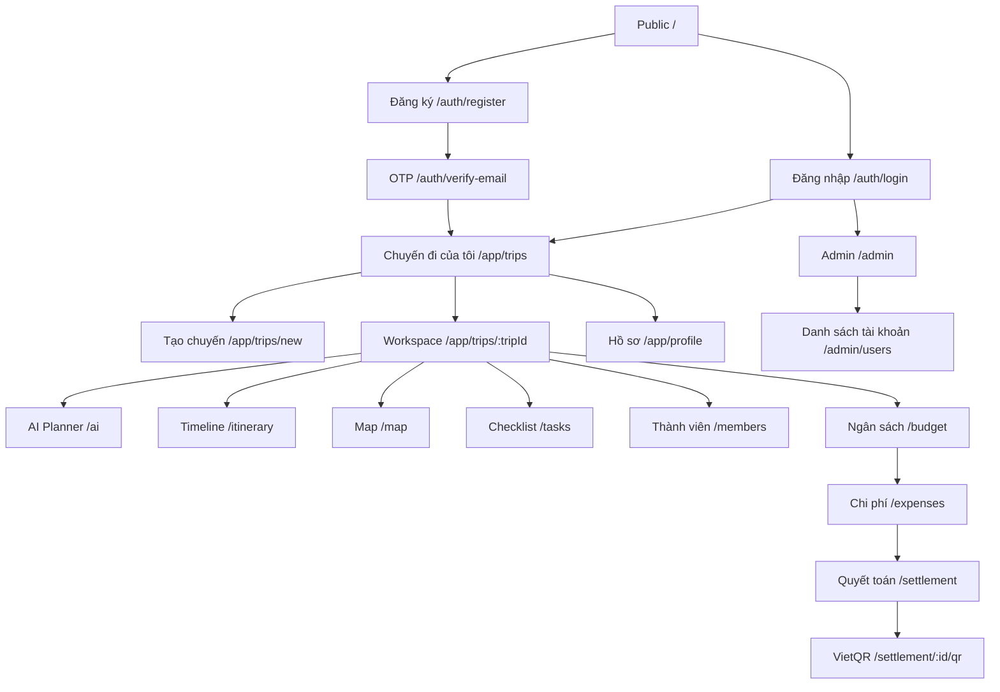
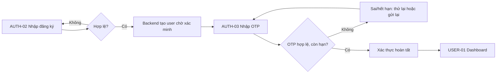
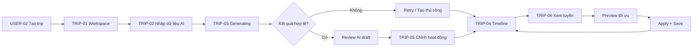
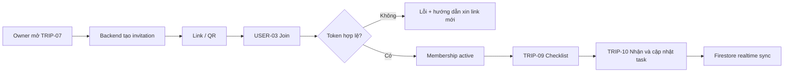
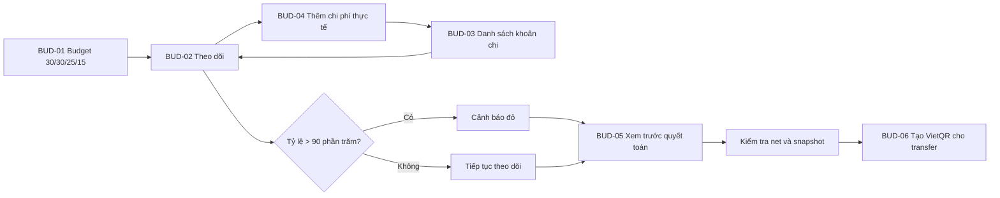
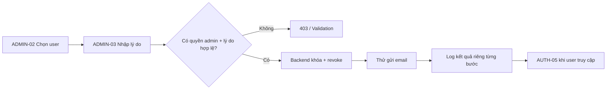

# TREKMATE — PROTOTYPE SCREEN SPECIFICATIONS

> **Tên đề tài:** XÂY DỰNG ỨNG DỤNG WEB LÊN KẾ HOẠCH DU LỊCH THÔNG MINH  
> **Sản phẩm:** TrekMate — Smart Travel Planning Web Application  
> **Đường dẫn dự kiến:** `.github/02-design-system/prototype-screens.md`  
> **Loại tài liệu:** UI/UX Screen Specifications + Prototype Handoff + Acceptance Checklist  
> **Phiên bản:** 1.0 (bản thiết kế đề xuất để nhóm duyệt)  
> **Ngày soạn:** 21/11/2026  
> **Ngôn ngữ giao diện:** Tiếng Việt; chuẩn tiền tệ: VND; múi giờ mặc định: `Asia/Ho_Chi_Minh`  
> **Nền tảng:** React SPA, Desktop Web + Mobile Web, không phải ứng dụng React Native  
> **Trạng thái:** `DRAFT — NEEDS PRODUCT/DESIGN APPROVAL`; chưa phải màn hình đã được thiết kế hoặc lập trình.

**Tài liệu liên quan:** [Design Tokens v2](./design-tokens-v2.md) · [Component Library v2](./component-library-v2.md).  
**Nguồn nghiệp vụ:** tệp slide `F5.pptx.pdf` do nhóm cung cấp, 13 trang (đặc biệt trang 2–7, 10–11). Slide trang 7 ghi tên model **Gemini 1.5 Flash**; khi triển khai phải kiểm tra model/API thực sự còn được hỗ trợ và chốt cấu hình thay vì hardcode phiên bản theo slide.  
**Quy ước nguồn gốc:** **[S]** = yêu cầu hiện diện trong slide; **[D]** = quyết định thiết kế đề xuất trong tài liệu này, cần nhóm thông qua; **[F]** = chức năng tương lai/ngoài MVP. Không suy diễn **[D]** thành yêu cầu đã được giáo viên duyệt.

---

### Đọc nhanh / điều hướng tài liệu

| Khi cần… | Đọc mục |
|---|---|
| Hiểu nguồn, scope, persona và những quyết định chưa được duyệt | **0–2** |
| Dựng navigation, responsive grid, tokens, components, phân quyền, global states | **3–8** |
| Xem đặc tả chi tiết 32 screen IDs theo 3 trụ cột và Admin | **9–12** |
| Nối 5 luồng click-through và thống nhất kiểu dữ liệu/API | **13–14** |
| Chuyển sang Figma, kiểm thử UI, dựng fixtures demo | **15–17** |
| Truy vết slide, lập kế hoạch 9 tuần, giao agent/PR và chốt open decisions | **18–21** |

**Phạm vi văn bản:** bản đặc tả theo hướng *screen-by-screen*, không phải một loạt ảnh screenshot. Mỗi Screen ID có thể tương ứng một trang SPA hoặc một state/drawer/dialog cụ thể.

---

## 0. HƯỚNG DẪN DÀNH CHO AI AGENT — PHẢI ĐỌC TRƯỚC KHI SINH UI

1. **Định danh sản phẩm:** chỉ tạo giao diện cho **TrekMate**, lĩnh vực **du lịch, lịch trình, bản đồ, nhóm bạn và chi tiêu**. Không xuất hiện tên, học phần, XP, Streak, Hearts, mic phát âm hay luồng học ngôn ngữ của `LingoCraft AI`.
2. **Phân loại nguồn:** slide `F5.pptx.pdf` là nguồn yêu cầu nghiệp vụ. Hai file `*-v2.md` đi kèm đang mô tả một sản phẩm **React Native dành cho học ngoại ngữ**; **không được copy mã React Native, màn hình học hoặc cấu trúc Expo** sang ứng dụng web. Chỉ kế thừa nguyên lý design token, phân cấp component, tính dễ đọc, quy tắc tương phản, motion và accessibility; phần chuyên biệt TrekMate được quy định ở tài liệu này.
3. **Không được bịa tính năng:** đặt vé máy bay/khách sạn và thời tiết realtime thuộc hướng phát triển tương lai [F], **không** đưa vào luồng MVP. Không hiển thị “đã chuyển khoản thành công” chỉ vì VietQR được tạo.
4. **Một nguồn chân lý cho giao diện:** sau khi được nhóm duyệt và sửa hai file v2 thành bản TrekMate Web, sử dụng tokens/components tương ứng. Trong thời gian chuyển tiếp, dùng **mapping tạm** ở mục 5–6; không nhúng hardcode tùy tiện vào screen.
5. **Không trộn mock và dữ liệu thật:** prototype có thể dùng fixtures ở mục 18. Bản chạy thực tế phải phân biệt lịch trình AI sinh, dữ liệu Google Maps thực, chi phí người dùng nhập và dữ liệu mô phỏng.
6. **Tạo trước P0, sau mới P1/P2.** Mỗi màn hình phải có đủ `loading / empty / error / success`, responsive, keyboard navigation, và thông điệp lỗi tiếng Việt. Đối với bản đồ/AI bổ sung `quota / timeout / offline`.
7. **Không tự giả định một API đã có:** giao tiếp với Node/Express qua hợp đồng dữ liệu được backend thống nhất. Firebase Authentication + Firestore dùng theo kiến trúc slide, không dùng Firestore client trực tiếp để vượt qua kiểm tra quyền ở backend.
8. **Không xử lý thanh toán thật.** QR ngân hàng chỉ hỗ trợ người dùng tự chuyển tiền qua ứng dụng ngân hàng; trạng thái xác nhận phải do người dùng cung cấp hoặc có tích hợp xác thực giao dịch riêng trong tương lai.
9. **Tất cả các luồng có đường quay lại.** Mọi hành động không thể hoàn tác (khóa tài khoản, xóa chi phí, hủy chuyến) phải có xác nhận, phân quyền và trạng thái lỗi.
10. **Không được tự coi tài liệu này là code đã triển khai.** Các URL, DTO, thông số giới hạn và quyền trong mục dưới là hợp đồng UI **[D]**; nhóm BE, FE, QA phải chốt trước khi mã hóa.

### 0.1. Ma trận sai khác giữa tài liệu v2 sẵn có và TrekMate

| Nội dung | Hai file v2 đang có | Hướng xử lý cho TrekMate |
|---|---|---|
| Sản phẩm | `LingoCraft AI` — học ngoại ngữ | **Thay toàn bộ nhãn sản phẩm bằng TrekMate** [S] |
| Nền tảng | React Native / Expo, `Pressable`, `TextInput`, `SafeAreaView` | React.js + Tailwind CSS SPA; dùng HTML semantic, CSS, accessible web components [S] |
| Persona | Học sinh, người đi làm học 5 phút | Khách du lịch tự túc, nhóm bạn/gia đình, Administrator [S] |
| Trục nghiệp vụ | Bài học, chấm phát âm, gamification | Chuyến đi, AI itinerary, Maps, checklist, ngân sách, VietQR [S] |
| Tokens | Teal/violet/stone, Be Vietnam Pro, lưới 8pt, Light/Dark | **Có thể tái sử dụng định hướng thị giác**, màu vai trò và typography; bổ sung map/budget/travel tokens [D] |
| Components dùng chung về mặt ý tưởng | `AppIcon`, `AppButton`, `AppTextInput`, `AppSelectDropdown`, `ScreenLayout`, `BentoCard` | **Chỉ tái sử dụng API/UX concept**, cần viết lại cho React DOM [D] |
| Components không phù hợp | `LessonProgressHeader`, `SingleTaskQuestionCard`, `AnswerOption`, `FeedbackBottomSheet`, `PronunciationMicButton`, `StreakChallengeCard` | Không dùng; thay bằng `TripCard`, `Timeline`, `MapPanel`, `ExpenseForm`, `BudgetChart`, `TaskBoard`, ... [D] |
| Quy tắc “1 câu hỏi/màn hình” | Phù hợp bài học | Không áp dụng máy móc; Travel Planner có thể dùng wizard nhiều bước và dashboard đa vùng [D] |
| Bố cục | Mobile app và bottom sheet | Responsive web; desktop split panel, mobile card/drawer/bottom sheet [S+D] |

**Điều kiện đồng bộ:** Nếu hai tệp `design-tokens-v2.md` / `component-library-v2.md` trong repository **chưa** được chuyển đổi sang TrekMate, chúng không thể được coi là mã nguồn giao diện Web tương thích. Mục 5 và 6 của tài liệu này là **đặc tả chuyển tiếp**; cần có một PR cập nhật hai file đó trước giai đoạn phát triển UI.

---

## 1. TẦM NHÌN, PHẠM VI VÀ TIÊU CHÍ THÀNH CÔNG

### 1.1. Mục tiêu sản phẩm

TrekMate là ứng dụng web SPA **All-in-One** hỗ trợ cá nhân hoặc nhóm lập kế hoạch chuyến đi: xác thực tài khoản; tạo workspace chuyến đi; tạo lịch trình bằng Gemini AI; hiển thị/điều chỉnh timeline; xem và tối ưu tuyến tham quan trên Google Maps; chia sẻ chuyến đi, giao checklist; đặt ngân sách, nhập chi phí, theo dõi hạn mức; tính công nợ nhóm và tạo mã VietQR để chuyển tiền. [S: slide 2–7]

### 1.2. Ba trụ cột phạm vi

| Scope | Chức năng nghiệp vụ gốc [S] | Cụm màn hình trong tài liệu |
|---|---|---|
| S1 — Tài khoản/phân quyền | Email/mật khẩu, OTP, profile/gu du lịch, Admin khóa tài khoản và revoke session | `AUTH-*`, `USER-04/05`, `ADMIN-*`, `SYS-*` |
| S2 — Lịch trình/công việc | Gemini sinh lịch trình JSON, timeline, Google Maps, sắp thứ tự POI, mời bằng link/QR, checklist realtime | `USER-01/02/03`, `TRIP-*` |
| S3 — Ngân sách/chi phí | Phân bổ theo nhóm, nhập chi phí, cảnh báo >90%, pie chart, quyết toán và VietQR | `BUD-*` |

### 1.3. Ưu tiên giao hàng

- **P0 (MVP bắt buộc):** cần để thực hiện demo end-to-end theo slide: đăng nhập/đăng ký/OTP; tạo chuyến; Gemini → timeline; map/POI; mời nhóm/checklist; ngân sách/chi phí; quyết toán VietQR; quản trị khóa tài khoản.
- **P1 (gia tăng chất lượng):** lưu mẫu, tìm kiếm nâng cao, chỉnh sửa quyền thành viên, lịch sử thay đổi, bộ lọc phức tạp, trải nghiệm cá nhân hóa nâng cao, khôi phục bản nháp.
- **P2 (ngoài MVP):** landing marketing đầy đủ, dashboard báo cáo sâu, integration thời tiết/đặt vé [F], thanh toán tự động, thông báo push và bản đồ offline.
- Các màn hình P0 có thể triển khai thành **view, tab hoặc dialog** trong một trang SPA để giảm chi phí 9 tuần; `Screen ID` là đơn vị thiết kế/kiểm thử, **không bắt buộc là 1 route độc lập**.

### 1.4. KPI sản phẩm và giới hạn trình diễn

| KPI / mục tiêu | Cơ sở | Tác động UI |
|---|---|---|
| AI tạo lịch trình **< 30 giây** | [S] Slide 10, KPI mục tiêu | Hiện progress có trạng thái và thời gian đã trôi; >30 giây thông báo chậm, cho retry/nhập tay; không hứa chắc thời gian |
| Uptime **≥ 99,5%** | [S] Slide 10, mục tiêu | Có màn hình bảo trì / retry; đây là **KPI hạ tầng**, không thể xác nhận bằng prototype |
| CSAT **≥ 85%** | [S] Slide 10, mục tiêu | Bố trí khảo sát hậu demo nếu nhóm phê duyệt [D]; không hiển thị giả là kết quả thực |
| Case study 4N3Đ Hà Nội | [S] Slide 11 | Fixture demo: 4 người, 3.500.000 VND/người, tổng ngân sách nhóm **14.000.000 VND** |
| Slide demo nêu **45 giây** | [S] Slide 11, case minh họa | Con số minh họa không đồng nghĩa KPI <30 giây; cần test để kết luận chính thức |
| 9 tuần Waterfall | [S] Slide 8 | Tài liệu phải bàn giao thiết kế ở tuần 3; triển khai tuần 4–6, QA tuần 7–8, deploy tuần 9 |

### 1.5. Những điều chưa được slide quyết định — phải chốt bằng ADR/meeting

| Mã | Vấn đề | Mặc định để thiết kế [D] | Cần xác nhận |
|---|---|---|---|
| DEC-01 | Quyền trong một chuyến | `owner`, `editor`, `viewer`; tất cả là user thường, `admin` là vai trò hệ thống riêng | Vai trò Editor/Viewer có được phép? |
| DEC-02 | Tạo chuyến khi chưa login | Đọc landing được, thao tác lưu/AI cần đăng nhập | Guest flow |
| DEC-03 | OTP đăng ký | 6 chữ số, hết hạn 5 phút, gửi lại sau 60 giây | Hình thức OTP và dịch vụ gửi email |
| DEC-04 | Ngân sách nhập theo người hay nhóm | Chọn `per_person` hoặc `total`; UI hiển thị cả hai khi đủ số thành viên | Quy tắc khi thành viên đổi |
| DEC-05 | Quyết toán | Chia đều mặc định theo thành viên tham gia; hỗ trợ chỉnh người tham gia từng khoản | Chính sách chi tiêu chung/riêng |
| DEC-06 | Dữ liệu địa điểm | POI có `placeId`, lat/lng, nguồn Google Maps hoặc người nhập | Quyền, API/quota, điều khoản dữ liệu |
| DEC-07 | Trạng thái khóa chuyến / quyết toán | Snapshot kỳ quyết toán; nếu chi phí đổi thì kết quả cũ `outdated` | Có cần đóng chuyến? |
| DEC-08 | URL chia sẻ và thời hạn | Link token có hạn (đề xuất 7 ngày), chủ chuyến thu hồi được | Quy định bảo mật |
| DEC-09 | Quyền ảnh avatar | Dùng URL ảnh do dịch vụ lưu ảnh an toàn trả về; kiểm tra định dạng/kích thước | Nơi lưu file |
| DEC-10 | Công thức tối ưu route | Heuristic khả thi, có hỗ trợ giờ mở cửa nếu dữ liệu hợp lệ | “Tối ưu” nghĩa là distance/time/cost? |

---

## 2. PERSONA, JTBD VÀ QUY TẮC TRẢI NGHIỆM

### 2.1. Persona ứng dụng [D — suy ra từ đối tượng slide, chưa có khảo sát]

| Persona | Nhu cầu quan trọng | Vấn đề | Luồng chính |
|---|---|---|---|
| **Travel Organizer** — người lên kế hoạch (ví dụ bạn An) | Lên chuyến 4N3Đ nhanh, cân đối ngân sách nhóm, giao việc | Tốn công gom địa điểm, chồng chéo lịch, khó đòi tiền | Tạo chuyến → AI → chỉnh lịch → mời → ngân sách → quyết toán |
| **Trip Member** — bạn đồng hành | Biết đi đâu/lúc nào, nhận checklist, ghi chi phí, trả phần của mình | Thông tin phân tán trong chat và ghi chú | Tham gia → timeline → task → expense → VietQR |
| **System Administrator** | Kiểm tra tài khoản vi phạm, khóa và thông báo | Rủi ro lạm dụng, quản trị người dùng | Đăng nhập → quản trị → kiểm tra → khóa → kiểm toán |

### 2.2. UX principles

1. **Trip-first:** mọi số liệu cần được gắn với `tripId`; breadcrumb và nhãn chuyến luôn rõ để tránh nhập nhầm chi phí.
2. **Preview before commit:** AI đề xuất nhưng người dùng duyệt; đổi lộ trình phải cho xem tác động thời gian/quãng đường trước khi lưu.
3. **Collaborative by default:** thể hiện chủ sở hữu, thành viên, thời điểm đồng bộ; xung đột không được âm thầm ghi đè.
4. **Trustworthy costs:** luôn phân biệt **ước tính** vs **đã chi**, **tổng nhóm** vs **mỗi người**, **đã tạo mã QR** vs **đã xác nhận thanh toán**.
5. **Safety and predictability:** confirmation cho hành động hủy/xóa/khóa; không tạo khoản tiền âm, không mất chỉnh sửa khi offline.
6. **Responsive, not reduced:** mobile web vẫn hoàn thành các nghiệp vụ P0, không chỉ xem read-only.
7. **AI is assistive:** mọi đề xuất gắn nhãn “Gợi ý AI”; người dùng chỉnh, xóa, thêm thủ công; nội dung về giá/địa điểm cần kiểm chứng trước chuyến đi.

---

## 3. INFORMATION ARCHITECTURE VÀ ROUTE MAP

### 3.1. Sitemap tổng thể



### 3.2. Screen inventory — bảng kiểm soát đủ màn hình

| ID | Tên màn hình / bề mặt | Route gợi ý | Role | Scope | Ưu tiên |
|---|---|---|---|---|---|
| PUB-01 | Landing / trang giới thiệu | `/` | Guest | Giới thiệu | P2 |
| AUTH-01 | Đăng nhập | `/auth/login` | Guest | S1 | P0 |
| AUTH-02 | Đăng ký | `/auth/register` | Guest | S1 | P0 |
| AUTH-03 | Xác minh OTP email | `/auth/verify-email` | Guest/pending | S1 | P0 |
| AUTH-04 | Quên/đặt lại mật khẩu | `/auth/forgot-password` | Guest | S1 | P0 |
| AUTH-05 | Tài khoản bị khóa / phiên hết hạn | `/auth/account-status` | User | S1 | P0 |
| USER-01 | Dashboard: chuyến đi của tôi | `/app/trips` | User | S2 | P0 |
| USER-02 | Tạo chuyến mới | `/app/trips/new` | User | S2 | P0 |
| USER-03 | Chấp nhận lời mời | `/invite/:token` | Guest/User | S2 | P0 |
| USER-04 | Hồ sơ cá nhân | `/app/profile` | User | S1 | P0 |
| USER-05 | Sở thích du lịch & thiết lập | `/app/preferences` | User | S1 | P0 |
| TRIP-01 | Tổng quan workspace | `/app/trips/:tripId` | Member | S2/S3 | P0 |
| TRIP-02 | Wizard nhập yêu cầu AI | `/app/trips/:tripId/ai` | Owner/Editor | S2 | P0 |
| TRIP-03 | Trạng thái sinh lịch trình AI | trong `TRIP-02` | Owner/Editor | S2 | P0 |
| TRIP-04 | Timeline lịch trình nhiều ngày | `/app/trips/:tripId/itinerary` | Member | S2 | P0 |
| TRIP-05 | Tạo/chỉnh sửa hoạt động | Drawer/dialog trong `TRIP-04` | Owner/Editor | S2 | P0 |
| TRIP-06 | Bản đồ & tối ưu tuyến | `/app/trips/:tripId/map` | Member | S2 | P0 |
| TRIP-07 | Mời thành viên qua link/QR | Dialog trong `TRIP-08` | Owner | S2 | P0 |
| TRIP-08 | Danh sách thành viên/quyền | `/app/trips/:tripId/members` | Member | S2 | P0 |
| TRIP-09 | Checklist Kanban/List | `/app/trips/:tripId/tasks` | Member | S2 | P0 |
| TRIP-10 | Tạo/xem/chỉnh task | Drawer/dialog trong `TRIP-09` | Member theo quyền | S2 | P0 |
| BUD-01 | Thiết lập/phân bổ ngân sách | `/app/trips/:tripId/budget/setup` | Owner/Editor | S3 | P0 |
| BUD-02 | Tổng quan ngân sách & biểu đồ | `/app/trips/:tripId/budget` | Member | S3 | P0 |
| BUD-03 | Danh sách chi phí | `/app/trips/:tripId/expenses` | Member | S3 | P0 |
| BUD-04 | Thêm/sửa khoản chi | Dialog hoặc `/expenses/new` | Member theo quyền | S3 | P0 |
| BUD-05 | Xem trước quyết toán | `/app/trips/:tripId/settlement` | Member | S3 | P0 |
| BUD-06 | Mã VietQR / thông tin chuyển tiền | `/app/trips/:tripId/settlement/:settlementId/qr` | Member liên quan | S3 | P0 |
| ADMIN-01 | Admin overview | `/admin` | Admin | S1 | P1 |
| ADMIN-02 | Quản lý người dùng | `/admin/users` | Admin | S1 | P0 |
| ADMIN-03 | Xác nhận khóa/mở khóa | Dialog trong `ADMIN-02` | Admin | S1 | P0 |
| ADMIN-04 | Nhật ký quản trị | `/admin/audit` | Admin | S1 | P1 |
| SYS-01 | 403/404/500/offline/maintenance | `/403`, `/404`, global boundary | All | Xuyên suốt | P0 |

**Tổng cộng: 32 Screen IDs** (trong đó có page, drawer, modal và các state riêng). `TRIP-03` và `AUTH-05` vẫn có ID để QA kiểm thử dù không nhất thiết có route tách biệt.

### 3.3. Navigation & route rules

- **Public navigation:** logo TrekMate trái; `Tính năng`, `Đăng nhập`, `Bắt đầu`. Guest không có truy cập workspace nhạy cảm.
- **App shell desktop:** left sidebar có `Chuyến đi`, `Hồ sơ`; khi ở trong chuyến, thêm subnav `Tổng quan | Lịch trình | Bản đồ | Công việc | Thành viên | Ngân sách | Chi phí | Quyết toán`. Header có tên chuyến, ngày đi, avatar/menu; 1 breadcrumb `Chuyến đi của tôi / Hà Nội 4N3Đ`.
- **App shell tablet:** sidebar thu gọn theo icon + label khi mở; nội dung chính rộng tối đa có thể.
- **App shell mobile:** top app bar + mobile drawer; trong workspace dùng `Tab` có cuộn ngang hoặc dropdown chọn phân hệ, **không** ép 8 tab lên một hàng.
- **Role guard:** chưa login → lưu `returnTo` an toàn rồi chuyển login; không thuộc chuyến → màn hình 403 hoặc lời mời hợp lệ; tài khoản bị khóa → `AUTH-05`; URL không tồn tại → `SYS-01` 404.
- **Deep link:** sau xác thực trả về đúng màn hình trước đó nếu user có quyền; token lời mời không đi vào analytics/raw logs.
- **Back navigation:** browser Back hoạt động; drawer/modal mở theo route state có thể đóng bằng `Esc` và nút rõ ràng; thao tác form dở phải hỏi xác nhận trước khi rời nếu có dữ liệu chưa lưu.

---

## 4. THIẾT KẾ BỐ CỤC ĐA THIẾT BỊ

### 4.1. Breakpoints [D]

| Dải rộng viewport | Bố cục | Container, lề | Đặc biệt |
|---|---|---|---|
| 320–639px — Mobile | 1 cột; drawer và bottom sheet | lề 16px; chiều rộng nội dung 100% | CTA form sticky bottom khi cần; map full-screen/tab, tránh map nhỏ |
| 640–1023px — Tablet | 1–2 cột theo ngữ cảnh | lề 24px | Map/Timeline có thể chuyển tabs; card grid 2 cột |
| 1024–1439px — Laptop | sidebar 240px, content fluid | lề 24–32px | Timeline + map split khi đủ chỗ |
| ≥1440px — Desktop rộng | sidebar 256px, main max 1440px | lề 32px | Split map/timeline ~60/40; không để dòng văn bản quá dài |

**Thiết kế kiểm thử:** 360×800, 390×844, 768×1024, 1280×800, 1440×900 và 1920×1080. Hoạt động từ chiều rộng 320px, hỗ trợ zoom 200% không mất chức năng cốt lõi.

### 4.2. Layout wireframe có tính hướng dẫn (ASCII, không phải ảnh UI hoàn thiện)

**Desktop — Workspace / Timeline**

```text
┌────────────────────────────────────────────────────────────────────────────┐
│ Logo TrekMate  Tìm chuyến…          Hà Nội • 4N3Đ           Avatar / Menu │
├───────────────────┬────────────────────────────────────────────────────────┤
│ Chuyến đi          │ Chuyến đi / Hà Nội / Lịch trình                      │
│ Tổng quan          │ [Ngày 1] [Ngày 2] [Ngày 3] [Ngày 4] [Lưu thay đổi] │
│ Lịch trình         │ ┌────────────────────────┬─────────────────────────┐ │
│ Bản đồ             │ │ 08:00  Hoạt động A    │ Map: markers, route     │ │
│ Công việc          │ │ 10:30  Hoạt động B    │                         │ │
│ Thành viên         │ │ 13:00  Hoạt động C    │ Dist/Time summary       │ │
│ Ngân sách          │ │ [+ Thêm địa điểm]    │ [Tối ưu lộ trình]       │ │
│ Chi phí            │ └────────────────────────┴─────────────────────────┘ │
│ Quyết toán         │ Status: Đã lưu lúc ... / Có thay đổi chưa lưu        │
└───────────────────┴────────────────────────────────────────────────────────┘
```

**Mobile — Lịch trình**

```text
┌──────────────────────────┐
│ ☰  Hà Nội 4N3Đ       ⋯   │
│ [Tổng quan ▾]            │
│ [Ngày 1][Ngày 2] →       │
│ [Timeline] [Bản đồ]      │
│ 08:00  Hoạt động A       │
│ 10:30  Hoạt động B       │
│ 13:00  Hoạt động C       │
│ [+ Thêm hoạt động]       │
│                          │
│ [Lưu thay đổi]           │
└──────────────────────────┘
```

*Chú thích:* Các ký hiệu ASCII chỉ minh họa thứ tự. UI thật dùng SVG/Lucide icon; không dùng emoji làm icon trang trí.

### 4.3. Quy tắc cấu trúc chung

- **Top app bar:** cao 64px desktop, 56–64px mobile [D]; logo dẫn về `/app/trips` nếu đã đăng nhập.
- **Main container:** vùng nội dung đủ tương phản, nền token `background`, card token `surface`, ưu tiên `BentoCard` loại web.
- **Heading:** mỗi route đúng 1 `h1`; mô tả phụ ngắn, không thay tiêu đề bằng ảnh.
- **CTA:** ưu tiên **một nút primary theo ngữ cảnh**; secondary hỗ trợ, danger chỉ cho hành động nguy hiểm có xác nhận.
- **Action feedback:** `aria-live` cho thông báo lưu, xóa, mời, sync; toast không chặn tác vụ; thông báo lỗi quan trọng nằm cạnh biểu mẫu.
- **Form desktop:** label đặt trên input, mô tả bên dưới, validation gần trường, bắt buộc có đánh dấu bằng chữ (`Bắt buộc`) không chỉ dấu `*`.
- **Card responsive:** grid không ép chiều ngang; dữ liệu tài chính trên mobile hiển thị card thay cho bảng quá rộng.
- **Mobile keyboard:** footer không che input; input numeric dùng `inputmode`, tránh tự động mở keyboard trong map.
- **Chart:** có bảng số liệu tương đương và nhãn, không phụ thuộc màu để hiểu số tiền.

---

## 5. TREKMATE WEB DESIGN TOKENS — MAPPING TẠM TỪ V2

> **[D] Chỉ là hợp đồng giao diện chuyển tiếp.** Hai file v2 hiện chứa `React Native` code và domain LingoCraft; trước khi coding phải chuyển thành `CSS variables`/Tailwind config, duyệt bảng màu TrekMate; không tuyên bố chúng đã hỗ trợ Web.

### 5.1. Visual direction

**Phong cách:** *Travel Workspace Soft Bento*: sạch, tin cậy, gần gũi, ảnh điểm đến chân thực, bản đồ rõ nét; không làm “dashboard doanh nghiệp” khô cứng, cũng không lạm dụng glassmorphism. **Teal** dùng cho hành động chính; **violet** chỉ nhấn AI; **amber** dùng cho cảnh báo ngân sách; trạng thái chi tiêu phải có chữ và ký hiệu. Ảnh điểm đến phải có quyền sử dụng và credit khi điều khoản nguồn yêu cầu; không bịa ảnh địa điểm từ AI rồi mô tả như ảnh thật.

### 5.2. Semantic mapping bắt nguồn từ `design-tokens-v2.md`

| Token vai trò | Light | Dark | Dùng ở TrekMate |
|---|---|---|---|
| `primary` | `#0F766E` | `#2DD4BF` | Tạo chuyến, Lưu, Xác nhận hành động chính |
| `primaryPressed` | `#115E59` | `#14B8A6` | Pressed/hover có kiểm tra contrast |
| `primarySurface` | `#F0FDFA` | `#042F2E` | Trip card đang chọn, route đã chọn |
| `aiPrimary` | `#6D28D9` | `#A78BFA` | Badge/CTA “Tạo lịch trình bằng AI” |
| `aiSurface` | `#F5F3FF` | `#2E1065` | Khung đề xuất AI, cảnh báo dữ liệu AI |
| `success`/`successSurface` | `#15803D`/`#F0FDF4` | `#4ADE80`/`#052E16` | Lưu thành công, task hoàn tất |
| `warning`/`warningSurface` | `#B45309`/`#FFFBEB` | `#FBBF24`/`#451A03` | Sắp vượt ngân sách, OTP gần hết hạn |
| `error`/`errorSurface` | `#B91C1C`/`#FEF2F2` | `#F87171`/`#450A0A` | Quá ngân sách, validation, khóa tài khoản |
| `background` | `#FAFAF9` | `#0C0A09` | Nền SPA |
| `surface` | `#FFFFFF` | `#1C1917` | Card, input, drawer |
| `border` | `#E7E5E4` | `#44403C` | Dividers |
| `textPrimary` | `#1C1917` | `#FAFAF9` | Văn bản chính |
| `textSecondary` | `#57534E` | `#A8A29E` | Meta text, mô tả |
| `textOnPrimary` | `#FFFFFF` | `#042F2E` | Text trên nút primary |
| `textOnAi` | `#FFFFFF` | `#2E1065` | Text trên CTA AI |

**Không dùng** `streak`, `xpGold`, `heartCoral` để thể hiện tính năng TrekMate vì đây là token gamification của sản phẩm cũ. Có thể giữ chúng trong mã cũ nhưng chưa đưa vào màn hình TrekMate. Đề xuất bổ sung `mapRoutePrimary`, `mapRouteAlternate`, `chartTransport`, `chartStay`, `chartFood`, `chartReserve`, `statusSynced` **chỉ sau khi** kiểm tra contrast và tính đọc được [D]; không tự bịa thành tokens đã có.

### 5.3. Typography, spacing, radius, motion

- Font: **Be Vietnam Pro** (ưu tiên vì tiếng Việt), fallback `system-ui, sans-serif`; hỗ trợ đầy đủ dấu thanh.
- Type scale kế thừa: `headingLg 24/34`, `headingMd 18/26`, `body 16/24`, `caption 14/20`, `micro 12/18` (chỉ metadata phụ); riêng desktop page heading **[D]** 28–32px khi đủ không gian.
- Spacing: `xs=4`, `sm=8`, `md=16`, `lg=24`, `xl=32` px; lưới 8px, ngoại lệ 4px.
- Radius: `sm=8`, `md=12`, `lg=20`, `xl=28`, pill cho badges; card không đổ bóng mạnh.
- Target click/touch tối thiểu **48×48 CSS px** theo định hướng v2; focus outline rõ ràng, không xóa `outline` mà không thay thế.
- Motion: `fast=120ms`, `base=200ms`, `slow=320ms`; hover/press scale `0.98` nếu phù hợp. `prefers-reduced-motion: reduce` → bỏ transition di chuyển, pulse, auto-pan không thiết yếu.
- Themes: cả light và dark cần được kiểm thử; nếu thời gian MVP không đủ, cho phép ship light mode sau khi nhóm quyết định, nhưng không trình bày dark mode như tính năng đã hoàn thiện.
- Web contrast mục tiêu: văn bản thường ≥ 4.5:1, văn bản lớn ≥ 3:1; kiểm nghiệm bằng công cụ, **không** mặc nhiên tin tỷ lệ “ước tính” trong token v2.

### 5.4. CSS custom properties khung triển khai [D, không phải code hiện có]

```css
:root {
  --tm-primary: #0f766e;
  --tm-primary-pressed: #115e59;
  --tm-primary-surface: #f0fdfa;
  --tm-ai: #6d28d9;
  --tm-ai-surface: #f5f3ff;
  --tm-bg: #fafaf9;
  --tm-surface: #fff;
  --tm-text: #1c1917;
  --tm-text-muted: #57534e;
  --tm-border: #e7e5e4;
  --tm-warning: #b45309;
  --tm-error: #b91c1c;
  --tm-success: #15803d;
  --tm-radius-card: 20px;
  --tm-radius-control: 12px;
  --tm-touch-min: 48px;
}
/* Đây là ví dụ định hướng; khi migrate, lấy từ file token đã được duyệt. */
```

---

## 6. COMPONENT LIBRARY WEB — HỢP ĐỒNG DÙNG TRONG PROTOTYPE

### 6.1. Primitives cần port sang React DOM

| Mã | Component đề xuất | API/Props cần có | Trạng thái bắt buộc |
|---|---|---|---|
| C-01 | `TMButton` | `variant`, `size`, `type`, `loading`, `disabled`, `icon`, `onClick` | default/hover/pressed/focus/disabled/loading |
| C-02 | `TMTextField` | `name`, `label`, `value`, `error`, `helperText`, `required`, `type` | default/focus/filled/invalid/readonly |
| C-03 | `TMSelect` | `options`, `value`, `onChange`, `placeholder`, `disabled` | open/search/no-results/error |
| C-04 | `TMDateRangePicker` | `start`, `end`, `minDate`, `maxDate`, `timezone` | open/selected/invalid |
| C-05 | `TMCard` | `tone`, `header`, `footer`, `interactive` | default/selected/hover/skeleton |
| C-06 | `TMIcon` | vector Lucide, `name`, `size`, `aria-hidden` | passive/action |
| C-07 | `TMBadge` | `tone`, `icon`, `label` | neutral/success/warning/error/ai |
| C-08 | `TMDialog` | `open`, `title`, `onClose`, focus trap, focus restore | open/closing/error |
| C-09 | `TMDrawer` | `open`, `side`, `onClose`, responsive sheet | default/dirty/form-error |
| C-10 | `TMToast` | `tone`, `message`, timeout, `aria-live` | info/success/error |
| C-11 | `TMEmptyState` | illustration/icon, title, description, action | empty-filter/empty-content |
| C-12 | `TMSkeleton` | layout variant | loading |
| C-13 | `TMTabs` | activeKey, keyboard navigation, orientation | active/disabled/overflow |
| C-14 | `TMStepper` | steps, active, completed, back navigation | draft/active/completed |
| C-15 | `TMDataTable` | sorting, filtering, pagination, mobile card | loading/empty/sorted |
| C-16 | `TMConfirmAction` | title, detail, reason (optional), danger, callback | idle/submitting/success/error |
| C-17 | `TMProgress` | value or indeterminate, accessible label | working/complete/failed |
| C-18 | `TMAvatarGroup` | members, overflowCount, tooltip | images/fallback |

**Yêu cầu web:** dùng `<button>`, `<label>`, `<input>`, `<nav>`, `<main>`, `<table>` khi phù hợp; phím `Tab/Shift+Tab`, `Enter/Space`, `Esc`, arrow keys cho tab/listbox, `aria-*` chính xác. **Không** import `react-native` hoặc `lucide-react-native` vào React Web. Dùng `lucide-react`/icon SVG tương thích web sau khi nhóm chốt dependency.

### 6.2. Domain components đặc thù TrekMate

| Mã | Component | Props/dữ liệu chính | Sử dụng ở |
|---|---|---|---|
| TC-01 | `TripCard` | name, place, dates, cover, participants, budget, status | USER-01 |
| TC-02 | `TripCreationWizard` | basicInfo, dateRange, budget, participants | USER-02 |
| TC-03 | `TripHeader` | trip, role, syncStatus, actions | TRIP-* / BUD-* |
| TC-04 | `TripStatGrid` | activitiesCount, membersCount, tasksProgress, spentVsBudget | TRIP-01 |
| TC-05 | `AIPlannerForm` | destination, dates, groupSize, preferences, budget, pace | TRIP-02 |
| TC-06 | `AIJobStatus` | jobId, status, elapsedSeconds, error, cached | TRIP-03 |
| TC-07 | `DayTabs` | days[], activeDay, dayErrors | TRIP-04/06 |
| TC-08 | `TimelineActivityCard` | start/end, place, cost, travelTime, coordinates, flags | TRIP-04/05 |
| TC-09 | `PlaceSearch` | query, Google suggestions, selectedPlace, source | TRIP-05/06 |
| TC-10 | `TripMapPanel` | markers, route, selectedActivity, mapStatus | TRIP-04/06 |
| TC-11 | `RouteSummary` | distance, estimatedDuration, warnings, optimizationDiff | TRIP-06 |
| TC-12 | `InviteSharePanel` | joinUrl, expiresAt, qrData, revoke, copy | TRIP-07 |
| TC-13 | `MemberList` | members, roles, pendingInvites | TRIP-08 |
| TC-14 | `TaskBoard` | lanes todo/in_progress/done, filters | TRIP-09 |
| TC-15 | `TaskForm` | title, assignee, dueAt, state, notes | TRIP-10 |
| TC-16 | `BudgetAllocationEditor` | total, categoryShares, amountView | BUD-01 |
| TC-17 | `BudgetSummary` | allocated, spent, remaining, usagePercent, threshold | BUD-02 |
| TC-18 | `BudgetBreakdownChart` | category totals, legend, accessible table | BUD-02 |
| TC-19 | `ExpenseTable` | expense records, paidBy, date, category, participants | BUD-03 |
| TC-20 | `ExpenseForm` | amount, paidBy, participants, splitRule, receipt | BUD-04 |
| TC-21 | `SettlementTransfers` | debtors/creditors, suggestedTransfers, snapshot | BUD-05 |
| TC-22 | `VietQRPanel` | beneficiary, bank, account, amount, note, qrPayload | BUD-06 |
| TC-23 | `AdminUserTable` | users, status, role, lastLogin, actions | ADMIN-02 |
| TC-24 | `BudgetAlert` | level, threshold, usage, category | TRIP-01/BUD-02 |
| TC-25 | `SyncStatusBadge` | saved/saving/offline/conflict/error | TRIP/BUD/Tasks |

### 6.3. Component behavior contracts

- **Map + Timeline liên kết 2 chiều:** chọn card → highlight marker; chọn marker → cuộn đến card đúng; keyboard users có danh sách địa điểm thay thế tương đương bản đồ.
- **Form tiền:** hiển thị `3.500.000 ₫`, lưu nguyên số `3500000` VND; không lưu chuỗi đã format; `0` không được coi là có chi phí thực tế hợp lệ.
- **Dashboard cards:** skeleton có cùng kích thước khối thật, tránh layout shift.
- **Task board:** hỗ trợ kéo-thả *và* menu “Chuyển sang…” cho bàn phím/touch; không phụ thuộc drag-and-drop để hoàn thành.
- **Chart:** tooltip mouse và click/tap, huyền thoại có text; có bản trình bày dạng bảng `Hạng mục | Đã chi | Hạn mức | Còn lại`.
- **QR:** bên dưới QR luôn có text người nhận/số tài khoản/số tiền/nội dung để sao chép và kiểm chứng, không dựa duy nhất vào ảnh QR.
- **Modal:** trap focus; đóng `Esc` trừ lúc action đang commit và đóng sẽ làm hỏng dữ liệu; trả focus về phần tử kích hoạt.
- **Ảnh:** không load ảnh full-res trên grid, có fallback và `alt` mô tả địa danh khi ảnh có ý nghĩa nội dung.

---

## 7. ROLE/PERMISSION MATRIX [D]

> Slide xác nhận có **User** và **Administrator**; quyền chuyến `owner/editor/viewer` dưới đây là đề xuất. Cần cập nhật sau khi có User Stories chính thức; UI ẩn action không thay cho kiểm tra quyền bằng server / Firestore security rules.

| Action | Guest | User chưa thuộc trip | Owner | Editor | Viewer | System Admin |
|---|---|---|---|---|---|---|
| Xem landing, đăng ký/login | ✓ | ✓ | ✓ | ✓ | ✓ | ✓ |
| Tạo chuyến mới | – | ✓ | ✓ | ✓ | ✓ | ✓ (với tư cách user nếu được phép) |
| Xem workspace riêng | – | – | ✓ | ✓ | ✓ | Chỉ khi có chính sách được duyệt; không mặc định |
| Sinh và lưu lịch trình AI | – | – | ✓ | ✓ | Xem | – |
| Chỉnh địa điểm/lịch trình | – | – | ✓ | ✓ | – | – |
| Mời/xóa thành viên, đổi quyền | – | – | ✓ | – | – | – |
| Xem checklist | – | – | ✓ | ✓ | ✓ | – |
| Tạo/gán task | – | – | ✓ | ✓ | – | – |
| Cập nhật task mình được giao | – | – | ✓ | ✓ | ✓ (task của mình) | – |
| Đổi hạn mức ngân sách | – | – | ✓ | ✓ | – | – |
| Xem ngân sách/chi phí | – | – | ✓ | ✓ | ✓ | – |
| Ghi khoản chi | – | – | ✓ | ✓ | ✓ (mình trả) | – |
| Sửa/xóa chi phí người khác | – | – | ✓ | ✓ (nếu chính sách cho phép) | – | – |
| Chạy quyết toán | – | – | ✓ | Xem kết quả | Xem kết quả | – |
| Xem QR mình cần thanh toán | – | – | ✓ | ✓ nếu liên quan | ✓ nếu liên quan | – |
| Khóa tài khoản hệ thống | – | – | – | – | – | ✓ |
| Xem audit admin | – | – | – | – | – | ✓ |

**Thông điệp cấm quyền:** “Bạn không có quyền thực hiện thao tác này. Hãy liên hệ chủ chuyến để được hỗ trợ.” Nếu quyền thay đổi trong lúc đang chỉnh, giữ bản nháp cục bộ có thể copy và chặn commit.

---

## 8. GLOBAL SCREEN STATES, FORM RULES VÀ FEEDBACK

### 8.1. State chuẩn

| State | UI chuẩn | Hành vi |
|---|---|---|
| `initial` | Skeleton cục bộ hoặc placeholder phù hợp | Không nhấp “Xóa/Sửa” khi dữ liệu chưa tải |
| `loading` | Skeleton card/table, `aria-busy=true` | Tránh spinner full-screen trừ bước chuyển trạng thái đầu tiên |
| `empty` | Tiêu đề + lý do + một CTA phù hợp quyền | Ví dụ “Chưa có chuyến đi nào — Tạo chuyến đầu tiên” |
| `saving` | Nút spinner, disabled đúng action, badge `Đang lưu…` | Không tự ý clear form |
| `saved` | Toast nhẹ “Đã lưu thay đổi”, timestamp | Dữ liệu cập nhật ngay sau xác nhận backend |
| `error` | Lỗi inline cụ thể + nút “Thử lại” | Không xóa input người dùng đã nhập |
| `offline` | Banner “Bạn đang ngoại tuyến. Một số thao tác tạm dừng.” | Form chưa gửi được giữ bản nháp; không giả là đã sync |
| `forbidden` | 403 hoặc restricted UI | Không hiển thị dữ liệu nhạy cảm |
| `conflict` | “Dữ liệu đã thay đổi trên thiết bị khác” | Cho xem bản mới, so sánh và tải lại; không ghi đè âm thầm |
| `quota` | Cảnh báo AI/Maps tạm hết hạn mức | Chọn tiếp tục chỉnh thủ công/đọc dữ liệu đã lưu |
| `timeout` | Thông báo phản hồi chậm, có retry an toàn | Không nhân đôi job/expense khi retry |

### 8.2. Quy tắc định dạng và validation [D]

- **Ngày:** hiển thị `dd/MM/yyyy`; lưu `ISO 8601` (với timezone rõ); `endDate >= startDate`; thời điểm trong timeline lấy theo **múi giờ của điểm đến**, không tự động ép về Việt Nam khi du lịch nước ngoài.
- **Thời gian:** 24h `HH:mm` theo múi giờ điểm đến, ngày/giờ lưu UTC kèm timezone IANA nếu phù hợp; lỗi DST phải được xử lý rõ.
- **Tiền:** VND không có phần thập phân; số nguyên không âm; tổng ngân sách phải >0 để phân bổ; số tiền khoản chi phải >0; hiển thị phân tách nghìn.
- **Số người:** integer 1–30 [D, configurable]; nếu vượt giới hạn nói rõ thay vì silently clamp.
- **Tên chuyến:** 3–80 ký tự [D], trim whitespace; cho phép dấu tiếng Việt; chống markup độc hại.
- **Tên task:** 3–120 ký tự [D]; deadline phải hợp lệ; nếu ngoài ngày chuyến, cảnh báo nhưng cho chọn nếu task chuẩn bị trước chuyến.
- **Tên địa điểm:** lấy POI có `placeId` nếu có, hoặc địa điểm tự nhập được gắn `manual` và có yêu cầu xác nhận tọa độ trước khi tối ưu map.
- **Số điện thoại:** tùy chọn, định dạng quốc tế hoặc Việt Nam có validation; không công khai cho thành viên ngoài nhóm nếu chưa đồng ý.
- **Email:** bắt buộc/đúng định dạng; giới hạn ký tự thực tế theo Auth provider; không lộ email đã tồn tại trong luồng khôi phục mật khẩu.
- **Mật khẩu:** theo chính sách Firebase/Auth được nhóm chốt, tối thiểu 8 ký tự ở UI [D], không đưa thông tin password vào Firestore.
- **URL invite:** token ngẫu nhiên, có thời hạn, có thể thu hồi; không render raw token ở nơi có thể bị copy bởi script không tin cậy.
- **Đồng bộ:** cập nhật optimistic chỉ với thao tác an toàn; chi tiêu/khóa tài khoản/quyết toán cần phản hồi server rõ ràng.

### 8.3. Hệ thống thông điệp UI mẫu

| Mã | Trường hợp | Copy tiếng Việt |
|---|---|---|
| MSG-01 | Lưu thành công | `Đã lưu thay đổi.` |
| MSG-02 | Chưa có internet | `Mất kết nối Internet. Kiểm tra mạng và thử lại.` |
| MSG-03 | AI lỗi | `Chưa thể tạo lịch trình bằng AI. Bạn có thể thử lại hoặc thêm hoạt động thủ công.` |
| MSG-04 | Google Maps lỗi | `Không tải được bản đồ. Lịch trình dạng danh sách vẫn hoạt động.` |
| MSG-05 | Budget 90% | `Chuyến đi đã sử dụng 90% ngân sách. Hãy kiểm tra chi phí còn lại.` |
| MSG-06 | Over budget | `Chi phí đã vượt ngân sách dự kiến.` |
| MSG-07 | Conflict | `Có thay đổi mới từ thành viên khác. Tải lại dữ liệu trước khi lưu.` |
| MSG-08 | OTP sai | `Mã xác minh không hợp lệ hoặc đã hết hạn.` |
| MSG-09 | Không có quyền | `Bạn không có quyền thực hiện thao tác này.` |
| MSG-10 | VietQR | `Đây là mã chuyển khoản, không phải xác nhận thanh toán thành công.` |
| MSG-11 | Session bị vô hiệu | `Phiên đăng nhập không còn hiệu lực. Vui lòng đăng nhập lại.` |

---

## 9. SCREEN SPECIFICATIONS — PUBLIC, AUTHENTICATION, USER

### 9.0. Template áp dụng cho mọi màn hình

Mỗi đặc tả bên dưới ghi: `Route/Priority/Actor`, **Mục tiêu**, **Thành phần và nội dung**, **Interaction/Validation**, **Responsive & States**, **Acceptance Criteria (AC)**, **Component Dependencies**. Tất cả thừa kế global state, role rules và a11y tại mục 4–8. Khi chuyển sang Figma, tạo `Frame` chính cho mỗi Screen ID, variants cho `default`, `loading`, `empty`, `error`, `mobile`, và các state đặc thù. Nếu màn hình là drawer/modal, tạo component variant gắn với frame cha.

### PUB-01 — Landing / trang giới thiệu TrekMate [D, P2]

- **Route:** `/` · **Actor:** Guest hoặc User · **Tiền điều kiện:** không cần xác thực.
- **Mục tiêu:** giúp người chưa có tài khoản hiểu TrekMate có thể làm gì mà không biến landing thành tính năng đặt tour/vé.
- **Desktop layout:** navigation; hero trái với headline “Lên kế hoạch du lịch thông minh, cùng cả nhóm”; mock timeline + map phải ghi `Minh họa`; 3 khối tính năng `Lịch trình AI`, `Bản đồ & checklist`, `Ngân sách & VietQR`; FAQ; footer điều khoản/chính sách.
- **Mobile:** 1 cột, hero visual sau title/CTA, không tự chạy video nặng; feature cards ngang full-width.
- **CTA:** primary “Bắt đầu lập kế hoạch” → `/auth/register` hoặc `/app/trips` nếu login; secondary “Đăng nhập” → AUTH-01. Không hiển thị CTA “Đặt vé ngay”.
- **States:** skeleton nếu tải ảnh động; image fallback; copy marketing không cam kết “tiết kiệm 90%” là kết quả đo thực trừ khi có bằng chứng.
- **AC:** PUB-01-01 hai CTA đi đúng route; PUB-01-02 người dùng logged-in không bị yêu cầu đăng ký lại; PUB-01-03 layout không tràn ngang tại 360px.
- **Components:** `TMButton`, `TMCard`, `TMIcon`.

### AUTH-01 — Đăng nhập [S, P0]

- **Route:** `/auth/login` · **Actor:** Guest · **Entry:** landing, session expire, route guard, invite.
- **Mục tiêu:** đăng nhập Firebase Auth để truy cập đúng dashboard hoặc deep link trước đó.
- **Desktop layout:** khung chính ở giữa, rộng khoảng 420–480px; logo TrekMate, h1 “Chào mừng trở lại”, mô tả, form, liên kết khôi phục mật khẩu và đăng ký; cột ảnh du lịch chỉ hiển thị ở màn hình rộng và mang tính trang trí.
- **Mobile:** form full-width padding 16, nút primary toàn chiều ngang, link đặt dưới form, không che bởi mobile keyboard.
- **Fields:** `email` (type email, autocomplete email, required); `password` (type password, autocomplete current-password, required); toggle xem/ẩn password (có label); checkbox “Ghi nhớ đăng nhập” chỉ khi chính sách persistence đã được xác nhận [D].
- **Main action:** “Đăng nhập”; khi nhấn validate → Auth provider; `success` → `returnTo` nội bộ hợp lệ hoặc `/app/trips`; nếu role system admin → chỉ chuyển `/admin` khi dashboard Admin là lựa chọn đã duyệt; không tạo redirect ngoài domain.
- **Secondary:** “Quên mật khẩu?”, “Chưa có tài khoản? Đăng ký”.
- **Error cases:** email trống/sai định dạng, mật khẩu trống, credentials sai (thông báo chung, không tiết lộ loại tài khoản), rate limit, offline, server error; user blocked → AUTH-05; pending OTP → AUTH-03. Không echo mật khẩu trong log.
- **States:** `idle`, `validating`, `submitting`, `invalid_credentials`, `blocked`, `success`, `offline`; nhập lại sau lỗi giữ email nhưng không giữ mật khẩu nếu policy security yêu cầu.
- **AC:** AUTH-01-01 form chỉ submit khi valid; AUTH-01-02 loading ngăn double-submit; AUTH-01-03 đăng nhập thành công quay đúng deep link hợp lệ; AUTH-01-04 blocked account không truy cập workspace; AUTH-01-05 toàn bộ form dùng được bằng keyboard.
- **Components:** `TMTextField×2`, `TMButton`, `TMCard`, `TMToast`.

### AUTH-02 — Đăng ký tài khoản [S, P0]

- **Route:** `/auth/register` · **Actor:** Guest.
- **Mục tiêu:** tạo user với email/mật khẩu, bắt đầu quy trình xác thực OTP email theo slide trang 4.
- **Layout:** single-column centered, progress `Bước 1/2: Tạo tài khoản` → `Bước 2/2: Xác minh email`; mobile full-width.
- **Fields:** `displayName` (2–60 ký tự [D]); `email` (required); `password` (minimum 8 ký tự [D]); `confirmPassword` (phải khớp); checkbox xác nhận đã đọc chính sách dữ liệu và điều khoản sử dụng [D, cần văn bản pháp lý trước release].
- **Privacy:** password do Auth provider quản lý, tuyệt đối không lưu trường mật khẩu rõ trong Firestore; hệ thống không gửi password qua email.
- **Main action:** “Đăng ký”; disable khi input invalid; gọi endpoint/Auth; thành công tạo account `pending_verification` → AUTH-03; chưa gán quyền system admin qua form công khai.
- **Errors:** email đã được đăng ký (nội dung thông báo nên theo policy chống liệt kê account), mismatch password, weak password, policy unchecked, email service unavailable; không báo “đã gửi OTP” nếu việc gửi thất bại.
- **AC:** AUTH-02-01 password matching; AUTH-02-02 không tạo admin từ input client; AUTH-02-03 account cần xác thực không được tự coi là đã hoàn tất; AUTH-02-04 OTP flow hoạt động sau sign-up, backend ghi trạng thái rõ ràng.
- **Components:** `TMTextField`, `TMButton`, `TMStepper`.

### AUTH-03 — Xác minh OTP qua email [S, P0]

- **Route:** `/auth/verify-email` · **Actor:** user pending-verification; yêu cầu có transaction/session token xác minh hợp lệ.
- **Mục tiêu:** hoàn tất email verification trước khi đưa user vào dashboard.
- **Layout:** icon thư, tiêu đề “Xác minh địa chỉ email”, mô tả địa chỉ đã che `kh***@...`, 6 ô OTP (hoặc 1 input với visual slots và paste), đếm ngược; CTA “Xác nhận”. Không in mã OTP trong URL hay DOM debug.
- **Form:** `otp` phải đúng 6 chữ số [D], `inputmode=numeric`, paste tự dàn ô; hỗ trợ screen reader bằng field hợp nhất/label. `expiresAt` backend trả, client chỉ hiển thị countdown.
- **Interactions:** xác nhận → server xác minh → trạng thái `verified` → `/app/trips`; “Gửi lại mã” enable sau 60s [D] và dùng rate limit backend; “Đổi email” quay lại AUTH-02 / flow cập nhật email đã được hỗ trợ.
- **Errors:** sai mã, hết hạn, đã dùng, quá số lần thử, email send fail, hết phiên, offline. Hết hạn vẫn giữ địa chỉ, hiển thị “Gửi lại mã”. Không reset countdown chỉ bằng việc reload frontend.
- **Security dependency (quan trọng):** Firebase email/password **không mặc định cung cấp OTP email 6 chữ số theo quy trình này**. Cần **dịch vụ OTP tùy chỉnh ở backend** hoặc chính thức đổi đặc tả sang email verification link sau khi được nhóm/giảng viên duyệt; UI không được giả là Firebase đã tích hợp sẵn OTP số.
- **AC:** AUTH-03-01 OTP sai không verify; AUTH-03-02 resend throttled; AUTH-03-03 expired OTP không được accept; AUTH-03-04 OTP chỉ sử dụng 1 lần; AUTH-03-05 verified user được route đúng.
- **Components:** `TMTextField`/`OTPInput` mới, `TMButton`, `TMProgress`, `TMToast`.

### AUTH-04 — Quên/đặt lại mật khẩu [D hỗ trợ S1, P0]

- **Route:** `/auth/forgot-password` · **Actor:** Guest.
- **Mục tiêu:** cho user khôi phục tài khoản theo luồng Firebase Auth phù hợp, không phát lộ tài khoản tồn tại.
- **Views:** (1) nhập email; (2) trạng thái “Nếu email hợp lệ tồn tại, chúng tôi sẽ gửi hướng dẫn”; (3) link đặt lại / phiên reset (nếu sản phẩm tùy biến landing); (4) thành công quay login.
- **Fields:** email; trên reset page có password mới + xác nhận (nếu Firebase handler tự xây dựng [D]).
- **Interactions:** “Gửi hướng dẫn”, “Quay lại đăng nhập”, “Gửi lại”; xử lý link đã hết hạn/đã dùng, hiển thị hành động gửi lại.
- **State/errors:** pending, sent, throttled, invalid-link, offline. Không lộ người nhận hoặc password.
- **AC:** AUTH-04-01 thông báo gửi email không tiết lộ email có tài khoản hay không; AUTH-04-02 expired link hướng dẫn retry; AUTH-04-03 nhập mật khẩu mới đáp ứng policy.
- **Components:** `TMTextField`, `TMButton`, `TMToast`, `TMCard`.

### AUTH-05 — Trạng thái tài khoản bị khóa / phiên không hợp lệ [S, P0]

- **Route:** `/auth/account-status` hoặc trạng thái trong global auth boundary.
- **Mục tiêu:** giải thích vì sao user không thể tiếp tục và đưa ra hành động an toàn.
- **Variants:** `blocked` — “Tài khoản đã bị tạm khóa”, chỉ hiển thị lý do người dùng **được phép thấy**; `session_revoked` — “Phiên đăng nhập không còn hiệu lực”; `email_unverified` — yêu cầu xác minh; `account_disabled` — liên hệ hỗ trợ.
- **UI:** trung tâm màn hình, icon cảnh báo + câu chữ; **không** render màn hình workspace cũ bên dưới (tránh lộ dữ liệu).
- **Interactions:** “Đăng nhập lại” khi session revoked; “Xác minh email” khi pending; “Liên hệ hỗ trợ” nếu có kênh thật được nhóm chỉ định. User blocked không được nút retry vô hạn và không hiển thị chi tiết quản trị nội bộ.
- **AC:** AUTH-05-01 sau khi Admin khóa thì user không thể gọi các endpoint được bảo vệ; AUTH-05-02 refresh không vượt qua blocked state; AUTH-05-03 copy đúng biến thể.
- **Components:** `TMCard`, `TMButton`, `TMBadge`.

### USER-01 — Dashboard “Chuyến đi của tôi” [S+D, P0]

- **Route:** `/app/trips` · **Actor:** authenticated User.
- **Mục tiêu:** vào chuyến đang lập kế hoạch, tạo chuyến mới, nhận lời mời; hỗ trợ đa chuyến.
- **Desktop layout:** header “Chuyến đi của tôi”, CTA “+ Tạo chuyến đi”, ô search/filter; dải `Sắp diễn ra / Đang lên kế hoạch / Đã kết thúc`; grid `TripCard` 3 cột (tuỳ độ rộng); lời mời đang chờ nếu có.
- **Mobile:** 1 card/cột, tab trạng thái gọn và nút “Tạo chuyến” rõ; không dùng bảng nhiều cột.
- **TripCard fields:** ảnh nền/chế độ fallback, `name`, `destination`, `startDate–endDate`, `memberCount`, `role`, `budgetIndicator` (nếu được quyền xem), `status` (`draft/upcoming/ongoing/completed`) [D]; tránh render actual budget nếu dữ liệu thiếu.
- **Actions:** mở card → TRIP-01; tạo chuyến → USER-02; tham gia từ invitation → USER-03; filter by status/search; chỉ chủ chuyến được thấy menu “Hủy/Xóa chuyến” nếu đã được phê duyệt [D].
- **States:** first-time empty “Bạn chưa có chuyến đi nào”; no search result; skeleton; network error; invitation expired. Search không gửi request mỗi ký tự không giới hạn (debounce [D]).
- **AC:** USER-01-01 chỉ liệt kê trip user được phép truy cập; USER-01-02 click card mở đúng tripId; USER-01-03 empty state CTA hoạt động; USER-01-04 mobile 360px card không tràn.
- **Components:** `TripCard`, `TMTextField`, `TMSelect`, `TMEmptyState`, `TMSkeleton`.

### USER-02 — Tạo chuyến đi mới [S+D, P0]

- **Route:** `/app/trips/new` · **Actor:** authenticated User; người tạo mặc định Owner [D].
- **Mục tiêu:** tạo Trip Workspace đủ dữ liệu cho AI Planner và ngân sách.
- **Desktop layout:** wizard tối đa 2 bước để giảm form dài; sidebar preview tóm tắt. Mobile: 1 cột có nút “Tiếp tục/Tạo chuyến” ở footer, có thể quay bước.
- **Step 1 — Cơ bản:** `tripName` (ví dụ `Hà Nội 4N3Đ`), `destination` (PlaceSearch tên/tọa độ hoặc địa danh chuẩn hóa), `startDate`, `endDate`, `origin` (nơi khởi hành, tùy chọn [D]).
- **Step 2 — Nhóm & ngân sách:** `expectedMemberCount` (ví dụ 4), `budgetMode`=`per_person/total` [D], `budgetAmount` (ví dụ 3.500.000/người), `travelStyle` (tùy chọn: tiết kiệm/cân bằng/thoải mái), notes; hiển thị `Tổng nhóm = 4 × 3.500.000 = 14.000.000 ₫`.
- **Actions:** “Quay lại”, “Tiếp tục”, “Tạo chuyến”. Sau thành công tạo trip và membership owner, chuyển TRIP-01, tùy chọn CTA “Tạo lịch trình AI”. Không tự động gọi AI nếu user chưa đồng ý.
- **Validation:** ngày kết thúc không trước ngày bắt đầu; ngân sách >0; tên trip hợp lệ; địa điểm có nhãn; prevent double creation với idempotency/deduplicate; ngày quá khứ có warning [D] nếu lập kế hoạch lưu kỷ niệm.
- **States:** draft, step1-invalid, step2-invalid, saving, duplicate, save-error. Khi user đi lùi, dữ liệu vẫn được giữ.
- **AC:** USER-02-01 tính đúng budget per-person ↔ total; USER-02-02 tạo 1 chuyến dù click 2 lần; USER-02-03 `owner` là creator; USER-02-04 trip lưu Firestore được thấy trên dashboard.
- **Components:** `TripCreationWizard`, `TMDateRangePicker`, `PlaceSearch`, `TMSelect`, `TMButton`, `TMStepper`.

### USER-03 — Tham gia chuyến qua lời mời Link/QR [S, P0]

- **Route:** `/invite/:token` · **Actor:** Guest hoặc User.
- **Mục tiêu:** xem tóm tắt lời mời và tham gia đúng chuyến mà không phải cung cấp token cho người lạ.
- **Layout:** invite card: tên chuyến, ngày, địa danh, người mời (tên công khai), lời nhắc bảo mật; “Tham gia chuyến đi”, “Từ chối”. Thông tin chuyến trước khi login cần hạn chế để không lộ lịch trình/chi phí riêng tư.
- **Interactions:** nếu Guest, nhấn Join → AUTH-01/02 và lưu `returnTo` an toàn; nếu User, xác minh token và membership; join thành công → TRIP-01; nếu đã là thành viên → “Bạn đã tham gia chuyến này” + “Mở chuyến”.
- **States:** valid, already_member, login_required, expired, revoked, max_uses, trip_deleted, forbidden, offline. Không cung cấp lý do nhạy cảm vượt quyền.
- **AC:** USER-03-01 token không tồn tại không cho join; USER-03-02 link đã thu hồi không hiệu lực; USER-03-03 guest login rồi vẫn tới invite ban đầu; USER-03-04 không duplicate membership khi reload.
- **Components:** `TMCard`, `TMButton`, `TMAvatarGroup`, `TMBadge`.

### USER-04 — Hồ sơ cá nhân [S, P0]

- **Route:** `/app/profile` · **Actor:** User.
- **Mục tiêu:** sửa avatar, họ tên, số điện thoại và thông tin hiển thị.
- **Layout:** avatar + thông tin cơ bản trái, form phải; mobile avatar trên, form dưới; nút “Lưu thay đổi”.
- **Fields:** `displayName`, `avatarUrl`/image upload [D], `phone` (optional), `email` (readonly nếu chưa xây flow đổi email), short bio (optional P1); phần sở thích link sang USER-05.
- **Interactions:** chọn ảnh → preview → validate (mime png/jpeg/webp, kích thước file đề xuất ≤5MB [D]); lưu profile; thao tác đổi email/password không xuất hiện nếu backend chưa hỗ trợ.
- **States:** loading, image-uploading, invalid-file, saving, saved, sync-error, offline.
- **AC:** USER-04-01 chỉ edit hồ sơ chính mình; USER-04-02 invalid phone/file có lỗi cụ thể; USER-04-03 sau lưu avatar/tên cập nhật ở header qua đồng bộ; USER-04-04 thay avatar không làm mất dữ liệu form.
- **Components:** `TMTextField`, `TMAvatarGroup`/`AvatarUploader` mới, `TMButton`, `TMToast`.

### USER-05 — Sở thích du lịch và thiết lập [S+D, P0]

- **Route:** `/app/preferences` · **Actor:** User.
- **Mục tiêu:** cung cấp sở thích cá nhân cho AI và tùy chỉnh UX, nhưng mỗi chuyến vẫn được ghi đè lựa chọn. **MVP tối thiểu** phải lưu được các tag gu du lịch; đổi theme và thiết lập nâng cao có thể để P1.
- **Desktop:** các card: `Gu du lịch` (thiên nhiên, ẩm thực, văn hóa, nghỉ dưỡng, phiêu lưu) [D]; `Nhịp độ` (thư thả/cân bằng/dày); `Ngân sách ưa thích` (tiết kiệm/vừa/thoải mái); `Cài đặt hiển thị` (Light/Dark/System nếu được thực thi); `Thông tin tài khoản`.
- **Inputs:** multi-select categories; radio single preference, max selected interests [D] cần giới hạn nếu backend có; không giả định thu thập vị trí chính xác liên tục.
- **Interactions:** update preferences → save; AI form prefill nhưng có thể sửa trong mỗi chuyến; hiển thị helper “Sở thích chỉ giúp gợi ý, không bảo đảm mọi địa điểm đều phù hợp”.
- **States:** no preferences yet, unsaved, saving, error; unsupported setting hidden thay vì disabled gây nhầm.
- **AC:** USER-05-01 saved preferences prefill AI planner; USER-05-02 theme switch (nếu bật) tôn trọng contrast; USER-05-03 user bỏ hết preferences vẫn có thể tạo lịch trình.
- **Components:** `TMCard`, `TMSelect`, `TMButton`, `TMBadge`.

---

## 10. SCREEN SPECIFICATIONS — TRIP WORKSPACE, AI, MAPS, TEAMWORK

### TRIP-01 — Tổng quan workspace chuyến đi [S+D, P0]

- **Route:** `/app/trips/:tripId` · **Actor:** Trip Member; Owner/Editor có thêm CTA chỉnh sửa.
- **Mục tiêu:** một điểm truy cập thống nhất, giúp nhóm biết chuyến đi đang ở trạng thái nào và công việc tiếp theo.
- **Desktop layout:** `TripHeader` phía trên (tên chuyến, nơi đến, ngày đi, badge status, avatar thành viên); `TripStatGrid` bốn thẻ: `Số ngày/hoạt động`, `Checklist hoàn thành`, `Đã chi / ngân sách`, `Số thành viên`; bên dưới 2 vùng `Lịch trình hôm nay/ngày kế tiếp` và `Việc cần làm`; một card cảnh báo ngân sách khi cần; hành động “Tạo lịch trình AI” nếu chưa có timeline.
- **Mobile:** xếp 1 cột, summary ngắn, hai nút hành động nổi bật `Xem lịch trình`/`Tạo lịch trình AI`, dùng accordion phần phụ; chart mini không chiếm toàn bộ màn hình đầu tiên.
- **Data:** `Trip`, `TripMember[]`, số lượng `Activity`, tỷ lệ task done, `BudgetSummary` (nếu đã setup), sync timestamp, role hiện tại; chi phí người khác không được phơi bày khi chưa có quyền.
- **Interactions:** click timeline preview → TRIP-04; card map → TRIP-06; task → TRIP-09/10; chi tiêu → BUD-02; thành viên → TRIP-08; menu trip chỉnh tên/ngày [P1 D] phải xem xét tác động tới hoạt động/chi phí.
- **States:** brand-new trip (empty itinerary, no budget, no tasks), partially configured, fully configured, sync in progress, archived/completed, read-only role, backend unavailable.
- **Rules:** không cộng `estimatedCost` của AI vào `spentAmount`; không hiển thị “Hoàn thành” chỉ vì ngày kết thúc đã qua nếu định nghĩa status chưa chốt.
- **AC:** TRIP-01-01 số đã chi khớp BUD-02; TRIP-01-02 member không thuộc trip nhận 403; TRIP-01-03 đúng role quyết định CTA; TRIP-01-04 mobile tìm được cả lịch, task, chi phí trong tối đa 2 thao tác.
- **Components:** `TripHeader`, `TripStatGrid`, `TMCard`, `BudgetAlert`, `SyncStatusBadge`.

### TRIP-02 — AI Planner: nhập yêu cầu sinh lịch trình [S, P0]

- **Route:** `/app/trips/:tripId/ai` · **Actor:** Owner/Editor.
- **Mục tiêu:** đưa tham số có cấu trúc vào Gemini, nhận bản nháp lịch trình có thể kiểm tra/chỉnh sửa.
- **Desktop layout:** phía trái form 2–3 phần `Thông tin chuyến`, `Sở thích và ràng buộc`, `Xem trước đầu vào`; phía phải Trip Summary card và tips sử dụng AI. Mobile: các phần theo wizard 2 bước; sticky bottom CTA.
- **Fields bắt buộc:** `destination` từ Trip; `startDate/endDate`; `groupSize`; `budgetAmount` (đơn vị group/per_person rõ ràng); `pace` (`relaxed/balanced/busy` [D]); `interests` (multi-select [D]).
- **Fields tùy chọn [D]:** `departurePoint`, `preferredTransport` (đi bộ/xe máy/ô tô/xe công cộng), `dailyStartTime`, `dailyEndTime`, `mustVisitPlaces[]`, `avoidPlaces[]`, `notes` (tối đa 500 ký tự); không gửi PII không cần thiết trong prompt.
- **Budget preview:** nếu user chọn `per_person 3.500.000`, group 4 → prompt phải truyền ngữ nghĩa rõ **total group 14.000.000** hoặc từng khoản theo người, không nhập nhằng.
- **CTA:** “Tạo lịch trình bằng AI” (variant `ai`, nhưng đây là primary action của màn hình); secondary “Tự thêm hoạt động” → TRIP-04. Hiển thị ghi chú: “Gợi ý AI có thể sai. Hãy kiểm tra giờ mở cửa, chi phí và đường đi.”
- **Processing contract:** client gửi structured input → Node/Express API → Gemini; server xác thực `tripId/role`, kiểm tra schema và quota, trả `jobId`/status; UI chuyển TRIP-03. Không cho client gọi Gemini bằng API key public.
- **Conflict with existing itinerary:** trước khi sinh lại, dialog: `Tạo bản nháp mới` (khuyên dùng) / `Hủy`; không tự ghi đè lịch đã chỉnh tay. Version history P1; MVP phải ít nhất giữ bản hiện tại đến khi user duyệt draft.
- **Validation:** trip date valid, destination resolved, groupSize >0, ngân sách đủ để diễn giải, user role, quota; `notes` không được dùng như chỉ thị hệ thống vô điều kiện (prompt injection prevention server-side).
- **States:** first-time, prefilled, invalid, loading preferences, submitting, quota-exceeded, API-unavailable; option “Xem lịch đã lưu” luôn có khi đã tồn tại.
- **AC:** TRIP-02-01 trường bắt buộc valid mới enable; TRIP-02-02 AI request sử dụng trip context đã duyệt; TRIP-02-03 sinh lại không mất lịch cũ trước confirm; TRIP-02-04 keys nằm ở backend; TRIP-02-05 hiển thị rõ ngân sách nhóm/người.
- **Components:** `AIPlannerForm`, `TMSelect`, `TMDateRangePicker`, `TMButton`, `TMConfirmAction`.

### TRIP-03 — Generation status & Preview AI result [S+D, P0]

- **Surface:** step/state của TRIP-02; kết quả có thể chuyển sang review trên TRIP-04 (chưa commit).
- **Mục tiêu:** tạo cảm giác kiểm soát khi AI đang xử lý, cho người dùng chọn chấp nhận/chỉnh sửa/kết thúc an toàn.
- **State machine:** `idle → queued → generating → validating → ready_for_review → approved/saved` hoặc `failed/cancelled/timeout/quota`.
- **UI đang chạy:** progress mô tả theo **phase thật** (không giả phần trăm nếu backend không cung cấp): `Đang chuẩn bị yêu cầu` → `Đang đề xuất lịch trình` → `Đang kiểm tra dữ liệu`; hiển thị elapsed time và CTA “Quay lại chuyến đi” nếu job hoạt động trên server.
- **KPI behavior:** ở mốc >30s hiển thị “Hệ thống đang xử lý lâu hơn dự kiến”; vẫn cho tiếp tục chờ hoặc tạo hoạt động thủ công. Không báo task “thành công” chỉ vì backend trả HTTP 200 khi JSON sai.
- **Success view:** badge `Gợi ý từ AI`; summary `4 ngày · 12 điểm đến (nếu dữ liệu thực trả về) · tổng chi phí ước tính`, warnings; từng `day` có list activity; nút `Xem và chỉnh sửa lịch trình`, `Dùng lịch trình này`, `Tạo lại`; AI result chưa commit có nhãn `Bản nháp`.
- **Validation & fallback:** server cần parse JSON và validate day/date, start/end, place coordinates, `estimatedCost >=0`; nếu thiếu POI cho Maps → cờ `need_place_review`; nếu activity xung đột giờ → cảnh báo `Trùng giờ`; nếu budget ước tính > total → warning, **không** tự xóa hoạt động.
- **Cache:** nếu dùng response cached (đề xuất trong slide trang 9), hiển thị `Gợi ý dựa trên dữ liệu lưu sẵn`; tránh trình bày đó là AI vừa truy cập thông tin mới.
- **States:** progress, invalid schema, timeout, API quota, cached sample, partial result, no locations. Khi lỗi → “Thử lại” với job idempotency key, “Nhập thủ công”.
- **AC:** TRIP-03-01 user nhận được dữ liệu có cấu trúc hoặc lỗi rõ; TRIP-03-02 job chạy lại không nhân đôi itinerary; TRIP-03-03 lỗi JSON không render trắng; TRIP-03-04 bản AI chưa duyệt không ghi đè bản đã lưu; TRIP-03-05 warnings có thể đọc bằng screen reader.
- **Components:** `AIJobStatus`, `TMProgress`, `TMBadge`, `TMCard`, `TMButton`, `TimelineActivityCard`.

### TRIP-04 — Timeline lịch trình theo ngày [S, P0]

- **Route:** `/app/trips/:tripId/itinerary` · **Actor:** toàn bộ Trip Members (viewer xem; editor/owner chỉnh).
- **Mục tiêu:** quản lý chi tiết từng ngày và tính khả thi của lịch trình.
- **Desktop layout:** header tên chuyến, `DayTabs` (Ngày 1–N và `dd/MM`), toolbar `Thêm hoạt động`, `Lưu`, `Xem bản đồ`; main split `Timeline 60%` và `TripMapPanel 40%` khi đủ chỗ. Timeline card hiển thị giờ bắt đầu/kết thúc, địa điểm, mô tả 1–2 dòng, chi phí **ước tính**, di chuyển sang điểm tiếp theo, source AI/manual, flags.
- **Mobile:** `DayTabs` cuộn ngang có label, switch `Danh sách / Bản đồ` (không đặt bản đồ nhỏ bên cạnh timeline), action toolbar bằng menu overflow; editor có nút “+ Thêm hoạt động”.
- **Interactions:** chọn ngày; click card mở TRIP-05; menu `Sửa`, `Nhân bản` [P1], `Xóa` (confirm), `Đổi thứ tự` (drag & keyboard alternative); chọn marker highlight card; “Lưu” commit batch với `revision`.
- **Timeline rules:** một ngày chỉ có hoạt động trong date tương ứng; `start < end`; trùng thời gian cảnh báo trước commit; nếu di chuyển ước tính vượt khoảng cách thời gian trống, hiển thị flag “Không đủ thời gian di chuyển” [D]; event đi qua nửa đêm cần tách/đánh dấu rõ.
- **Accessibility:** heading ngày, `ol` cho thứ tự stop, mỗi card có action labelled (“Chỉnh sửa hoạt động…”) và nút reorder `Đưa lên/Đưa xuống`, không dùng chỉ màu cho flag.
- **States:** no AI itinerary → empty có `Tạo bằng AI`/`Thêm thủ công`; loading/syncing/saved/conflict; place unresolved; Maps unavailable (timeline vẫn chỉnh được); read-only viewer.
- **AC:** TRIP-04-01 đổi ngày đúng hoạt động; TRIP-04-02 reorder lưu đúng thứ tự sau refresh; TRIP-04-03 AI/manual source hiển thị rõ; TRIP-04-04 Viewer không sửa được; TRIP-04-05 bản đồ lỗi không chặn timeline.
- **Components:** `DayTabs`, `TimelineActivityCard`, `TripMapPanel`, `SyncStatusBadge`, `TMConfirmAction`, `TMDrawer`.

### TRIP-05 — Drawer thêm/chỉnh sửa hoạt động & POI [S+D, P0]

- **Surface:** drawer bên phải trên desktop, bottom sheet/full-screen sheet trên mobile; xuất phát từ TRIP-04/06.
- **Mục tiêu:** người dùng có thể chỉnh hoạt động AI sai hoặc thêm hoạt động thủ công mà không mất bối cảnh chuyến.
- **Fields:** `dayId` (chọn ngày), `title` (3–120 ký tự [D]), `place` (`placeId`, name, lat/lng, address), `startTime`, `endTime`, `description` (≤500 [D]), `estimatedCost` VND (≥0, default 0 **với nhãn “Chưa có ước tính”** để tránh hiểu 0 là miễn phí), `transportToNext` optional [D], `source='manual'` khi do user tạo.
- **PlaceSearch:** autocomplete từ Google, trạng thái no results, route không hợp lệ, tự nhập địa chỉ; nếu không có tọa độ, card vẫn có thể vào timeline nhưng disable Map-route cho stop đó và hiện badge `Cần xác định vị trí`.
- **Actions:** `Lưu hoạt động`, `Hủy`; edit menu `Xóa` có confirm; unsaved changes → confirm `Ở lại / Rời mà không lưu`.
- **Validation:** end > start; không lưu title trống; xung đột giờ là **warning** yêu cầu xác nhận (trừ khi nhóm xác định cấm cứng); giá ước tính không được đồng bộ sang actual expenses.
- **States:** new, edit, place-search-loading, invalid-time, overlapping, saving, saved, version-conflict, offline.
- **AC:** TRIP-05-01 add manual activity thành công; TRIP-05-02 sửa AI card không đổi chi tiêu actual; TRIP-05-03 missing coords có warning rõ; TRIP-05-04 unsaved change có confirm; TRIP-05-05 create/edit bị chặn với viewer.
- **Components:** `TMDrawer`, `TMTextField`, `PlaceSearch`, `TMSelect`, `TMButton`, `TMConfirmAction`.

### TRIP-06 — Google Maps & tối ưu tuyến đường [S, P0]

- **Route:** `/app/trips/:tripId/map` · **Actor:** all Trip Members, only Owner/Editor can save route changes.
- **Mục tiêu:** xem điểm tham quan, tuyến đi và điều chỉnh thứ tự để giảm di chuyển bất hợp lý.
- **Desktop layout:** left panel list `DayTabs`, stops có số thứ tự và drag handle, `RouteSummary` distance/time; right map chiếm phần còn lại, pins được đánh số và polyline. Toolbar `Tính lại tuyến`, `Tối ưu thứ tự`, `Lưu lộ trình`.
- **Mobile:** ưu tiên `Bản đồ` full-screen + bottom collapsible stop list hoặc switch `Danh sách / Bản đồ`; vùng điều khiển của map không đè lên CTA; nút zoom/recenter accessible.
- **Inputs:** `dayId`, danh sách POI đủ tọa độ, `transportMode` [D]; Google Maps API chỉ dùng qua cơ chế key restrictions và backend phù hợp; route result trả `distanceMeters`, `durationSeconds`, `order`, `warnings`.
- **Interactions:** chọn marker → popup có tên, giờ, link sang TRIP-05; sắp thứ tự thủ công bằng drag / `Lên, Xuống`; `Tối ưu thứ tự` tính phương án xem trước (before/after số km/phút **chỉ khi provider trả**); `Áp dụng và lưu` commit order và làm mới TRIP-04.
- **Optimization constraints:** thứ tự cố định (ví dụ vé đã đặt) [P1], giờ bắt đầu/kết thúc và thời gian di chuyển [D]; chỉ khẳng định là `Đề xuất tuyến hợp lý hơn`, **không** cam kết tuyến ngắn nhất toàn cục khi dùng heuristic/dữ liệu không đầy đủ.
- **Fallback:** Map quota/API fail → route textual list; thiếu lat/lng → skip riêng stop có warning; zero/one POI → “Cần ít nhất 2 điểm để tính tuyến”; provider trả không có route → cho chỉnh tay.
- **Privacy/cost:** không thu vị trí hiện tại liên tục; chỉ gọi browser geolocation khi người dùng bấm rõ `Dùng vị trí của tôi` [P1]. Hạn chế request route với debounce/batch/cache hợp lệ; tuân thủ điều khoản Google Maps về lưu/caching dữ liệu.
- **AC:** TRIP-06-01 marker đúng stop order; TRIP-06-02 tối ưu chỉ lưu sau xác nhận; TRIP-06-03 distance/time hiển thị đơn vị rõ; TRIP-06-04 map fail vẫn thấy danh sách; TRIP-06-05 mobile thao tác reorder không cần kéo-thả.
- **Components:** `TripMapPanel`, `RouteSummary`, `DayTabs`, `PlaceSearch`, `TMButton`, `TMConfirmAction`.

### TRIP-07 — Mời thành viên qua Link / QR [S, P0]

- **Surface:** dialog/bottom sheet từ TRIP-08 hoặc TripHeader · **Actor:** Owner [D].
- **Mục tiêu:** mời bạn bè và gia đình tham gia chuyến đi một cách an toàn.
- **Layout:** h2 “Mời người tham gia”, giải thích “Người có liên kết có thể yêu cầu tham gia chuyến này”; vùng URL short/link copy; QR code có label; `Hết hạn` và trạng thái hiệu lực; nút “Tạo link”, “Sao chép”, “Thu hồi”.
- **Flows:** owner tạo invitation → backend trả token/link và expiresAt → hiển thị QR cùng URL → member scan → USER-03; copy success toast; revoke → confirm rồi đổi state link cũ thành invalid.
- **Permissions:** URL không chứa `tripId` + quyền admin vượt cần thiết; người ngoài chỉ nhìn thấy invite preview hạn chế; token phải đủ ngẫu nhiên và không hiển thị vào audit log không cần thiết.
- **States:** not-created, generating, active, copied, expired, revoked, offline, quota, max-uses [D]. Nếu QR library fail, vẫn có link text.
- **AC:** TRIP-07-01 link/QR cùng trỏ invitation; TRIP-07-02 thu hồi có hiệu lực backend; TRIP-07-03 người khác không thể tạo lời mời cho trip; TRIP-07-04 QR có text-link thay thế.
- **Components:** `InviteSharePanel`, `TMDialog`, `TMButton`, `TMConfirmAction`, `TMToast`.

### TRIP-08 — Thành viên nhóm / phân quyền [S+D, P0]

- **Route:** `/app/trips/:tripId/members` · **Actor:** Trip Member.
- **Mục tiêu:** biết ai tham gia, ai là chủ chuyến, ai được giao việc; Owner quản lý thành viên.
- **Desktop layout:** header + avatar group, member table `Họ tên | Email được che hoặc chỉ hiển thị khi cho phép | Vai trò | Ngày tham gia | Thao tác`; section link pending nếu có.
- **Mobile:** member cards; menu context theo quyền; nút “Mời thành viên” mở TRIP-07 chỉ có cho Owner.
- **Actions:** xem thành viên; Owner đổi `editor/viewer` [D], remove member [D] với xác nhận; không thể remove owner cuối cùng; Owner transfer ownership [P1] cần flow riêng có xác minh. Member tự rời chuyến [P1] nếu không là owner hoặc có chuyển quyền.
- **Security:** role update server-side, realtime Firestore updates; khi quyền user bị hạ trong lúc đang edit, disable action và hiện thông báo, không ghi đè.
- **States:** team 1 người, loading, invite pending, role-changed, removed, stale role, permission denied.
- **AC:** TRIP-08-01 Owner thấy Invite; TRIP-08-02 viewer không thấy action quản trị; TRIP-08-03 không xóa owner cuối; TRIP-08-04 người bị remove mất quyền truy cập ngay sau đồng bộ + backend enforcement.
- **Components:** `MemberList`, `TMAvatarGroup`, `TMDataTable`, `TMConfirmAction`, `TMDialog`.

### TRIP-09 — Checklist / quản lý công việc nhóm [S, P0]

- **Route:** `/app/trips/:tripId/tasks` · **Actor:** Trip Member.
- **Mục tiêu:** tạo và theo dõi các việc cần làm trước/trong chuyến, cập nhật realtime.
- **Desktop layout:** header `Công việc`, progress `6/10 đã hoàn thành`; toggle `Bảng / Danh sách`; 3 lane **To Do**, **In Progress**, **Done** (phù hợp slide trang 5); task card title, assignee, deadline, status, overdue flag; filters `Của tôi | Tất cả`.
- **Mobile:** default List view group by status, expandable; Board mode optional nếu thao tác không thuận lợi; nút `+ Công việc`.
- **Interactions:** Owner/Editor tạo task, assign member, chọn deadline; người được giao hoặc editor update status; kéo-thả hoặc menu “Chuyển trạng thái”; search/filter, open card → TRIP-10. Cập nhật hiển thị realtime với `SyncStatusBadge`.
- **Rules:** trạng thái enum `todo/in_progress/done`; task `doneAt` chỉ có khi done; khi revert done → progress giảm; overdue khi `dueAt < now` và chưa done (đánh giá theo timezone của task/trip); gán user đã bị remove phải báo và yêu cầu reassignment.
- **States:** no task, board empty lane, loading, syncing, conflict, offline, permission denied, overdue.
- **AC:** TRIP-09-01 progress = done/total (tránh chia 0); TRIP-09-02 status sync giữa 2 thiết bị; TRIP-09-03 keyboard chuyển task được; TRIP-09-04 không giao việc cho non-member; TRIP-09-05 user read-only xem được tiến độ.
- **Components:** `TaskBoard`, `TaskForm`, `TMProgress`, `TMTabs`, `TMEmptyState`.

### TRIP-10 — Task detail / tạo và sửa checklist [S+D, P0]

- **Surface:** drawer hoặc dialog từ TRIP-09 · **Actor:** Owner/Editor; assignee có quyền cập nhật status [D].
- **Mục tiêu:** ghi tên việc rõ ràng, giao đúng người, đúng hạn và tránh mất thay đổi.
- **Fields:** `title` required; `description` optional; `assignedTo` chọn từ member active; `dueAt` ngày/giờ; `status` enum; `priority` thấp/vừa/cao [P1]; `createdBy`, `updatedAt` readonly.
- **Actions:** `Tạo/Lưu công việc`, `Đánh dấu hoàn tất`, `Chuyển đang thực hiện`, `Xóa` (Owner/Editor only); assignee viewer chỉ được đổi status task được giao theo matrix.
- **Validation:** title >0, assignee trong group, due date valid; task được gán trước ngày khởi hành là hợp lệ; không âm thầm tăng deadline khi timezone đổi.
- **States:** create/edit/view/read-only, invalid, saving, conflict, assignee-removed, deleted, offline.
- **AC:** TRIP-10-01 task create hiện ở đúng lane; TRIP-10-02 assign thay đổi cập nhật cho thành viên; TRIP-10-03 viewer assignee chỉ đổi trạng thái theo quyền; TRIP-10-04 xóa có confirm, không lặp task.
- **Components:** `TaskForm`, `TMDrawer`, `TMSelect`, `TMDateRangePicker`/DateTimeInput, `TMConfirmAction`.

---

## 11. SCREEN SPECIFICATIONS — BUDGET, EXPENSES & VIETQR

### 11.0. Quy tắc nghiệp vụ tài chính chung (đọc trước các screen BUD)

1. **Tách rõ 3 loại tiền:** `budgetLimit` = hạn mức dự kiến; `estimatedCost` trên itinerary = ước tính của hoạt động; `expense.amount` = khoản **thực chi do người dùng ghi nhận**. `estimatedCost` không tự động chuyển thành expense.
2. **Cấp ngân sách:** theo slide, phân bổ mẫu `Di chuyển 30% | Phòng 30% | Ăn uống 25% | Dự phòng 15%`. Nhóm có thể cho chỉnh phần trăm [D], nhưng tổng luôn 100% và quy tắc làm tròn phải bảo toàn số tiền.
3. **Category ngoài 4 nhóm:** trong MVP chỉ dùng `transport/stay/food/reserve` để bám tỷ lệ 30/30/25/15. `other` là extension [P1] và phải chốt cách phân bổ/trình bày trước khi được phép tạo thực chi loại này.
4. **Cảnh báo:** theo slide trang 6, **đổi sang cảnh báo đỏ khi tỷ lệ sử dụng >90%** (strict greater than, không phải >=90). [D] Có thể thêm cảnh báo vàng mức 80–90% nếu được duyệt, nhưng không được thay nghĩa cảnh báo gốc.
5. **Người chi trả:** mỗi `Expense` phải biết `paidBy`, `participants` hưởng khoản chi và `shares` tương ứng để quyết toán; `category` dùng thống kê ngân sách, **không** tự quyết định ai nợ ai.
6. **Tính toàn vẹn tiền:** lưu VND integer, tổng `shares` bằng `amount` tuyệt đối; khi chia dư 1–3 VND, áp dụng thuật toán phân phối phần dư theo thứ tự ổn định để không sai tổng.
7. **Không có transaction ngân hàng:** hệ thống **gợi ý** chuyển khoản, tạo VietQR, ghi nhận trạng thái người dùng báo; không tự xác nhận tiền đã thực sự chuyển, không kiểm tra ngân hàng nếu không có tích hợp đối soát được phê duyệt.
8. **Phiên quyết toán:** nên dựa trên snapshot (ID expense list + revision) để tránh thay đổi số tiền sau khi render QR. Khi expense thay đổi, gắn `Cần tính lại` cho snapshot cũ.

### BUD-01 — Khởi tạo và phân bổ ngân sách [S, P0]

- **Route:** `/app/trips/:tripId/budget/setup` · **Actor:** Owner/Editor.
- **Mục tiêu:** nhập tổng hạn mức và phân bổ theo 4 hạng mục, khởi tạo budget trong Trip Workspace.
- **Desktop layout:** trái form `Ngân sách nhóm | Ngân sách/người`, tổng tiền VND, số thành viên/nhóm dự kiến; phải `BudgetAllocationEditor` với từng dòng `%` + `Số tiền` và summary tổng 100%; panel cuối giải thích hạn mức là **dự kiến**, không phải số tiền đã thanh toán.
- **Mobile:** các hạng mục thành card, biểu đồ nhỏ bên dưới, footer `Lưu ngân sách`; không hiển thị bốn input phần trăm trên một hàng nhỏ.
- **Defaults từ slide:** `transport:30`, `stay:30`, `food:25`, `reserve:15`. Với tổng nhóm 14.000.000: `4.200.000 | 4.200.000 | 3.500.000 | 2.100.000` VND. Đây là ví dụ fixture [S+D], không áp dụng ngầm cho mọi chuyến.
- **Fields:** `totalLimitVnd` hoặc `perPersonLimitVnd`, `memberCount` (lấy Trip), `allocationMode` [D], percentages; mỗi input 0–100 và tổng đúng 100; để hỗ trợ khác biệt tỷ lệ dùng decimal max 2 chữ số [D] nhưng tiền vẫn integer.
- **Actions:** “Dùng phân bổ mặc định”, “Chỉnh tỷ lệ”, “Lưu ngân sách”; nếu đã phát sinh expense, thay hạn mức phải hiển thị confirm vì sẽ đổi tỷ lệ cảnh báo (không thay số thực chi).
- **States:** no budget, prefilling from trip, invalid sum, saving, saved, expense already exists, permission denied, conflict.
- **AC:** BUD-01-01 tổng phân bổ bằng đúng tổng hạn mức (không lệch do rounding); BUD-01-02 mặc định 30/30/25/15; BUD-01-03 không lưu nếu tổng %≠100; BUD-01-04 member count thay đổi không âm thầm nhân lại toàn bộ ngân sách đã chốt; BUD-01-05 viewer không chỉnh.
- **Components:** `BudgetAllocationEditor`, `TMTextField`, `TMButton`, `TMCard`, `TMConfirmAction`.

### BUD-02 — Budget Dashboard / theo dõi sử dụng [S, P0]

- **Route:** `/app/trips/:tripId/budget` · **Actor:** Trip Member.
- **Mục tiêu:** theo dõi hạn mức và thực chi, trực quan hóa bằng pie/donut + breakdown + cảnh báo kịp thời.
- **Desktop layout:** top 3–4 metric cards `Ngân sách`, `Đã chi`, `Còn lại`, `Tỷ lệ sử dụng`; cạnh đó donut/pie theo hạng mục và bảng chi tiết `Hạng mục | Hạn mức | Đã chi | Chênh lệch`; phần dưới `Chi phí mới nhất` + CTA “Thêm khoản chi”.
- **Mobile:** metric cards 2×2 hoặc stack, chart một cột, bảng chuyển card; cảnh báo nổi trước chart khi >90%.
- **Formula:** `spent = Σ active expense.amount`; `remaining = budgetLimit - spent` (có thể âm); `usagePercent = spent / budgetLimit × 100` khi limit >0; budget per category = allocation; category spend = Σ expense cùng category. Chỉ từ data thực tế; không cộng estimated.
- **Chart semantic:** pie cho **tỷ trọng đã chi theo category**, progress bar cho **% sử dụng tổng ngân sách**. Tuyệt đối không gộp hai ý nghĩa thành một chart khó hiểu.
- **Alerts:** `usagePercent > 90` → banner/error red with icon+text “Đã dùng x% ngân sách”; `usagePercent > 100` → bổ sung “Vượt ngân sách y ₫”; `=90` không kích hoạt cảnh báo đỏ theo bản gốc. Có thể có warning category riêng [D] nhưng không thay đổi thông điệp tổng.
- **Actions:** mở BUD-03, thêm BUD-04, Owner/Editor vào BUD-01, mở BUD-05; click category filter expense list.
- **States:** chưa thiết lập ngân sách → `Tạo ngân sách`; chưa có chi phí → `0 ₫ đã chi` nhưng chart actual có empty placeholder; expense sync pending; error; partial invalid data server (không cố tính bằng NaN).
- **AC:** BUD-02-01 số tiền khớp danh sách expense; BUD-02-02 cảnh báo chỉ bật theo threshold >90%; BUD-02-03 `remaining` âm hiển thị “Vượt”; BUD-02-04 biểu đồ có bảng thay thế; BUD-02-05 realtime cập nhật sau tạo expense.
- **Components:** `BudgetSummary`, `BudgetBreakdownChart`, `BudgetAlert`, `TMCard`, `TMDataTable`.

### BUD-03 — Danh sách khoản chi thực tế [S, P0]

- **Route:** `/app/trips/:tripId/expenses` · **Actor:** Trip Member.
- **Mục tiêu:** ghi nhớ và kiểm tra các khoản chi theo ngày, người trả và hạng mục.
- **Desktop layout:** title `Chi phí`, tổng đang lọc và tổng toàn chuyến (nhãn phân biệt); toolbar `+ Thêm khoản chi`, filter ngày/hạng mục/người thanh toán, search mô tả; table `Ngày | Khoản chi | Hạng mục | Người trả | Số tiền | Số người chia | Thao tác`.
- **Mobile:** cards theo ngày; hiển thị tên, tiền, người trả và category ngay trên card; filter bằng sheet; tổng toàn chuyến cố định hoặc dễ tìm.
- **Actions:** thêm BUD-04, click row xem chi tiết; sửa nếu có quyền; xóa (confirm) nếu có quyền; export CSV/PDF P1 [D, không nhất thiết trong MVP].
- **Business:** expense `active` mới cộng vào budget; khoản đã xóa soft-delete nếu quyết toán/audit policy cần; không xoá vĩnh viễn ngay nếu ảnh hưởng snapshot lịch sử.
- **Sorting:** mới nhất trước; đổi thứ tự có thể; hiển thị theo timezone đúng; query/filter chỉ thay kết quả trình bày không thay tổng ngân sách chính.
- **States:** no expense; no filtered result; loading more; deleting; optimistic update rollback; backend conflict; permission denied.
- **AC:** BUD-03-01 sort/filter không làm đổi tổng toàn chuyến; BUD-03-02 expense mới xuất hiện đúng, không trùng sau retry; BUD-03-03 người không có quyền không thể sửa/delete; BUD-03-04 số tiền hiển thị chuẩn VND.
- **Components:** `ExpenseTable`, `TMDataTable`, `TMSelect`, `TMConfirmAction`, `TMEmptyState`.

### BUD-04 — Thêm / chỉnh sửa khoản chi [S+D, P0]

- **Route/surface:** `/app/trips/:tripId/expenses/new` hoặc drawer trong BUD-03 · **Actor:** member có quyền ghi expense.
- **Mục tiêu:** tạo dữ liệu chi tiêu đủ cho cả dashboard và thuật toán quyết toán.
- **Fields bắt buộc:** `description`, `amountVnd >0`, `category` (`transport/stay/food/reserve`; mục `other` chỉ bổ sung [P1] sau khi chốt quy tắc phân bổ), `paidBy` (member), `expenseAt` (date/time), `participants[]` (≥1), `splitRule` (`equal` mặc định; `custom` P1). Optional: note, receipt image [P1].
- **Desktop layout:** form 2 cột: chi tiết khoản chi bên trái, người tham gia/chia tiền bên phải; summary hiển thị “Tổng đã chia: X / X ₫”. Mobile step form cho dễ thao tác.
- **Default:** `paidBy=currentUser`; `participants=all active members` khi là chi phí chung [D], nhưng **phải hiển thị rõ và cho bỏ chọn**; không tự gán toàn bộ thành viên trong khoản chi cá nhân.
- **Equal split:** với amount 100.001 VND chia 3 người → shares `33.334, 33.334, 33.333`, tổng chính xác 100.001; thứ tự phân dư theo memberId ổn định [D].
- **Validation:** không cho người không thuộc Trip làm `paidBy`/participant; custom shares (nếu có) tổng bằng amount; category hợp lệ; amount không chứa ký tự lạ; timestamp phù hợp; nếu expense thuộc ngày ngoài lịch vẫn cho phép với warning [D].
- **Actions:** `Lưu khoản chi`, `Hủy`; khi save thành công update BUD-03/02 và đánh dấu snapshot settlement cũ `outdated`; destructive delete/edit version needs confirm nếu đã có quyết toán.
- **States:** new/edit, invalid, saving, offline draft, role changed, member removed, settlement stale, sync conflict.
- **AC:** BUD-04-01 amount integer >0; BUD-04-02 shares sum exact; BUD-04-03 paidBy/participants là member hợp lệ; BUD-04-04 edit không nhân đôi expense; BUD-04-05 budget + settlement đánh dấu cần cập nhật.
- **Components:** `ExpenseForm`, `TMTextField`, `TMSelect`, `TMDrawer`, `TMConfirmAction`, `TMToast`.

### BUD-05 — Xem trước và tính quyết toán nhóm [S, P0]

- **Route:** `/app/trips/:tripId/settlement` · **Actor:** Trip Member; Owner được trigger recalculation [D].
- **Mục tiêu:** tính chênh lệch người đã trả và số tiền thực sự mỗi người phải chịu, đưa ra các khoản chuyển tiền gợi ý.
- **Desktop layout:** header `Quyết toán chi phí`, banner snapshot/time, cards `Tổng đã chi | Số thành viên tham gia | Số khoản chuyển cần thực hiện`; table per-member `Đã trả | Phần phải chịu | Chênh lệch`; `SettlementTransfers` với `Người gửi → Người nhận | Số tiền | Hành động xem QR`.
- **Mobile:** summary cards trước; transfers cards xếp dọc, mỗi card có copy amount/note và nút “Xem VietQR”; member table chuyển accordion.
- **Calculation contract:**
  - `paid[u] = Σ expenses with paidBy=u`;
  - `owed[u] = Σ shares[u] on expenses the user participates in`;
  - `net[u] = paid[u] − owed[u]` (dương → cần nhận; âm → cần trả);
  - Tổng net của tất cả member phải bằng **0** (VND integer); nếu không bằng 0 thì **không** render QR.
  - Ghép người nợ với người được nhận để tạo **phương án giảm số giao dịch**; mô tả đây là đề xuất, không bảo đảm đạt optimum toán học trên mọi tập giao dịch nếu triển khai thuật toán greedy.
- **Ví dụ kiểm chứng [D]:** nhóm 4 người, chi phí chung tổng **1.600.000 ₫**, An đã trả 1.200.000, Bình đã trả 400.000, Chi/ Dũng chưa trả; mỗi người chịu 400.000 → An cần nhận 800.000; Chi nợ 400.000, Dũng nợ 400.000; gợi ý `Chi → An 400.000` và `Dũng → An 400.000`, Bình không phải chuyển thêm.
- **Actions:** `Tính lại quyết toán` (Owner [D]), `Xem chi tiết từng khoản`, `Tạo VietQR` từng transfer; copy summary [P1]. Nếu snapshot stale hiển thị CTA re-run và chặn dùng QR chưa cập nhật theo chính sách an toàn.
- **Special cases:** không có expense → empty “Chưa có chi phí để quyết toán”; một người trả tất cả, solo trip, amount zero due, deleted member, missing payer bank info; tránh hiển thị transfer amount 0; hoàn tiền/negative expense không hỗ trợ MVP nếu chưa có thiết kế riêng.
- **States:** not_calculated, calculating, ready, zero_balance, outdated, invalid_shares, error, offline, payment_marked_manually [D].
- **AC:** BUD-05-01 `sum(net)=0`; BUD-05-02 đề xuất transfer không vượt net cần trả/nhận; BUD-05-03 amount 0 không có QR; BUD-05-04 data thay đổi → snapshot stale; BUD-05-05 member chỉ thấy QR transfers liên quan nếu policy yêu cầu.
- **Components:** `SettlementTransfers`, `TMDataTable`, `TMCard`, `TMBadge`, `TMButton`.

### BUD-06 — VietQR: hướng dẫn chuyển tiền [S, P0]

- **Route:** `/app/trips/:tripId/settlement/:settlementId/qr` · **Actor:** payer/payee liên quan và user có quyền được duyệt.
- **Mục tiêu:** hiển thị một mã VietQR hợp lệ cho một transfer đã được tính, kèm dữ liệu kiểm chứng bằng chữ.
- **Desktop layout:** left `VietQRPanel` QR hình vuông; right `Từ → Đến`, ngân hàng nhận, tên chủ tài khoản, số tài khoản (mask khi ngoài quyền [D]), số tiền, nội dung chuyển khoản đề xuất, snapshot version và nút copy từng field. Mobile QR đủ lớn, các thông tin đặt ngay bên dưới, không bị cắt.
- **Inputs bắt buộc:** payee có `bankId`, `accountNumber`, `accountName` đã xác nhận (quyền lưu và hiển thị cần chốt); `amountVnd >0`; `transferNote` không chứa thông tin nhạy cảm và theo giới hạn ngân hàng.
- **Actions:** `Sao chép số tiền`, `Sao chép tài khoản`, `Sao chép nội dung`; `Tải ảnh QR` [P1, cần hỗ trợ phù hợp]; `Tôi đã chuyển khoản` [D] chỉ đổi thành `self_reported`, không thành `verified`.
- **Critical copy:** banner: “**Vui lòng kiểm tra thông tin người nhận trong ứng dụng ngân hàng trước khi xác nhận. TrekMate không tự xác minh giao dịch.**” Nếu click self-reported → “Đã ghi nhận xác nhận từ bạn — chưa được ngân hàng đối soát.”
- **QR generation:** payload phải tuân theo chuẩn/đặc tả tích hợp VietQR mà nhóm chọn; không tự bịa mã payload/tài khoản; validate thông tin từ backend và trả rõ lỗi `BANK_INFO_MISSING`, `QR_GENERATION_FAILED`, `SETTLEMENT_STALE`.
- **Security:** giới hạn dữ liệu ngân hàng theo owner/recipient, không đưa số tài khoản lên URL query, không gửi thông tin bank vào analytics, không cache công khai, không tự nhập tài khoản nhận thay user.
- **States:** ready, rendering, missing_bank_data, invalid_amount, stale_snapshot, cancelled, generation_error, network_error, self_reported. `bankVerified` không có trong MVP.
- **AC:** BUD-06-01 QR và text amount/payee khớp transfer; BUD-06-02 QR stale không cho dùng; BUD-06-03 QR render fail có text fallback; BUD-06-04 không hiển thị “Thanh toán thành công” nếu chỉ tạo QR; BUD-06-05 permission check bảo vệ thông tin ngân hàng.
- **Components:** `VietQRPanel`, `TMCard`, `TMButton`, `TMBadge`, `TMToast`.

---

## 12. SCREEN SPECIFICATIONS — ADMINISTRATOR & SYSTEM STATES

### ADMIN-01 — Dashboard quản trị [S+D, P1]

- **Route:** `/admin` · **Actor:** System Admin only.
- **Mục tiêu:** điểm vào an toàn để xem tổng quan hệ thống và truy cập quản trị tài khoản; không mặc định có quyền xem toàn bộ lịch trình/chi tiêu người dùng.
- **Layout desktop:** sidebar Admin tách user workspace; metric `Tài khoản hoạt động`, `Tài khoản bị khóa`, `Số khóa gần đây`, `Lỗi API nổi bật` [P1, chỉ số nào backend có mới hiển thị]; table `Thao tác mới nhất` từ audit nếu có.
- **Mobile:** tóm tắt thẻ và nút “Quản lý tài khoản”; tính năng khóa phải hoạt động ở mobile nhưng không cần dashboard số liệu sâu.
- **States:** loading, no stats, error, unauthorised, audit delayed.
- **AC:** ADMIN-01-01 user thường 403; ADMIN-01-02 metric không tính từ dữ liệu giả; ADMIN-01-03 liên kết tới ADMIN-02.
- **Components:** `TMCard`, `TMDataTable`, `TMBadge`.

### ADMIN-02 — Quản lý tài khoản người dùng [S, P0]

- **Route:** `/admin/users` · **Actor:** System Admin.
- **Mục tiêu:** tìm đúng tài khoản và quyết định khóa/mở khóa theo lý do có căn cứ.
- **Desktop layout:** search email/tên/userId, filter trạng thái; bảng `Người dùng | Email | Vai trò hệ thống | Trạng thái | Ngày tạo / Đăng nhập gần nhất (nếu có) | Thao tác`; pagination/server-side list; nút `Xem chi tiết` hoặc menu “Khóa / Mở khóa”.
- **Mobile:** user list cards; filter drawer; thao tác có nhãn text, không chỉ icon khóa.
- **Actions:** tìm kiếm; mở thông tin trạng thái; “Khóa tài khoản” → ADMIN-03; “Mở khóa” → ADMIN-03 confirm variant nếu policy cho phép. Không có nút tự tạo Admin công khai.
- **Rules:** cần quyền admin từ backend/custom claims; không thể khóa chính mình nếu sẽ tạo tình huống mất quản trị [D], không thể khóa admin cao nhất cuối cùng nếu policy áp dụng. Cần audit cho thao tác quan trọng.
- **States:** empty search, loading, blocked active mix, action pending, permission stale, backend denied.
- **AC:** ADMIN-02-01 user thường không truy cập được API; ADMIN-02-02 action target đúng userId; ADMIN-02-03 trạng thái sau khóa cập nhật từ server; ADMIN-02-04 không hiển thị mật khẩu/OTP/token.
- **Components:** `AdminUserTable`, `TMDataTable`, `TMSelect`, `TMButton`, `TMConfirmAction`.

### ADMIN-03 — Dialog khóa / mở khóa tài khoản [S, P0]

- **Surface:** modal xác nhận từ ADMIN-02 · **Actor:** System Admin.
- **Mục tiêu:** thực thi quy trình slide trang 4: chọn user → nhập lý do → revoke session token → gửi email thông báo.
- **Dialog copy:** `Khóa tài khoản của [Tên]?`, `Email: ...`, `User ID (masked/truncated)`; textarea `Lý do khóa` bắt buộc 10–500 ký tự [D]; tùy chọn `Gửi email thông báo` (mặc định true, nếu hệ thống có dịch vụ thông báo).
- **Primary destructive:** “Xác nhận khóa” màu danger kèm xác nhận. Secondary “Hủy”. Không yêu cầu user tự nhập token/admin secret.
- **Backend contract:** verify admin → write account disabled/blocked state → revoke sessions (ví dụ Firebase Admin SDK revocation, kết hợp middleware kiểm tra trạng thái/revocation) → enqueue/send notification → log audit; UI hiển thị trạng thái dựa trên kết quả thật. Firebase revoke không có nghĩa mọi token cũ tự vô hiệu ngay nếu backend không kiểm tra revocation trong request.
- **Partial failure:** account đã khóa nhưng email thất bại → thông báo **“Đã khóa tài khoản; chưa gửi được email”** và đường retry notification; không rollback khóa nếu email service fail trừ policy được chốt.
- **Unlock variant:** rõ lý do mở khóa, confirm, cập nhật account; không giả định phiên cũ được tự động phục hồi.
- **States:** idle, reason_invalid, submitting, blocked_success, blocked_email_failed, server_error, conflict/changed-by-another-admin.
- **AC:** ADMIN-03-01 thiếu lý do không submit; ADMIN-03-02 khóa diễn ra trên server, không chỉ đổi badge UI; ADMIN-03-03 email fail hiển thị kết quả tách biệt; ADMIN-03-04 user đã bị revoke không còn truy cập khi backend kiểm tra đúng; ADMIN-03-05 audit ghi actor/target/timestamp/reason với quyền xem hạn chế.
- **Components:** `TMDialog`, `TMTextField`/`TMTextarea`, `TMButton`, `TMConfirmAction`, `TMToast`.

### ADMIN-04 — Nhật ký quản trị [D, P1]

- **Route:** `/admin/audit` · **Actor:** System Admin.
- **Mục tiêu:** truy vết thao tác khóa/mở khóa và tình trạng gửi email; hỗ trợ trình bày tài liệu quản lý dự án, không làm lộ thông tin nhạy cảm.
- **Fields/table:** time, admin actor, event type, target masked, result, notification status; filter theo thời gian/hành động/target.
- **Actions:** filter, xem chi tiết (hạn chế), xuất CSV [P2]; không cho sửa/xóa audit từ UI bình thường.
- **States:** loading, empty, read error, forbidden.
- **AC:** ADMIN-04-01 không lộ raw tokens/password/OTP; ADMIN-04-02 dữ liệu audit bất biến theo quy tắc backend; ADMIN-04-03 chỉ admin được xem.
- **Components:** `TMDataTable`, `TMSelect`, `TMBadge`.

### SYS-01 — Trang lỗi chung, no-permission, offline và service degraded [D, P0]

- **Routes:** `/403`, `/404`, error boundary cho `/500`, offline banners; áp dụng mọi role.
- **403:** `Bạn không có quyền truy cập nội dung này` + CTA `Về chuyến đi của tôi` nếu có session hợp lệ.
- **404:** `Không tìm thấy trang bạn yêu cầu` + `Quay về trang chủ` và link dashboard nếu login.
- **500:** `Có lỗi hệ thống. Dữ liệu của bạn có thể chưa được lưu.` + `Thử lại`, số mã lỗi an toàn để QA hỗ trợ.
- **Network offline:** banner trên app shell; nếu form draft chưa save, không điều hướng làm mất draft; task/expense commit bị block hoặc queue rõ theo chính sách đã được duyệt.
- **Service degraded:** Gemini down → AI panel unavailable, itinerary manual vẫn dùng; Maps down → text route list; VietQR down → thông tin chuyển tiền bằng chữ, **không** render QR giả.
- **Session timeout:** logout clear protected cached UI, gọi AUTH-05; không để private data xuất hiện qua Back browser nếu session đã revoked.
- **AC:** SYS-01-01 deep link sai không crash SPA; SYS-01-02 error boundary có retry/quay lại; SYS-01-03 offline không báo saved khi chưa sync; SYS-01-04 không lộ stack trace/API keys/PII trong lỗi người dùng.
- **Components:** `TMEmptyState`, `TMButton`, `TMBadge`, `SyncStatusBadge`, `TMToast`.

---

## 13. USER FLOWS END-TO-END VÀ ĐIỀU KIỆN CHUYỂN TRẠNG THÁI

### FLOW-01 — Guest → Tạo tài khoản → OTP → Dashboard [S]



- **Happy path:** đăng ký → gửi OTP thành công → nhập đúng mã → role user → `/app/trips`.
- **Alternate:** gửi OTP lỗi → cho retry an toàn; session pending bị mất → yêu cầu login/khôi phục transaction; user đã verify → điều hướng Dashboard.
- **QA:** không tồn tại trạng thái `verified` chỉ do front-end tự đổi; phải xác minh server/Auth provider.

### FLOW-02 — Tạo chuyến → AI → Timeline → Maps [S]



- AI là **đề xuất**, không tự overwrite lịch hiện có; hoạt động từ AI gắn `source=ai` cho đến khi user chỉnh tay (lúc đó lưu `editedBy`/`updatedAt`).
- `Timeline` và `Map` phải đọc cùng một `Itinerary Revision` để tránh map hiển thị route cũ sau reorder.
- Khi Maps không hoạt động, vẫn hoàn thành được flow thêm và lưu hoạt động qua list.

### FLOW-03 — Mời nhóm → Realtime checklist [S]



- Token chia sẻ chỉ cấp quyền tham gia theo chính sách; không cấp system admin.
- Realtime task list chỉ được cập nhật với membership hợp lệ, tránh leak dữ liệu trong subscription Firestore cũ.

### FLOW-04 — Thiết lập ngân sách → Nhập chi phí → Quyết toán → VietQR [S]



- Quyết toán **không bắt buộc** budget đã có nếu nhóm cho phép expense-only settlement [D]; với MVP theo slide, khuyên cấu hình budget để thống nhất demo.
- Nếu sửa chi phí sau khi lập settlement, old QR phải báo `stale`; cần re-compute bằng dữ liệu mới.
- QR là **hướng dẫn chuyển tiền**; thao tác đã chuyển được ghi `self_reported`, không phải ngân hàng xác nhận.

### FLOW-05 — Admin khóa tài khoản [S]



- Email gửi thất bại không được thể hiện là **khóa thất bại** nếu trạng thái user thực tế đã disabled.
- Admin không được truy cập dữ liệu chuyến cá nhân chỉ vì thao tác quản trị tài khoản; quyền truy cập data cần chính sách riêng.

### 13.1. Screen transition table dùng cho prototype click-through

| Trigger | From | To / Hiệu ứng | Điều kiện |
|---|---|---|---|
| Đăng ký | AUTH-02 | AUTH-03 | Account pending + OTP dispatched |
| Xác minh thành công | AUTH-03 | USER-01 | Verified + session valid |
| Tạo chuyến | USER-02 | TRIP-01 | Trip created + owner membership |
| Tạo bằng AI | TRIP-02 | TRIP-03 | Valid request, job accepted |
| AI sẵn sàng | TRIP-03 | TRIP-04 review | JSON validated |
| Click hoạt động | TRIP-04 | TRIP-05 drawer | Có quyền sửa nếu edit |
| Tối ưu lộ trình | TRIP-06 | Preview ở TRIP-06 | ≥2 POI valid coords |
| Mời thành viên | TRIP-08 | TRIP-07 dialog | Owner only |
| Mở invitation | TRIP-07 → Link | USER-03 | Token hợp lệ |
| Xem task | TRIP-09 | TRIP-10 drawer | Member only |
| Cấu hình ngân sách | TRIP-01/BUD-02 | BUD-01 | Owner/Editor |
| Thêm khoản chi | BUD-03 | BUD-04 | Role allowed |
| Quyết toán | BUD-02/03 | BUD-05 | At least one valid expense |
| Xem QR | BUD-05 | BUD-06 | Transfer >0 + payee bank data |
| Khóa người dùng | ADMIN-02 | ADMIN-03 modal | Admin + target allowed |

---

## 14. UI DATA CONTRACT / VIEW MODEL [D — BACKEND PHẢI DUYỆT]

> Đây là **hợp đồng thiết kế dữ liệu đề xuất**, dùng để dựng prototype, tạo mock API và trao đổi FE/BE. Không tuyên bố là Firestore Schema hoặc REST API đã được triển khai. Chưa có `db-schema.md`/`software-architecture.md` của **TrekMate** trong bộ file đính kèm, nên phải đối chiếu khi tài liệu kiến trúc được tạo.

### 14.1. Entity contract gợi ý (TypeScript pseudocode)

```typescript
// Pseudocode for UI view models; NOT a deployed API or exact DB schema.
type RoleSystem = 'user' | 'admin';
type RoleTrip = 'owner' | 'editor' | 'viewer';
type TripState = 'draft' | 'upcoming' | 'ongoing' | 'completed';
type TaskStatus = 'todo' | 'in_progress' | 'done';
type AIStatus = 'queued' | 'generating' | 'validating' | 'ready' | 'failed';
type MoneyVnd = number; // Nonnegative integer for costs, signed integer for balances.

type UserProfileVM = {
  id: string; displayName: string; email: string; photoUrl?: string;
  phone?: string; preferredTravelTags?: string[];
  systemRole: RoleSystem; disabled: boolean; emailVerified: boolean;
};

type TripVM = {
  id: string; name: string; destinationName: string; destinationPlaceId?: string;
  originName?: string; startDate: string; endDate: string;
  destinationTimezone: string; expectedMemberCount: number;
  ownerId: string; status: TripState;
  createdAt: string; updatedAt: string; revision: number;
};

type TripMemberVM = {
  tripId: string; userId: string; displayName: string;
  role: RoleTrip; membershipStatus: 'active' | 'removed'; joinedAt: string;
};

type InviteVM = {
  id: string; tripId: string; expiresAt: string; revoked: boolean;
  inviteUrl: string; maxUses?: number; uses?: number;
  // Token itself is not persistently exposed in client data lists.
};

type AIRequestVM = {
  tripId: string; destination: string; dateFrom: string; dateTo: string;
  groupSize: number; budgetTotalVnd: MoneyVnd;
  pace: 'relaxed' | 'balanced' | 'busy'; interests: string[];
  mustVisitPlaceIds?: string[]; avoidPlaceIds?: string[];
  specialNotes?: string;
};

type AIJobVM = {
  id: string; tripId: string; state: AIStatus; createdAt: string;
  itineraryDraftId?: string; errorCode?: string; usedCachedSample?: boolean;
};

type ActivityVM = {
  id: string; tripId: string; dayDate: string; order: number;
  title: string; placeName?: string; placeId?: string;
  lat?: number; lng?: number; timeStart: string; timeEnd: string;
  estimatedCostVnd?: MoneyVnd; description?: string;
  source: 'ai' | 'manual'; updatedAt: string;
};

type TaskVM = {
  id: string; tripId: string; title: string; description?: string;
  assignedTo?: string; dueAt?: string; status: TaskStatus;
  createdBy: string; updatedAt: string; revision: number;
};

type BudgetVM = {
  tripId: string; totalLimitVnd: MoneyVnd; revision: number;
  allocations: Array<{
    category: 'transport' | 'stay' | 'food' | 'reserve' | 'other';
    percent: number; limitVnd: MoneyVnd;
  }>;
};

type ExpenseVM = {
  id: string; tripId: string; description: string;
  amountVnd: MoneyVnd; category: 'transport' | 'stay' | 'food' | 'reserve' | 'other';
  paidByUserId: string; happenedAt: string;
  shares: Array<{ userId: string; amountVnd: MoneyVnd }>;
  createdBy: string; status: 'active' | 'deleted'; revision: number;
};

type TransferVM = {
  id: string; fromUserId: string; toUserId: string;
  amountVnd: MoneyVnd; note: string;
  state: 'suggested' | 'self_reported' | 'cancelled';
};

type SettlementVM = {
  id: string; tripId: string; createdAt: string;
  sourceRevision: number; stale: boolean;
  totalExpensesVnd: MoneyVnd; transfers: TransferVM[];
};

type ApiErrorVM = {
  code: string; message: string; correlationId?: string;
  fieldErrors?: Record<string, string>;
};
```

**Lưu ý thực thi:** `number` JavaScript giữ chính xác các số nguyên đến `Number.MAX_SAFE_INTEGER`; API phải giới hạn ngân sách thực tế phù hợp hoặc chuyển sang integer-string/BigInt handling khi cần. Không dùng `float` để tích lũy nhiều khoản tiền phân số; không nhận `amount=NaN/Infinity`. JSON xuất cho UI phải kiểm tra schema và ID/reference tồn tại.

### 14.2. API interaction mapping [D — chỉ liệt kê capability]

| UI Feature | Capability backend cần có | Hành vi lỗi nhất định phải support |
|---|---|---|
| AUTH-01/02/03 | Auth session, register, OTP send/verify | `INVALID_CREDENTIALS`, `OTP_EXPIRED`, `ACCOUNT_DISABLED`, `RATE_LIMITED` |
| USER-01/02 | List/create trip, membership owner | `DUPLICATE_CREATE`, `FORBIDDEN`, `VALIDATION_ERROR` |
| USER-03/TRIP-07 | Create/revoke/accept invite | `INVITE_EXPIRED`, `INVITE_REVOKED`, `ALREADY_MEMBER` |
| TRIP-02/03 | Create AI job, read job state/result, validate JSON | `AI_QUOTA`, `AI_TIMEOUT`, `AI_INVALID_JSON`, `AI_UNAVAILABLE` |
| TRIP-04/05 | CRUD itinerary/activity with revision | `REVISION_CONFLICT`, `PLACE_UNRESOLVED` |
| TRIP-06 | POI lookup, route calc, route save | `MAPS_QUOTA`, `NO_ROUTE`, `INVALID_COORDINATES` |
| TRIP-09/10 | CRUD tasks, assign, change status | `ASSIGNEE_REMOVED`, `REVISION_CONFLICT` |
| BUD-01/02 | Budget set, aggregate expenses | `BUDGET_INVALID_ALLOCATION`, `NO_BUDGET` |
| BUD-03/04 | Expense CRUD + split validation | `INVALID_SPLIT`, `INVALID_MEMBER`, `REVISION_CONFLICT` |
| BUD-05/06 | Settlement preview/snapshot, VietQR | `SETTLEMENT_STALE`, `BANK_INFO_MISSING`, `QR_GENERATION_FAILED` |
| ADMIN-02/03 | List users, lock/unlock, revoke, email status, audit | `ADMIN_FORBIDDEN`, `LOCK_ALREADY_APPLIED`, `NOTIFICATION_FAILED` |

**Mọi mutation** cần request idempotency key hoặc cơ chế chống retry trùng phù hợp [D]. `403` phải do server trả ngay cả khi UI cố gọi API thủ công. `409` conflicts cần có version/revision để front-end hiện xử lý, không generic “Thao tác thất bại”.

### 14.3. State management và data freshness [D]

- **Server state:** trips, itinerary, tasks, members, expenses, budget, settlement. Query keys phải chứa `tripId` và đủ filter/role scope để tránh dính dữ liệu chéo chuyến.
- **Local UI state:** modal open, form draft, selected day, selected marker, filter/sort, view mode. Không cần ghi Firestore mỗi lần người dùng mở filter.
- **Realtime:** subscribe các collection đủ quyền, cleanup khi thay trip/logout, handle removed membership; mỗi sự kiện invalidate/update query cache một cách nhất quán.
- **Offline:** không promise hoàn thành offline sync khi chưa triển khai queue. Trong MVP, có thể cho nhập bản nháp và báo “Chưa lưu”, chỉ commit khi mạng trở lại.
- **Data versioning:** itinerary và expense/settlement dùng revision hoặc updatedAt+optimistic concurrency. Nếu server thay đổi, hiển thị `conflict` và đề xuất refresh.
- **Derived values:** số days = ngày kết thúc - ngày bắt đầu + 1 theo timezone và date-only; phần trăm budget tính từ số nguyên; task progress `doneCount/totalCount` khi total>0, còn 0 task hiện “Chưa có công việc”.

### 14.4. Quy tắc bảo vệ dữ liệu và bất biến cần test

| ID | Bất biến (invariant) | Màn hình ảnh hưởng |
|---|---|---|
| INV-01 | User thường không tự gán role admin | AUTH-02, ADMIN-* |
| INV-02 | Member không thể đọc trip khác | USER-01, TRIP-*, BUD-* |
| INV-03 | Lưu Activity không làm tăng Expense thực chi | TRIP-04/05, BUD-02 |
| INV-04 | Tổng allocation amount đúng budgetLimit | BUD-01/02 |
| INV-05 | Tổng shares mỗi expense = amount | BUD-04/05 |
| INV-06 | Tổng net balances sau quyết toán = 0 | BUD-05 |
| INV-07 | Số tiền transfer đều >0, có bên trả và bên nhận khác nhau | BUD-05/06 |
| INV-08 | Thay đổi Expense revision khiến Settlement cũ stale | BUD-04/05/06 |
| INV-09 | QR không đồng nghĩa chuyển tiền đã xác thực | BUD-06 |
| INV-10 | Block account thực hiện bằng backend, access token cũ được kiểm tra đúng | ADMIN-03, AUTH-05 |
| INV-11 | AI JSON chỉ được lưu sau validation và duyệt | TRIP-02/03/04 |
| INV-12 | Route optimization chỉ áp dụng sau user confirmation | TRIP-06, TRIP-04 |

---

## 15. PROTOTYPE INTERACTIONS & FIGMA HANDOFF SPEC

### 15.1. Frame/component naming convention

| Layer type | Naming | Ví dụ |
|---|---|---|
| Screen | `SCREEN/{ID}/{device}/{state}` | `SCREEN/TRIP-04/Desktop/Default` |
| Screen mobile | `SCREEN/{ID}/Mobile/{state}` | `SCREEN/BUD-02/Mobile/Over90` |
| Modal | `OVERLAY/{ID}/{variant}` | `OVERLAY/ADMIN-03/BlockPending` |
| Shared component | `COMPONENT/{type}/{variant}` | `COMPONENT/TMButton/PrimaryLoading` |
| Domain component | `DOMAIN/{name}/{state}` | `DOMAIN/AIJobStatus/Timeout` |
| User-flow connector | `FLOW/{number}/{action}` | `FLOW/04/OpenVietQR` |

### 15.2. Figma page proposal [D]

1. `00 — Cover & References`: project, source notes, terms [S]/[D]/[F], revision.
2. `01 — Foundations`: styles/tokens light/dark, typography, spacing, elevations, grid, icon.
3. `02 — Web Components`: buttons, input, select, chips, cards, alerts, dialog, drawer, responsive table.
4. `03 — Authentication & User`: AUTH-01..05, USER-01..05.
5. `04 — Trip Planning`: TRIP-01..06.
6. `05 — Collaboration`: TRIP-07..10.
7. `06 — Budget & Settlement`: BUD-01..06.
8. `07 — Administration`: ADMIN-01..04, SYS-01.
9. `08 — Prototype Flows`: clickable flows FLOW-01..05.
10. `09 — States & Responsive QA`: grids Default/Loading/Empty/Error/Offline/Blocked and 360/768/1440.

### 15.3. Click-through prototype baseline

- Mỗi **P0** phải có prototype từ điểm vào đến điểm ra; **đích CTA rõ và có thể click thật trong prototype** (không chỉ ảnh tĩnh).
- Tạo prototype paths cho FLOW-01 (auth), FLOW-02 (AI/Map), FLOW-03 (join/checklist), FLOW-04 (budget/settlement), FLOW-05 (admin lock).
- Tối thiểu các state prototype: `AUTH-03/OTP-invalid`, `TRIP-03/Loading`, `TRIP-03/AI-Error`, `TRIP-04/Timeline-Editable`, `TRIP-06/Route-Preview`, `TRIP-09/Task-Done`, `BUD-02/Over90`, `BUD-05/Settlement-Stale`, `BUD-06/QR`, `ADMIN-03/Block-Confirm`.
- Sử dụng **Auto Layout, constraints, component properties, variant sets**, tránh frame screenshot không thể sửa.
- Chuẩn handoff: kích thước mobile 390×844 + desktop 1440×900 cho mọi P0, tablet 768×1024 cho shell và ít nhất 1 màn khó (`TRIP-04`, `TRIP-06`, `BUD-03`); screen state keyframes.
- Text sample sử dụng tiếng Việt có dấu, số tiền >7 chữ số, tên địa điểm dài, họ tên dài để phát hiện layout overflow. Figma data dùng mock có nhãn `Dữ liệu minh họa`.

### 15.4. Interaction/motion details

| Interaction | Animation | Điều kiện Reduce Motion | Ghi chú |
|---|---|---|---|
| Button hover/press | feedback 120ms | chỉ đổi màu/border | Không scale làm text nhòe |
| Open dialog/drawer | fade/slide 200ms | hiện tức thì | Trap focus + restore focus |
| Switch Timeline/Map | crossfade 200ms | không chuyển động | giữ activeDay |
| Reorder timeline/task | ghost drag + drop indicator | hỗ trợ nút Up/Down | không chặn keyboard |
| AI processing | spinner/linear progress non-deterministic | chỉ text trạng thái | không fake “85%” khi API không cho dữ liệu |
| Expense saved | subtle toast 200ms | tức thì | announce bằng `aria-live` |
| Budget >90 | banner cố định theo context | không nhấp nháy | icon + chữ + số tiền cụ thể |
| Loading skeleton | pulse nhẹ tối đa | skeleton tĩnh | tránh infinite animation gây khó chịu |

### 15.5. Accessibility & inclusive UX checklist

- [ ] WCAG 2.2 AA mục tiêu cho toàn bộ luồng P0; contrast test bằng công cụ ở **cả** Light/Dark (nếu hỗ trợ).
- [ ] Header/nav/aside/main/footer dùng landmark semantic hợp lý; mỗi route đúng 1 h1.
- [ ] Focus visible, thứ tự Tab logic, không keyboard trap (trừ dialog intentional, có Esc).
- [ ] Form có `<label htmlFor>`, validation `aria-invalid`, `aria-describedby`, báo lỗi bằng text.
- [ ] Bản đồ có danh sách địa điểm tương đương, keyboard chọn marker, có trạng thái route dạng chữ.
- [ ] Biểu đồ chi phí có text table với các số đầy đủ; red warning có icon và chữ.
- [ ] QR có text bank/payee/amount/note cùng nút copy; không yêu cầu bắt buộc scan để hoàn thành công việc.
- [ ] Cỡ target tối thiểu 48×48 px; không có icon-only action thiếu accessible label.
- [ ] Hỗ trợ zoom 200%, 320px viewport, text dài và scale OS; không cắt mất tiền tệ/cảnh báo.
- [ ] Reduce Motion làm tắt pulse, auto slide và animation kéo dài.
- [ ] Trạng thái “Đang lưu”/“Đã lưu” rõ; không chỉ đổi màu icon.
- [ ] Date/time form hiểu múi giờ, không mặc định ngày giờ giữa các nước giống nhau.
- [ ] Không tự động xin geolocation, ảnh, microphone; chỉ cần quyền user thực sự kích hoạt chức năng.

---

## 16. QA TEST MATRIX & ACCEPTANCE GATES

### 16.1. Các test case tối thiểu để chứng minh 3 Scope

| TC | Liên quan | Kịch bản / input | Expected result |
|---|---|---|---|
| QA-01 | AUTH-01 | Email sai, mật khẩu bất kỳ | Error chung; không login |
| QA-02 | AUTH-02 | Password != confirm | Không submit; lỗi cạnh field |
| QA-03 | AUTH-03 | OTP sai / hết hạn | Không verified; có resend đúng limit |
| QA-04 | AUTH-05/ADMIN-03 | Admin khóa user đang login | Request được bảo vệ sau đó bị reject theo chính sách revoke |
| QA-05 | USER-02 | 4 người × 3.500.000 VND/người | Hiện tổng nhóm 14.000.000 VND |
| QA-06 | USER-02 | Double click Tạo chuyến | Chỉ 1 trip được tạo |
| QA-07 | USER-03 | Link mời expired/revoked | Không join; hướng dẫn xin link mới |
| QA-08 | TRIP-02/03 | Gemini trả JSON invalid | Hiển thị lỗi/fallback; không tạo timeline rác |
| QA-09 | TRIP-03 | AI xử lý >30 giây | Báo chậm; không tự báo xong |
| QA-10 | TRIP-04/05 | Tạo hoạt động 10:00–09:00 | Validation từ chối |
| QA-11 | TRIP-04/06 | Đổi thứ tự POI và lưu | Timeline và map cùng thứ tự sau refresh |
| QA-12 | TRIP-06 | Google Maps quota exhausted | Danh sách stop vẫn xem/chỉnh được |
| QA-13 | TRIP-09/10 | Assignee hoàn thành task | Task sang Done, progress thay đổi realtime |
| QA-14 | TRIP-09 | Viewer kéo task không được phép | Backend từ chối; UI báo quyền hạn |
| QA-15 | BUD-01 | Tổng 14M; 30/30/25/15 | Bốn khoản 4.2M/4.2M/3.5M/2.1M |
| QA-16 | BUD-01 | Tổng % = 99% | Không lưu, báo tổng phải 100% |
| QA-17 | BUD-02 | Budget 1M; spent 900.000 | `90%`; **không** báo đỏ từ rule >90 |
| QA-18 | BUD-02 | Budget 1M; spent 900.001 | `>90%`; hiển thị cảnh báo đỏ |
| QA-19 | BUD-02 | Budget 1M; spent 1.200.000 | Còn lại -200.000; hiển thị vượt ngân sách |
| QA-20 | BUD-04 | Chi 100.001 chia đều 3 | Shares 33.334/33.334/33.333, tổng chính xác |
| QA-21 | BUD-05 | Demo An 1.2M; Bình 0.4M, Chi/Dũng 0 | Net: An +800k, Bình 0, Chi -400k, Dũng -400k |
| QA-22 | BUD-05/06 | Xem settlement sau sửa expense | Báo stale; không dùng QR bản cũ |
| QA-23 | BUD-06 | QR thành công nhưng chưa chuyển tiền | `suggested` chứ không `verified` |
| QA-24 | BUD-06 | QR provider lỗi | Hiện thông tin chuyển khoản bằng chữ / báo lỗi rõ |
| QA-25 | ADMIN-03 | Lock backend OK, email fail | Báo khóa thành công, email chưa gửi; lưu audit |
| QA-26 | Cross-trip | User A gọi URL trip của User B | 403, không có dữ liệu riêng của B |
| QA-27 | Responsive | Viewport 360px, 768px, 1440px | Không tràn ngang; CTA chính dùng được |
| QA-28 | Accessibility | Chỉ dùng Tab/Enter/Esc, SR labels | Hoàn thành luồng P0 không cần chuột |
| QA-29 | Offline | Mất mạng khi expense saving | Không báo saved; giữ draft và retry an toàn |
| QA-30 | Conflict | 2 người sửa cùng task/itinerary revision | Không silently overwrite; có conflict recovery |

### 16.2. Definition of Ready (DoR) cho mỗi màn hình

- [ ] Đã có Screen ID, Scope, route, priority, actor, quyền và nguồn gốc [S]/[D]/[F].
- [ ] Data fields/validation, state, action, exit condition rõ.
- [ ] Token/component dependency đã đối chiếu với bộ TrekMate Web được duyệt.
- [ ] Có UX copy tiếng Việt, icon/vector thay emoji, không cần text lorem ipsum.
- [ ] Backend dependency rõ ràng; mock label cho dữ liệu chưa có API.
- [ ] Figma frame desktop/mobile có state tối thiểu cần test.
- [ ] Acceptance criteria testable; Owner FE/BE/QA xác nhận khả thi.

### 16.3. Definition of Done (DoD) cho từng P0

- [ ] Trang chạy được ở đúng route và deep link; role guard client + backend.
- [ ] UI khớp approved design tokens và approved component library, không còn logic LingoCraft.
- [ ] Có `loading`, `empty`, `error`, `success`, offline/quota tùy domain; không lộ stack traces.
- [ ] Tất cả button và form hoạt động; validation cả client/server; retry không double action.
- [ ] Responsive 360/768/1440, zoom và keyboard navigation được kiểm thử.
- [ ] API request trả đúng DTO/schema, error codes; log không chứa secrets/OTP/PII nhạy cảm.
- [ ] Unit tests cho tính tiền / logic route guard; integration tests cho mutations.
- [ ] E2E theo flow liên quan đã pass; ảnh chụp evidence có ID màn hình, ngày test và thiết bị.
- [ ] Đã review bởi QA và ít nhất 1 thành viên khác phụ trách phân hệ.

### 16.4. Smoke test trước buổi demo trước lớp

1. Mở web từ link deploy; đăng nhập tài khoản demo đã được tạo đúng quy định (OTP hoàn tất từ trước hoặc demo trực tiếp OTP test hợp lệ).
2. Tạo trip mới 4N3Đ Đà Nẵng → Hà Nội; budget 3.500.000/người cho nhóm 4 người.
3. Mở AI form, tạo lịch trình: **ưu tiên dùng API thật khi quota/mạng cho phép**; chuẩn bị bản kế hoạch mẫu được đánh nhãn `Dữ liệu demo dự phòng` để tránh buổi demo thất bại do AI quota.
4. Mở timeline, chỉnh một địa điểm; mở Map, thử reorder/optimization preview; không giả mạo distance nếu Maps không trả.
5. Tạo link mời, member join, tạo task và chuyển `To Do → In Progress → Done` ở hai browser sessions.
6. Thiết lập allocation 30/30/25/15; tạo 2–4 khoản chi thực tế; kiểm tra dashboard + cảnh báo khi >90% trên trip **demo riêng** (không cần sửa dữ liệu thật của nhóm).
7. Mở settlement, xem bảng công nợ, tạo QR sample dựa trên thông tin người nhận do nhóm kiểm soát; **không thực hiện chuyển khoản thật trong demo trừ khi có sự đồng ý rõ ràng**.
8. Admin khóa **tài khoản demo** riêng, test user session hết quyền; không thao tác vào account của nhóm hoặc giáo viên.
9. Test fallback nếu Gemini/Google Maps/VietQR unavailable. Chụp ảnh evidence đủ URL, thời gian và UI state nhưng **che tokens, email riêng, số tài khoản thật**.

---

## 17. DEMO FIXTURES & SCENARIO DATA

### 17.1. Kịch bản mẫu từ slide [S]

| Thuộc tính | Giá trị demo | Lưu ý |
|---|---|---|
| Trip name | Hà Nội 4N3Đ | Đặt tên theo demo team |
| Điểm xuất phát | Đà Nẵng | [S] slide 11 |
| Điểm đến | Hà Nội | [S] slide 11 |
| Số ngày/đêm | 4 ngày, 3 đêm | Chọn **ngày lịch thật** trước khi demo; slide không cung cấp ngày cụ thể |
| Thành viên | 4 người | [S] slide 11 |
| Ngân sách mỗi người | 3.500.000 ₫ | [S] slide 11 |
| Tổng ngân sách nhóm | 14.000.000 ₫ | **Tính từ** 4×3.500.000, không phải số slide khẳng định trực tiếp |
| Tỷ lệ phân bổ | 30 / 30 / 25 / 15 | [S] slide 6 |
| Số điểm đến đề xuất | 12 trong case study | [S] slide 11; chỉ hiển thị nếu mock/API trả đúng |
| Thời gian AI trong case study | 45 giây | [S] slide 11, khác KPI mục tiêu <30s |
| Độ chính xác ngân sách “92%” | Case study slide | **Chưa có phương pháp đo** trong nguồn đính kèm; không coi là số liệu kiểm chứng thực tế |

### 17.2. JSON fixture tối thiểu [D, để UI demo có dữ liệu nhất quán]

```json
{
  "trip": {
    "id": "trip-demo-hanoi-4d3n",
    "name": "Hà Nội 4N3Đ",
    "ownerId": "user-demo-an",
    "destinationName": "Hà Nội",
    "originName": "Đà Nẵng",
    "startDate": "2026-12-10",
    "endDate": "2026-12-13",
    "destinationTimezone": "Asia/Ho_Chi_Minh",
    "expectedMemberCount": 4,
    "status": "upcoming",
    "revision": 1
  },
  "budget": {
    "totalLimitVnd": 14000000,
    "allocations": [
      { "category": "transport", "percent": 30, "limitVnd": 4200000 },
      { "category": "stay", "percent": 30, "limitVnd": 4200000 },
      { "category": "food", "percent": 25, "limitVnd": 3500000 },
      { "category": "reserve", "percent": 15, "limitVnd": 2100000 }
    ]
  },
  "members": [
    { "id": "user-demo-an", "name": "An", "role": "owner" },
    { "id": "user-demo-binh", "name": "Bình", "role": "editor" },
    { "id": "user-demo-chi", "name": "Chi", "role": "viewer" },
    { "id": "user-demo-dung", "name": "Dũng", "role": "viewer" }
  ],
  "itineraryNote": "Dữ liệu hoạt động/POI là mock; không có Google Place ID hoặc giờ mở cửa đã xác minh.",
  "tasks": [
    { "id": "task1", "title": "Lên danh sách đồ mang theo", "assignedTo": "user-demo-chi", "status": "todo" },
    { "id": "task2", "title": "Kiểm tra phương tiện di chuyển", "assignedTo": "user-demo-binh", "status": "in_progress" },
    { "id": "task3", "title": "Chốt lịch trình ngày đầu", "assignedTo": "user-demo-an", "status": "done" }
  ]
}
```

**Quan trọng:** ngày `10–13/12/2026` chỉ là **fixture thiết kế** [D], không phải lịch đi thật của nhóm. Thay ngày trước khi demo. Các ID có tiền tố `demo-` không được xem là user Firebase thực hoặc Google Place ID thực. Không ghi tài khoản ngân hàng thật trong fixture công khai.

### 17.3. Bộ dữ liệu trạng thái phụ [D]

| Fixture ID | Mục đích | Trạng thái mong đợi |
|---|---|---|
| `demo_empty_trip` | Mới tạo chưa có lịch | TRIP-01/TRIP-04 empty |
| `demo_ai_pending` | AI đang chạy | TRIP-03 generating |
| `demo_ai_invalid_json` | Parse/validate fail | TRIP-03 error + manual fallback |
| `demo_map_quota` | Maps không sẵn sàng | TRIP-06 text list fallback |
| `demo_invite_expired` | Test token lỗi | USER-03 invite expired |
| `demo_task_conflict` | Hai người cùng cập nhật | TRIP-09 conflict recovery |
| `demo_budget_90_exact` | Threshold biên | BUD-02 90%, không đỏ |
| `demo_budget_90_above` | Cảnh báo | BUD-02 >90%, banner đỏ |
| `demo_overbudget` | Chi vượt hạn mức | BUD-02 remaining âm |
| `demo_settlement_stale` | QR version cũ | BUD-05/06 stale |
| `demo_bank_missing` | Chưa có ngân hàng nhận | BUD-06 yêu cầu dữ liệu/không QR |
| `demo_admin_email_error` | Lock OK, notify fail | ADMIN-03 partial success |

---

## 18. TRACEABILITY: SLIDES → REQUIREMENTS → SCREENS → TESTS

> Vì ảnh thư mục mẫu thuộc **LingoCraft AI**, các file ví dụ `us-01-auth-and-onboarding.md`, `us-02-micro-learning-skill-tree.md`... **không phải user stories của TrekMate**. Dưới đây là **định danh yêu cầu đề xuất** để nhóm tạo bộ `03-requirements` thực tế; không tự coi các user story đó đã tồn tại.

| Proposed Requirement | Nguồn slide | Mô tả | Screen IDs | QA coverage |
|---|---|---|---|---|
| `FR-AUTH-01` | Trang 3–4 | Đăng ký, đăng nhập, OTP | AUTH-01/02/03 | QA-01/02/03 |
| `FR-AUTH-02` | Trang 4 | Cập nhật avatar, SĐT, sở thích | USER-04/05 | USER-04/05-AC |
| `FR-AUTH-03` | Trang 4 | Admin khóa, revoke token, gửi mail | ADMIN-02/03, AUTH-05 | QA-04/25 |
| `FR-TRIP-01` | Trang 2, 5 | Workspace và tạo chuyến | USER-01/02, TRIP-01 | QA-05/06 |
| `FR-AI-01` | Trang 3, 5 | Gemini trả JSON lịch trình | TRIP-02/03/04 | QA-08/09 |
| `FR-MAP-01` | Trang 3, 5 | Google Maps, reorder, optimize | TRIP-04/05/06 | QA-10/11/12 |
| `FR-COLLAB-01` | Trang 5 | Invite bằng QR/link | USER-03, TRIP-07/08 | QA-07 |
| `FR-TASK-01` | Trang 3, 5 | Realtime checklist và assignee/deadline | TRIP-09/10 | QA-13/14 |
| `FR-BUD-01` | Trang 3, 6 | Hạn mức 30/30/25/15 | BUD-01/02 | QA-15/16 |
| `FR-EXP-01` | Trang 3, 6 | Thực chi, pie chart, >90% alert | BUD-02/03/04 | QA-17/18/19/20 |
| `FR-SETTLE-01` | Trang 3, 6 | Công nợ và VietQR | BUD-05/06 | QA-21/22/23/24 |
| `NFR-TECH-01` | Trang 7 | React SPA, Node/Express, Firebase | Toàn bộ | Integration/route guards |
| `NFR-KPI-01` | Trang 10 | AI <30s, 99.5% uptime, CSAT 85% | TRIP-03, SYS-01 | QA-09 + monitor thực tế |
| `NFR-SCHEDULE-01` | Trang 8–9 | Waterfall 9 tuần, quota/cache risk | Mọi P0 | Gate tuần 3–9 |
| `FUTURE-01` | Trang 12 | Thời tiết, liên kết đặt vé/khách sạn | **Không thuộc MVP** | Không làm prototype P0 |

### 18.1. User Stories đề xuất để gắn vào Product Backlog TrekMate

| Proposed story | As a… I want… so that… | Acceptance anchor | Priority |
|---|---|---|---|
| `US-TM-01` | khách du lịch, tôi muốn đăng ký và xác minh email để dùng chuyến đi | AUTH-02/03 | P0 |
| `US-TM-02` | người tổ chức, tôi muốn tạo workspace để tập hợp lịch trình | USER-02/TRIP-01 | P0 |
| `US-TM-03` | người tổ chức, tôi muốn AI tạo lịch theo ngân sách để tiết kiệm thời gian | TRIP-02/03/04 | P0 |
| `US-TM-04` | người tổ chức, tôi muốn thay đổi thứ tự POI trên bản đồ | TRIP-06 | P0 |
| `US-TM-05` | thành viên, tôi muốn tham gia bằng QR/link để xem chuyến | USER-03/TRIP-07 | P0 |
| `US-TM-06` | thành viên, tôi muốn xem và cập nhật checklist theo tiến độ | TRIP-09/10 | P0 |
| `US-TM-07` | người tổ chức, tôi muốn phân bổ ngân sách để tránh chi quá tay | BUD-01/02 | P0 |
| `US-TM-08` | người tham gia, tôi muốn ghi các khoản đã trả để cả nhóm biết thực chi | BUD-03/04 | P0 |
| `US-TM-09` | thành viên, tôi muốn biết mình cần trả/nhận bao nhiêu và có QR chuyển khoản | BUD-05/06 | P0 |
| `US-TM-10` | administrator, tôi muốn khóa tài khoản vi phạm để bảo vệ hệ thống | ADMIN-02/03 | P0 |

**Đề xuất cấu trúc yêu cầu trong Git** (chỉ là gợi ý tổ chức, không tạo thêm file ở bước này):

```text
.github/
├── 02-design-system/
│   ├── design-tokens-v2.md          # CẦN chuyển đổi LingoCraft → TrekMate Web
│   ├── component-library-v2.md     # CẦN chuyển đổi React Native → React Web
│   └── prototype-screens.md        # TÀI LIỆU NÀY
├── 03-requirements/
│   ├── user-stories/                # Viết lại theo US-TM-01..10
│   └── product-backlog.md          # Đồng bộ P0/P1/P2
└── 04-architecture/
    ├── db-schema.md                # Firestore schema TrekMate
    └── software-architecture.md    # React/Express/Gemini/Maps/Firebase
```

---

## 19. ROADMAP 9 TUẦN & PHÂN CÔNG REVIEW

### 19.1. Ánh xạ theo slide Waterfall [S] + đề xuất deliverables [D]

| Tuần | Giai đoạn từ slide | Mục tiêu thực tế liên quan screen specification | Deliverable / Gate |
|---|---|---|---|
| 1–2 | Phân tích | Chốt scope 3 trụ cột, persona, FR/US, DEC-01..10, rule chi phí/OTP/roles | Scope baseline, user stories, validated business rules |
| 3 | Thiết kế | Chốt token **TrekMate Web**, component library React Web, kiến trúc, DB; hoàn thiện Figma 32 Screen IDs (P0 ưu tiên), 5 flow | Design Review Signoff, prototype + màn hình states, API contract draft |
| 4 | Phát triển 1 | Auth + trip core: AUTH-01..05, USER-01..04, TRIP-01 | Login/OTP/create trip demo có lưu thật |
| 5 | Phát triển 2 | TRIP-02..10: AI, timeline, map, invite, task; song song API/Firestore rules | AI JSON validated, itinerary edit, basic Maps, real-time checklist |
| 6 | Phát triển 3 | BUD-01..06 + ADMIN-02/03; tích hợp cùng scope trước | Budget/expense/settlement/VietQR; block user hoạt động |
| 7–8 | QA/QC | Chạy 30 QA cases, responsive/a11y/security/integration, sửa bug, thử quota/retry | Test report, bug log, demo evidence, regression pass |
| 9 | Triển khai | Deploy SPA và backend đúng nơi lưu trữ đã chốt, cấu hình OAuth/keys/cors/Firebase rules, demo dự phòng | Link deploy, readme, tài liệu bàn giao, bản release |

**Rủi ro lịch trình:** Các mục P0 nhiều hơn khả năng chắc chắn của nhóm 5 người trong 9 tuần. Nếu trễ, **giảm độ sâu UI/phức tạp triển khai** (ví dụ dùng danh sách thay full Kanban, inline edit thay modal riêng, settlement tính lại bằng một action) nhưng **không** xóa 3 scope đã công bố. Giữ P1/P2 ngoài đường găng. Mọi thay đổi baseline phải được ghi change request.

### 19.2. RACI review đề xuất dựa trên phân công slide trang 9

| Workstream | Responsible theo slide | Review/consult cần có | Handoff |
|---|---|---|---|
| AI Planner / Gemini | Phạm Mai Gia Huy | FE, Backend, QA | TRIP-02/03, schema AI, fallback |
| Backend / Firebase | Nguyễn Danh Linh | Lead, QA | Auth/OTP, role guards, trip/realtime/expense/settlement APIs |
| Frontend / Google Maps | Nguyễn Đức Trọng | Lead, Backend, QA | Responsive React SPA, Map + Timeline + all components |
| QA / Integration | Phan Văn Nhật Hiếu | Cả nhóm | QA-01..30, evidence, regression, performance |
| System Admin / Docs | Phạm Viết Hưng | Backend, Lead | ADMIN-02/03, audit, docs, change log |

**RACI note:** Slide nêu vai trò/phụ trách công việc, **chưa** giao riêng quyền phê duyệt design system; nhóm cần chỉ định người `A — Accountable` phê duyệt UX và scope trước khi code. Tài liệu này không tự bổ nhiệm người duyệt.

### 19.3. Dependency register và risk response

| ID | Blocker/risk | Ảnh hưởng | Phản ứng |
|---|---|---|---|
| DEP-01 | Hai file design v2 không đúng sản phẩm/stack | Agent sinh React Native/LingoCraft | Migrate tokens/components sang TrekMate React Web trước development |
| DEP-02 | Chưa chốt OTP implementation | AUTH-02/03 không chạy đúng slide | Chọn custom OTP backend hoặc thay đổi scope có phê duyệt; test security |
| DEP-03 | Gemini quota/API downtime | TRIP-02/03 demo fail | Cache demo fixture **gắn nhãn**, retries, manual planner |
| DEP-04 | Google Maps API quota/chi phí/Terms | TRIP-06 thiếu route | Text list fallback, hạn chế requests, validate POIs, dự phòng demo |
| DEP-05 | Firestore rules/role mismatch | Leak dữ liệu hoặc không realtime | Threat modeling, test cross-trip permission, backend validation |
| DEP-06 | Quy tắc chia tiền chưa chốt | Settlement sai công nợ | Chốt shares/paidBy, test invariants và input biên |
| DEP-07 | Thiếu bank account/QR integration | Không tạo QR thật | Có state thiếu dữ liệu + mock có nhãn, không tự khẳng định thanh toán |
| DEP-08 | React SPA deploy nhưng API Express cần hosting riêng | 404/500 production | Chốt kiến trúc deploy frontend/backend, env vars, domain/cors |
| DEP-09 | AI suggestions không xác thực giá/giờ mở cửa | Lịch phi thực tế | Gắn label “ước tính”, cho sửa, warning verify time/cost |
| DEP-10 | User Stories/DB docs hiện vẫn là mẫu LingoCraft nếu copy nguyên | Requirement traceability sai | Tạo lại Trekmate requirements/architecture trước signoff |

---

## 20. BUILD CHECKLIST DÀNH CHO AGENT VÀ REVIEWER

### 20.1. Thứ tự đọc tài liệu

1. `F5.pptx.pdf` (slide nghiệp vụ chính) — nếu repository có bản chính thức.
2. `.github/03-requirements/product-backlog.md` và US-TM (sau khi được tạo đúng đề tài).
3. `.github/02-design-system/design-tokens-v2.md` **bản đã chuyển sang TrekMate Web**.
4. `.github/02-design-system/component-library-v2.md` **bản đã chuyển sang React Web**.
5. **Tài liệu `prototype-screens.md` này**.
6. `.github/04-architecture/software-architecture.md`, `db-schema.md` **của TrekMate** trước khi code data layer.

### 20.2. Agent execution contract cho từng màn hình

```text
TASK: Build {SCREEN_ID} for TrekMate React SPA.
1) Read product context and [S]/[D]/[F] legend from prototype-screens.md.
2) Verify its route, role matrix, domain invariants, field validation and AC.
3) Read approved TrekMate Web tokens/components; do not import React Native code.
4) Build semantic HTML + React components + Tailwind/CSS tokens; no ad-hoc colors.
5) Implement default/loading/empty/error/permission/offline variants as applicable.
6) Integrate approved typed API; do not invent endpoint names in shipped code.
7) Add keyboard/screen reader/Responsive 360, 768, 1440 behavior.
8) Add unit and integration tests for this screen's AC and domain invariants.
9) Return: changed files, route/variant screenshots, tests, unresolved decisions.
10) Do not implement [F] features or claim mock/demo data are live.
```

### 20.3. Pull request template đề xuất

```markdown
## Screen
- ID: ...
- Route: ...
- Scope: S1 / S2 / S3
- Priority: P0 / P1 / P2

## Evidence
- [ ] Desktop 1440×900
- [ ] Mobile 390×844
- [ ] Loading / Empty / Error / Success
- [ ] Role check / guard
- [ ] Keyboard & accessibility
- [ ] Backend integration or explicit demo mock label

## Acceptance Tests
- [ ] <SCREEN-ID>-01
- [ ] <SCREEN-ID>-02

## Risks / Pending Decisions
- DEC-XX ...
```

### 20.4. Gate “Prototype Approved” trước khi phát triển

- [ ] Lead xác nhận đúng **3 scope** và quyền dự kiến (DEC-01..10 có người chịu trách nhiệm).
- [ ] Không còn tên LingoCraft / React Native / gamification trong **approved TrekMate design files**.
- [ ] Token semantic đã hợp nhất vào một nguồn chân lý Web; màu được contrast test.
- [ ] Component Web đã có props/variants và route state đúng tài liệu.
- [ ] Các màn hình P0 có thiết kế Desktop/Mobile, click-through prototype, error states.
- [ ] Backend chốt OTP thực tế, AI result schema, Firestore rules, thuật toán shares/settlement, VietQR contract.
- [ ] QA chấp thuận test matrix, có dữ liệu giả lập và thử nghiệm API thật hợp lệ.
- [ ] Không claim KPI, hiệu quả AI, uptime hoặc thanh toán verified nếu chưa đo/xác minh.

---

## 21. CHANGE LOG & OPEN QUESTIONS

### 21.1. Change log

| Version | Date | Change | Status |
|---|---|---|---|
| 1.0 | 21/11/2026 | Khởi tạo 32 screen specs, state, responsive rules, design-token/component mapping, flows, data contracts, QA, fixtures, 9-week handoff | Draft for review |

### 21.2. Quyết định bắt buộc trước triển khai (không để agent tự chọn)

- [ ] **D-01:** Hai file v2 đã được chuyển sản phẩm **LingoCraft → TrekMate** chưa? Ai duyệt visual style?
- [ ] **D-02:** OTP email 6 số có backend/dịch vụ thực hay nhóm sẽ xin điều chỉnh thành email link verification?
- [ ] **D-03:** Quyền trong chuyến áp dụng Owner/Editor/Viewer hay chỉ Owner/Member?
- [ ] **D-04:** `budgetMode` mặc định per-person hay total; khi join thêm người thì budget có tự tăng không?
- [ ] **D-05:** Chia tiền mặc định đều theo tất cả thành viên hay theo participants đã chọn từng expense?
- [ ] **D-06:** Ảnh avatar được lưu ở dịch vụ nào và có chính sách file/URL ra sao?
- [ ] **D-07:** Map optimize ưu tiên thời gian, quãng đường hay chi phí? Có cần giờ mở cửa?
- [ ] **D-08:** Thành viên Viewer có thể ghi expense của mình, chuyển trạng thái task của mình không?
- [ ] **D-09:** VietQR dùng ngân hàng nhận của ai và thu thập thông tin người nhận bằng luồng nào?
- [ ] **D-10:** Triển khai backend Express ở đâu; frontend Vercel kết nối API qua domain nào?
- [ ] **D-11:** Có cho phép lưu demo Gemini/Maps cache lâu dài không? Điều khoản provider và chính sách dữ liệu có cho phép không?
- [ ] **D-12:** Có cần dark mode trong MVP không, hay chốt light mode để đảm bảo tiến độ 9 tuần?

**Nguyên tắc phê duyệt:** Nếu chưa có câu trả lời, giữ trạng thái `[D]`, dùng UI linh hoạt/feature flag nếu hợp lý, và tạo ticket quyết định. Không mặc định nhu cầu marketing hoặc ví dụ trong slide là kết quả đã kiểm chứng.

---

## KẾT LUẬN BÀN GIAO

Bản `prototype-screens.md` này đặc tả **32 màn hình/bề mặt**, **5 luồng end-to-end**, các role/permission, responsive breakpoints, semantic token mapping, 25 component domain, UI data contracts, lỗi/đường lui, 30 QA test cases, dữ liệu mock 4N3Đ và gate phát triển theo **Waterfall 9 tuần**. Mục đích là biến slide đề tài TrekMate thành bản yêu cầu UI/UX đủ kiểm thử, dễ tạo prototype trên Figma và đủ chính xác để AI coding agent triển khai có kiểm soát.

**Phạm vi công việc còn lại của nhóm:** phê duyệt các quyết định `[D]`; chuyển đổi `design-tokens-v2.md` và `component-library-v2.md` sang **TrekMate React Web**; xây các user stories/DB schema TrekMate chính thức; tạo prototype và kiểm thử. Tài liệu này **không** tự thực thi các phần đó, không phải bằng chứng đã tích hợp API thành công.
