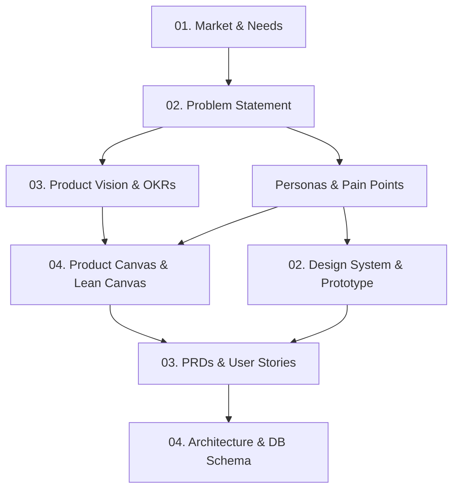

# 🧠 Product Knowledge Vault (AI-Native Second Brain) - TrekMate

> Kho lưu trữ tri thức tập trung (Single Source of Truth - SSOT) cho dự án **TrekMate — Ứng dụng Web Lên Kế Hoạch Du Lịch Thông Minh**. Toàn bộ tài liệu được chuẩn hóa bằng Markdown & Mermaid, liên kết chéo ngữ cảnh chặt chẽ nhằm cung cấp bối cảnh chuẩn xác cho AI Agent (chống Hallucination, kiểm soát Scope Creep).

---

## 🗺️ Sơ đồ liên kết tri thức (Knowledge Graph)



---

## 📌 Tổng quan Đề tài & Thông tin Dự án

* **Tên đề tài:** Xây dựng ứng dụng Web lên kế hoạch du lịch thông minh (TrekMate)
* **Học phần:** Quản trị Dự án Phần mềm
* **Đơn vị đào tạo:** Trường Đại học Công nghệ Thông tin và Truyền thông Việt - Hàn (VKU) — Đại học Đà Nẵng
* **Nhóm thực hiện:** Nhóm F5

---

## 🎯 3 Trụ Cột Phạm Vi Cốt Lõi (Core System Scope)

| Scope | Tên phân hệ | Mô tả nghiệp vụ cốt lõi |
| :--- | :--- | :--- |
| **SCOPE 1** | **Quản Lý Tài Khoản & Phân Quyền** | Đăng ký, đăng nhập xác thực mã OTP qua Email, cập nhật hồ sơ sở thích & gu du lịch cá nhân, phân quyền Người dùng (Traveler) & Quản trị viên (Admin), cơ chế khóa tài khoản bảo mật (Revoke Token). |
| **SCOPE 2** | **Quản Lý Lịch Trình & Công Việc** | Lập kế hoạch du lịch tự động bằng Google Gemini 1.5 Flash API (< 30s), tối ưu tuyến đường di chuyển ngắn nhất trên Google Maps tương tác, phân công Checklist công việc nhóm theo thời gian thực (Realtime ToDo $\rightarrow$ InProgress $\rightarrow$ Done). |
| **SCOPE 3** | **Quản Lý Ngân Sách & Chi Phí** | Thiết lập hạn mức chi tiêu tự động theo tỷ lệ vàng (Di chuyển 30%, Lưu trú 30%, Ăn uống 25%, Dự phòng 15%), bóc tách khoản chi thực tế kèm cảnh báo đỏ khi chạm > 90%, tự động tính toán chênh lệch và quyết toán chia tiền qua VietQR. |

---

## 🏗️ Kiến Trúc Công Nghệ Áp Dụng

* **Frontend:** React.js + Tailwind CSS (Single Page Application - SPA hiện đại, tối ưu trải nghiệm Responsive trên Desktop & Mobile Web).
* **Backend:** Node.js + Express.js (RESTful API điều phối nghiệp vụ, xác thực bảo mật và trung gian truyền thông AI Gateway).
* **AI Engine & Bản đồ:** Google Gemini 1.5 Flash API (Grounding trên dữ liệu POI) & Google Maps Platform API (Maps, Places, Directions).
* **Cơ sở dữ liệu & Xác thực:** Firebase Ecosystem (Cloud Firestore Realtime NoSQL & Firebase Authentication).
* **Hạ tầng triển khai:** Vercel Hosting & Cloudflare DNS.

---

## 📂 Cấu trúc Kho Tri thức (Vault Structure)

```text
├── README.md                                 # Bản đồ tri thức & Tổng quan dự án (File này)
├── .github/
│   └── copilot-instructions.md               # Chỉ thị ngữ cảnh cho AI Agent trong Vault
├── 00-ai-harness/                            # Bộ công cụ điều phối, kiểm soát & ghìm cương AI
│   ├── po-kit.md                             # Quy tắc PO, guardrails & biểu mẫu chuẩn
│   ├── prompts-and-reviews.md                # Nhật ký Human-in-the-loop & review thực tế
│   ├── skill.md                              # PO Discovery Skill (Single Source of Truth)
│   └── ui-ux-skill.md                        # UI/UX Web Design & Component Skill
├── 01-discovery/                             # Giai đoạn Nghiên cứu & Định nghĩa Sản phẩm
│   ├── 01-market-and-needs.md                # Nhu cầu người dùng, phân tích đối thủ & Market Gap
│   ├── 02-problem-statement.md               # Tuyên bố vấn đề chuẩn hóa & sơ đồ nguyên nhân - hệ quả
│   ├── 03-product-vision.md                  # Tầm nhìn Geoffrey Moore, 3 Goals & SMART OKRs
│   ├── 04-product-canvas.md                  # Product Canvas, Lean Canvas 9 ô & User Journey
│   ├── 05-mvp-moscow.md                      # Phân loại phạm vi MVP theo ma trận MoSCoW
│   └── personas/                             # Chân dung người dùng từ dữ liệu thực tế
│       ├── persona-01-student.md             # Bạn An - Sinh viên VKU (Trưởng nhóm du lịch tiết kiệm)
│       └── persona-02-working-pro.md         # Anh Tuấn - Nhân viên văn phòng (Du lịch ngắn ngày)
├── 02-design-system/                         # Hệ thống thiết kế giao diện (File trống - Chờ GĐ 2)
│   ├── component-library.md
│   ├── design-tokens.md
│   └── prototype-screens.md
├── 03-requirements/                          # Đặc tả yêu cầu kỹ thuật & User Stories (File trống - Chờ GĐ 3)
│   ├── product-backlog.md
│   └── user-stories/
│       ├── us-01-auth-and-profile.md
│       ├── us-02-ai-itinerary-generator.md
│       ├── us-03-interactive-map-routing.md
│       ├── us-04-group-task-checklist.md
│       └── us-05-budget-expense-vietqr.md
└── 04-architecture/                          # Kiến trúc hệ thống & Thiết kế CSDL (File trống - Chờ GĐ 4)
    ├── db-schema.md
    └── software-architecture.md
```
